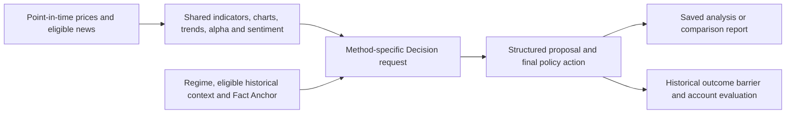

# Regime-Aware Multi-Task Bayesian In-Context Learning for Multi-Agent LLM Stock Trading

QuantAgent VN is a local research application for analyzing daily Vietnamese
equities and simulating LONG/CASH decisions. It combines a LangGraph workflow,
technical indicators, visual chart analysis, quantitative alpha factors,
Vietnamese news sentiment, and historical context conditioned on market regimes.

The Flask application supports single-stock analysis, paired comparisons, and
historical backtests. The published studies, manuscript sources, and audit
evidence are included in the repository.
[Paper](outputs/paper/paper.pdf) · [Thesis](outputs/thesis/thesis.pdf) · [Evidence guide](evidence/README.md)

## Run locally

Use a full Git checkout. The serving runtime verifies pinned source files
against historical Git objects. The project pins Python **3.13.5** in
[`.python-version`](.python-version).

```powershell
git clone https://github.com/DungPhanHoangg05/A-Multi-Agent-Large-Language-Model-Approach-to-Price-Driven-Stock-Trading-in-the-Vietnamese-Stock-Ma.git quantagent-vn
cd quantagent-vn
py -3.13 -m venv .venv
.\.venv\Scripts\python.exe --version
.\.venv\Scripts\python.exe -m pip install -r requirements.txt
.\.venv\Scripts\python.exe -m pip check
.\.venv\Scripts\python.exe -c "import tiktoken; tiktoken.get_encoding('o200k_base')"
.\.venv\Scripts\python.exe -X utf8 web_interface.py
```

Open [QuantAgent VN](http://127.0.0.1:5000). Set `GROQ_API_KEY` in the process
environment or enter your key in the Analysis page before starting a hosted
run. `PORT` overrides the default port `5000`.

- Install dependencies into the same Python environment used to launch Flask.
  The requirements file includes the package index for `vnstock==4.0.9` and
  `vnai==2.6.2`. The Windows lock file records the integrated runtime, including
  its CUDA-specific PyTorch build. [Requirements](requirements.txt) · [Windows lock file](requirements-unified.lock.txt) · [Market-data guide](docs/vnstock_upgrade.md)
- Flask verifies and installs the bundled serving inputs at startup. For CLI
  use, run `.\.venv\Scripts\python.exe scripts/install_study_resources.py` from
  the repository root. [Resource installer](scripts/install_study_resources.py) · [Serving inputs](resources/serving_inputs.zip)
- The serving API defaults to `qwen/qwen3.8-27b` for the Pattern and Trend agents
  and `openai/gpt-oss-20b` for the text model. Hosted runs require Groq access to
  the configured models. The serving registry and preflight constrain model
  choices. [Serving defaults](core/serving_runtime/resources.py) · [Application defaults](default_config.py)
- `VISOBERT_BACKEND` selects `auto`, `local`, `endpoint`, or `lexicon` sentiment
  scoring. The local backend may download weights on first use.
  `VISOBERT_DEVICE`, `HF_TOKEN`, and `HF_INFERENCE_ENDPOINT_URL` configure the
  relevant Hugging Face path. [Sentiment configuration](agents/sentiment_agent.py)

## Application workflows

| Page | Workflow |
| --- | --- |
| `/` or `/demo` | Select a stock and one of six methods for live daily analysis. |
| `/compare` | Select two different methods for one stock. Use the latest completed session or one supported historical session. Review the overview and switch between the two full reports. |
| `/output` | Reopen an analysis to inspect agent reports, charts, alpha and sentiment evidence, raw proposals, and final actions. |
| `/backtest` | Evaluate methods over a supported historical range. Review coverage, cycle returns, account NAV, and the CASH and ALWAYS_LONG controls. |
| `/experiments` | Browse verified research results and saved backtests, with comparison and export tools. |

The current workflow uses the server's `finalize_serving_v1` profile at daily
frequency. Indicator, Pattern, Trend, and the remaining upstream inputs are
prepared once per point and reused by both methods in a comparison. Original
proceeds from Alpha to Decision. The upgraded methods have a BICL context step
and use the method registry to resolve dependencies and fallbacks.
[Application registry](core/serving_registry.py) · [Method registry](core/variant_registry.py)

### Live analysis and comparison

- Live capture uses raw VCI stock prices, observed VN-Index sessions, and
  corporate-action records. The price cutoff is the latest completed session
  present in both the stock and the index. The current session becomes eligible
  at 15:30 Vietnam time when both sources have published it. Stale or invalid
  data can block a run. [Live capture](core/finalize_live_capture.py)
- The stock picker uses the live stock directory. Stocks outside the nine-code
  research sample need at least 45 valid daily bars and are marked exploratory.
  The transferred Alpha selector uses frozen factor choices and requires at
  least 600 bars and finite factor values. Reports record unavailable Alpha
  inputs and the effective method used by each branch.
  [Live catalog](core/serving_live/catalog.py) · [Resource validation](core/finalize_serving_resources.py)
- CafeF sentiment uses eligible articles available at capture time. The scorer
  uses titles and available summaries for the selected stock, plus qualifying
  related-stock articles when available. The job saves the article set and
  scores with the price snapshot. Resume and report views reuse the saved
  inputs. [Live news capture](core/serving_live/cafef_news.py)
- Live comparison shares one capture and shows the two forecasts and their
  reasoning. Its outputs have no realized T+2.5 P&L. Historical comparison
  can show net P&L per method and the difference in percentage points when
  verified outcomes are available.

### Historical comparison and backtest

Frozen serving inputs cover `BHN`, `CMG`, `FPT`, `HVN`, `MBB`, `MWG`, `VCB`,
`VJC`, and `VNM` from **1 July to 23 September 2026**. Preflight checks the exact
stock-date points and resource hashes. Backtests select points every three
trading sessions, with up to 30 stock-date points and one to three repeats per
job. Historical comparison uses one stock, one supported session, and one
repeat. These workflows use archived point-in-time news and open historical
execution outcomes after the required forecasts are recorded.
[Historical support](core/serving_runtime/resources.py) · [Preflight and evaluation inputs](core/finalize_serving_resources.py)

### Reports and checkpoints

The UI supports Vietnamese and English, light and dark themes, and switching
between full reports within a saved comparison. English presentation follows
the same decision and stored evidence. Older reports use the language versions
available in their records. The live MT-BICL explanation draws from stored
numeric facts, historical statistics, and the recorded policy decision.
[MT-BICL presentation](core/ui_presentation/mt_bicl.py)

The server preflights the selected methods, credentials, model settings, and
resources before starting a job. Saved runs belong to the browser session's
signed owner identity. Job controls operate on the saved snapshot and UUID.
An `unknown` attempt requires reconciliation before execution can continue.
[Serving API](utils/serving_web.py) · [Live API](utils/serving_live_web.py)

## Methods and architecture

| Application method | Registry ID | Decision inputs and policy |
| --- | --- | --- |
| Original (Our system) | `original_fix` | Technical reports, OHLCV alpha, and eligible Vietnamese news sentiment. |
| Bayesian v1 | `bayesian_v1` | Regime-matched prior with up to three historical examples. |
| Bayesian v2 (C2) | `C2` | Quality-gated conditional statistics and qualifying examples. |
| Bayesian A (TP Pool) | `A_tp_pool` | Conditional statistics pooled by OHLCV trend and pattern. |
| Bayesian B (Semantic) | `B_semantic` | Conditional evidence with explicit counts, credible intervals, and example descriptions. |
| MT-BICL | `MT_BICL` | Fact Anchor, historical tasks, teacher/student inference, posterior utility, and a revision policy. |

The Bayesian variants use the Common baseline (`original_common`) when their
same-stock evidence does not meet eligibility requirements. MT-BICL starts
with the Fact Anchor decision. A proposed change must satisfy the fact checks
and have positive tenth-percentile incremental net utility. When historical
context lacks support, the runner can retain the Fact Anchor decision. An
invalid Fact Anchor uses the Common baseline. Reports identify the proposed
and final decisions and the reason for any fallback.
[Bayesian prior](core/finalize_prior.py) · [MT-BICL policy](core/mt_bicl_policy.py)



The regime detector uses a Gaussian Hidden Markov Model (HMM) over VN-Index
features. The original study and current application share versioned decision
and data contracts. The current profile uses causal Alpha preprocessing and
frozen selectors for the research sample.
[Regime detector](core/regime_detector.py) · [Decision profiles](core/decision_profiles.py) · [Causal Alpha](core/causal_alpha.py)

## Trading and data contracts

| Setting | Contract |
| --- | --- |
| `LONG` | Buy at `Open(t+1)` and liquidate at `Close(t+3)`. Horizons use trading sessions. |
| `SHORT` | Hold cash for the cycle. The recorded action is `CASH`. |
| Transaction costs | 0.25% brokerage and 0.10% slippage on each entry and exit leg. |
| Default initial capital | VND 50,000,000. |
| Price units | The account converts prices from thousands of VND to VND once. |
| Historical labels | Cycle labels use `compute_round_trip_net_return` from the same backtest engine. |

Prices end at the query session. Historical news is restricted to its as-of
availability. Retrieved trading cycles must end strictly before the query
date. Live reports record a separate news capture timestamp. The paired runner
seals shared reports before decisions and opens historical outcomes after the
required forecasts are durable. Undefined metrics are stored as `null` and
shown as unavailable. [Backtest engine](core/backtest_engine.py) · [Paired runner](core/serving_runtime/runner.py)

## Published research and reproducibility

The paper, *Enhancing Multi-Agent Large Language Models for Stock Trading
through Quantitative Alpha Integration*, evaluates what alpha and Vietnamese
news add to the QuantAgent technical pipeline on 102 paired stock-date
cutoffs, with a secondary BICL study. The thesis examines the contribution of
historical context to Our system and documents the MT-BICL design. The frozen
evaluation and its limitations apply to the declared cohorts. Catalog-wide
live runs are exploratory. The historical native Alpha selector failed its
recorded row-wise causality audit. Whole-system causality and profitable
trading remain unestablished.
[Full paper](outputs/paper/paper.pdf) · [Submission PDF](outputs/paper/paper-submit.pdf) · [Thesis PDF](outputs/thesis/thesis.pdf)

Verify the manuscript tables and presentation against the shipped evidence
without running hosted inference.

```powershell
.\.venv\Scripts\python.exe -X utf8 scripts/project_finalize_manuscript_tables.py --audit --check
.\.venv\Scripts\python.exe -X utf8 scripts/thesis_docs/check.py --strict-cutover-targets --strict-current-targets
```

The evidence guide maps the component study, historical BICL results, and
follow-up to their archived inputs and evaluation records. It also lists the
source checkouts for historical replay and the checksums for the distributed
PDFs. [Evidence guide](evidence/README.md) · [PDF source map](scripts/thesis_docs/source-map.json) · [Paper build](paper/README.md) · [Thesis build](docs/thesis_build.md)

## Development checks

Select checks for the affected code and contracts. These commands cover the
Flask analysis pages, serving point-in-time behavior, and the browser UI.

```powershell
.\.venv\Scripts\python.exe -X utf8 -m unittest discover -s tests/analysis_ui -p test_pages.py -v
.\.venv\Scripts\python.exe -X utf8 -m unittest discover -s tests -p test_finalize_serving_leakage.py -v
node --test tests/js/analysis_ui.test.mjs tests/js/backtest_ui.test.mjs tests/js/site_preferences.test.mjs
```

Create task branches from `develop` and use Conventional Commits. Preserve the
economic, point-in-time, paired-execution, prompt-budget, and checkpoint
contracts. [Development instructions](AGENTS.md)

## Repository guide

| Path | Contents |
| --- | --- |
| `agents/`, `utils/` | Agent code, graph assembly, report presentation, and Flask blueprints. |
| `core/` | Market data, Alpha, prior retrieval, MT-BICL, accounting, and the serving runtime. |
| `templates/`, `static/`, `web_interface.py` | Flask pages, browser scripts, styles, and the local entrypoint. |
| `scripts/`, `tests/` | Resource installation, reproducibility checks, and regression tests. |
| `resources/`, `evidence/` | Pinned runtime inputs and published study evidence. |
| `paper/`, `thesis/` | LaTeX sources, references, and build instructions. |
| `outputs/paper/`, `outputs/thesis/`, `outputs/revision/` | Published PDFs, tables, supplements, and manifests. |

## Attribution and licensing

The technical and visual analysis foundation adapts QuantAgent from
Y-Research @SBU, including its Indicator, Pattern, Trend, and Decision agents,
LangGraph orchestration, chart tools, and portions of the web interface.
Vietnamese market access, alpha and sentiment integration, accounting,
historical priors, MT-BICL, and paired research infrastructure extend that
foundation.

The upstream comparison is pinned to `92519f806286192345e940e7ab77496462d662b7`.
The originally adopted upstream commit is unrecorded. Upstream-derived
material retains its MIT copyright and license notice. Project additions,
datasets, model weights, and dependencies retain their respective terms.
[Third-party notices](THIRD_PARTY_NOTICES.md) · [Preserved QuantAgent MIT license](LICENSES/QuantAgent-MIT.txt)
