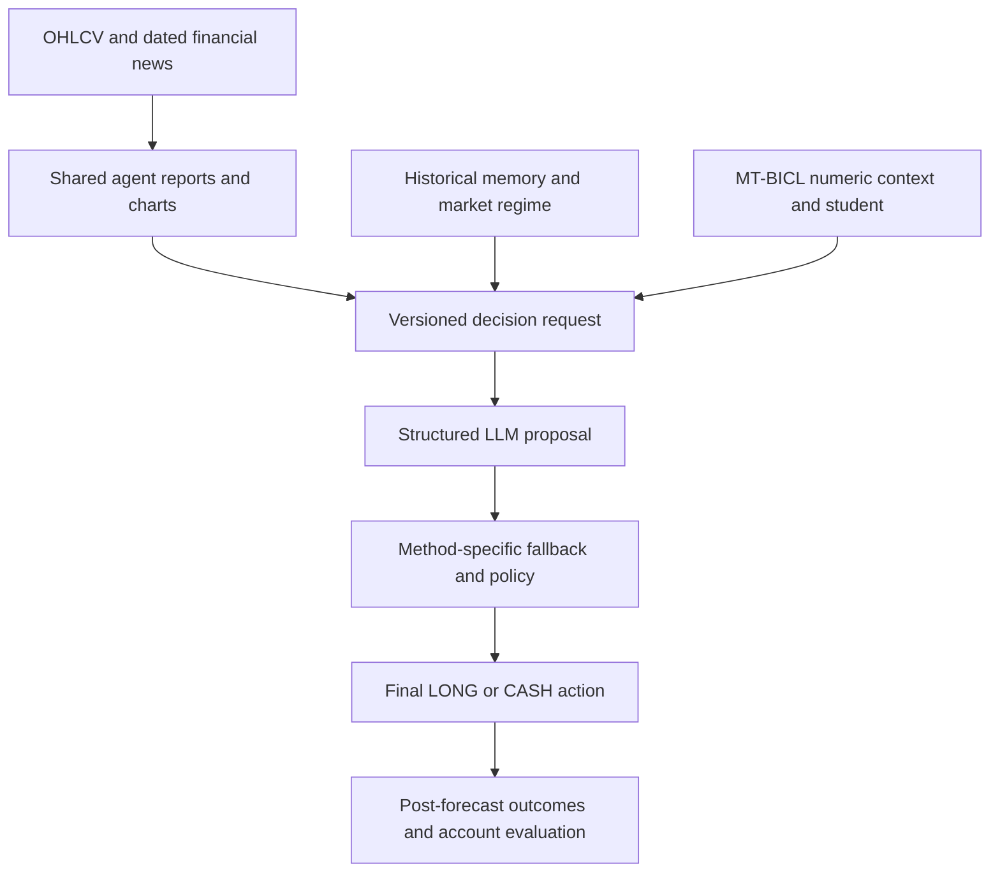

# Regime-Aware Multi-Task Bayesian In-Context Learning for Multi-Agent LLM Stock Trading

A research system for stock analysis and LONG/CASH trading simulation in the
Vietnamese stock market. It combines a LangGraph multi-agent pipeline, technical
and visual chart analysis, quantitative alpha factors, Vietnamese financial-news
sentiment, and historical context conditioned on market regimes.

The repository contains Our system, five BICL extensions, a Flask application, paired
experiment infrastructure, and the sources for the research paper and thesis.
The original project title is *A Multi-Agent Large Language Model Approach to
Price-Driven Stock Trading in the Vietnamese Stock Market*.

## Capabilities

- Analyze Vietnamese stocks using OHLCV, technical indicators, chart patterns,
  trend analysis, alpha factors, and ViSoBERT-based news sentiment.
- Select among six application methods, including the original system, four
  Bayesian variants, and MT-BICL.
- Inspect reports, charts, historical context, raw proposals, final actions,
  and policy reasons in a Vietnamese/English interface with light and dark themes.
- Run walk-forward backtests and compare methods using shared snapshots,
  explicit execution costs, account-level metrics, and CASH/ALWAYS_LONG controls.
- Validate, replay, inspect, and export experiments with versioned contracts,
  source hashes, checkpoints, and request/response provenance.

## System architecture



| Component | Responsibility |
| --- | --- |
| Indicator Agent | Calculate technical indicators and summarize their signals. |
| Pattern Agent | Interpret chart patterns using visual inputs. |
| Trend Agent | Analyze trend direction and trendline structure. |
| Alpha Agent | Calculate and select quantitative factors and integrate enabled sentiment evidence. |
| Sentiment module | Score Vietnamese financial news and preserve publication-date eligibility. |
| Decision Agent | Combine distilled reports and optional context into a structured `LONG`/`SHORT` prediction. |
| Bayesian context | Retrieve eligible historical episodes and construct compact regime-conditioned priors. |
| MT-BICL | Combine fact anchoring, historical numeric context, a student model, posterior utility, and policy checks. |
| Evaluation layer | Convert predictions into LONG/CASH actions and evaluate execution, accounts, and classification. |

The regime detector uses a Gaussian Hidden Markov Model (HMM) over VN-Index
features. MT-BICL includes teacher–student distillation for numeric context and
uses posterior utility in its final policy.

Paired experiments run Indicator → Pattern → Trend once per test point and
deep-copy the shared upstream state into comparison branches. Alpha, sentiment,
context preparation, and dependencies follow the selected method's execution
plan. Forecast inputs are sealed before the outcome barrier opens.

### Methods and profiles

The manuscript names map to stable registry IDs. The component study
uses QuantAgent as the price-only comparator and Our system as the
augmented system. The context studies evaluate what BICL adds.

| System or control | Registry or study ID | Context or policy |
| --- | --- | --- |
| QuantAgent | Component study `baseline` | Locally evaluated price-only adaptation of the published Indicator, Pattern, Trend, and Risk/Decision architecture. |
| Our system | `original_fix`, component study `full` | OHLCV alpha and eligible Vietnamese news sentiment with no historical context. |
| Our system (Common) | `original_common` | Common Decision prompt with augmented evidence and no context prior. |
| BICL v1 | `bayesian_v1` | Regime-matched historical prior with K=3. |
| BICL v2 | `C2` | Quality-conditioned historical statistics. |
| BICL v3 | `A_tp_pool` | Relaxes the condition for historical statistics to trend and pattern. |
| BICL v4 | `B_semantic` | Uses v2 evidence with explicit counts, intervals, and example descriptions. |
| Fact Anchor | `Fact_Anchor` | Structured facts and reference action based on the Common result. |
| BICL v5 | `MT_BICL` | Multi-task numeric context, teacher/student inference, and utility-gated revision. |

The registry resolves dependency order and declared fallbacks. Component ablations use `full`, `alpha_only`,
`sentiment_only`, and `baseline`.

`original_fix_serving_v1` is the default native decision profile.
`common_decision_v1` supplies the common comparison prompt.
`causal_common_v1` supplies a separate alpha input profile with prefix-based
preprocessing and a selector frozen after purged train/validation fitting.
Experiment identities record the selected profiles. Their implementations and
method dependencies are defined in the source registries.
[Decision profiles](core/decision_profiles.py), [method registry](core/variant_registry.py),
[application registry](core/serving_registry.py).

## Trading and data contracts

The simulator implements the project's T+2.5 economic contract.

| Setting | Contract |
| --- | --- |
| `LONG` | Enter at `Open(t+1)` and liquidate at `Close(t+3)`, using trading-session positions. |
| `SHORT` prediction | Hold cash, represented as the final action `CASH`. |
| Brokerage fee | 0.25% on each entry and exit leg. |
| Slippage | 0.10% on each entry and exit leg. |
| Default account capital | VND 50,000,000. |
| Stock-price conversion | Prices in thousands of VND are multiplied by 1,000 once for accounting. |
| Historical labels | Canonical `net_cycle_v1` records use `compute_round_trip_net_return`. |

The round-trip return oracle and account simulation live in the backtest
engine. Accounts compound independently within their configured reset groups.
Cross-account averages summarize those accounts. Risk metrics retain their
return frequency and convention, with separate daily-NAV and cycle-return
representations. Undefined values serialize as `null`.
[Backtest engine](core/backtest_engine.py).

Point-in-time inputs and execution follow these boundaries.

- Price candles end at or before the query cutoff. Shared chart/report snapshots
  use up to 600 candles.
- Research news has a known publication date at or before the cutoff.
- Retrieved memory episodes have `exit_date < as_of_date`.
- Economic outcomes become available only after the required forecasts are durable.
- Decision research prompts remain below 6,500 characters, with a K=3 Bayesian
  Regime Prior Prefix of at most 600 characters.
- Retry wrappers apply backoff and provider retry delays. Checkpoints preserve
  completed work, identity, and unresolved-attempt state for recovery.

## Installation

Run commands from the repository root. Python **3.13.5** is pinned in
`.python-version`. On Windows with the Python launcher installed,

```powershell
py -3.13 -m venv .venv
.\.venv\Scripts\python.exe -m pip install --upgrade pip
.\.venv\Scripts\python.exe -m pip install -r requirements.txt
```

Verify that the selected interpreter reports Python 3.13.5. Dependencies include
TA-Lib, PyTorch, Transformers, LangGraph, LangChain, HMMlearn, and scikit-learn.
`requirements-unified.lock.txt` records the Windows integration environment and
can be installed using `pip install -r requirements-unified.lock.txt`.
Platform-specific deployments require compatible package builds.

The web launcher installs the pinned serving inputs on first use. For direct
research commands and serving tests, install them once from a full Git checkout.

```powershell
.\.venv\Scripts\python.exe scripts/install_study_resources.py
```

Market access uses `vnstock==4.0.9` and `vnai==2.6.2` through the extra package
index declared in the requirements. Vendor access and configuration are covered
in the market-data guide. [Market-data setup](docs/vnstock_upgrade.md).

### Configuration

Set `GROQ_API_KEY` in the process environment or enter it through the application's
API-key controls. Model IDs, providers, generation settings, and accounting
defaults are defined in `default_config.py`. Hosted execution requires a valid
key and provider access to the configured models. [Default configuration](default_config.py).

| Environment variable | Purpose |
| --- | --- |
| `GROQ_API_KEY` | Groq credentials for hosted agent inference. |
| `PORT` | Local Flask port, defaulting to `5000`. |
| `VISOBERT_BACKEND` | Sentiment backend, one of `auto`, `local`, `endpoint`, or `lexicon`. |
| `VISOBERT_DEVICE` | Device selection for local sentiment inference. |
| `HF_TOKEN` | Optional Hugging Face credentials. |
| `HF_INFERENCE_ENDPOINT_URL` | Optional Hugging Face sentiment endpoint. |

The local sentiment backend may download model weights on first use. The direct
Flask launcher reads process environment variables. A launcher using `.env`
must load it explicitly. Docker Compose loads `.env` through `env_file`.
Keep credentials in local environment configuration.

## Running the application

```powershell
.\.venv\Scripts\python.exe web_interface.py
```

Open `http://127.0.0.1:5000`.

| Page | Workflow |
| --- | --- |
| `/` | Application landing page. |
| `/demo` | Select a stock and one of the six methods, then run realtime 1D analysis. |
| `/output` | Inspect a completed analysis and its reports, charts, decision, and context. |
| `/backtest` | Configure walk-forward backtests and inspect progress and results. |
| `/experiments` | Browse verified research results and serving jobs, compare supported methods, and export JSON/CSV. |

The Analysis and Backtest forms use the server's research execution profile
(`finalize_serving_v1`), used for the thesis's main BICL evaluation and the
paper's BICL follow-up. Original analysis goes from Alpha directly to Decision.
The five upgraded methods show a BICL context step before Decision. Live analysis
captures the latest completed daily session. The server validates resources and the Groq key in preflight
before starting a checkpointed job. Completed results expose historical context,
common alpha inputs, fallback/bypass reasons, and raw/final actions where
applicable. Backtests use their own supported symbols, dates, and resource bindings.

Each new Research-profile live run captures CafeF news for the selected ticker
up to the instant the run was started. It scores article titles and available
summaries, then saves the article set and scores with the run. Resuming a run
and reopening its report read that snapshot. Research backtests use the frozen
FIN05 news inputs for their evaluation dates.

New live reports prepare Vietnamese and English presentations during existing
agent invocations or from deterministic numeric templates. Language switching
displays the saved presentation immediately. Older records depend on the
presentations available in their cache. Jobs with unresolved attempts keep
their `unknown` state until reconciliation.

Serving support is checked against the server's resource manifest. Frozen
as-of resources cover nine symbols over 1 July–23 September 2026, with exact
point availability checked during preflight. The live daily provider has a
separate snapshot lifecycle. The method registry defines dependencies and supported profiles.
[Serving registry](core/serving_registry.py).

### Docker deployment

Create a local `.env` containing the required environment settings, then run

```powershell
docker compose up --build -d
docker compose logs -f web
```

The Compose application is available at `http://127.0.0.1:8000`. Its image uses
Python 3.13.5, CPU PyTorch, and one threaded Gunicorn worker to share in-process
job state. Named volumes persist model cache, backtest results, and research
outputs. Research methods also require their declared resource bundles in the
deployment. Reverse-proxy and Oracle VM configuration are documented separately.
[Deployment guide](docs/oracle_deployment.md), [Compose configuration](compose.yaml).

## Experiments and reproducibility

The unified experiment CLI supports offline registry inspection, spec
validation, prepared-response replay, verification, and export.

```powershell
.\.venv\Scripts\python.exe -I -X utf8 scripts/run_unified_experiment.py registry
.\.venv\Scripts\python.exe -I -X utf8 scripts/run_unified_experiment.py validate path/to/spec.json
.\.venv\Scripts\python.exe -I -X utf8 scripts/run_unified_experiment.py replay path/to/bundle.json --sha256 <full-bundle-sha256>
.\.venv\Scripts\python.exe -I -X utf8 scripts/run_unified_experiment.py verify outputs/unified_integration/<run-id>
.\.venv\Scripts\python.exe -I -X utf8 scripts/run_unified_experiment.py export outputs/unified_integration/<run-id> --format csv --output table.csv
```

Replace placeholder paths, run IDs, and hashes with the intended experiment's
inputs. Export destinations must be new files. `ExperimentSpec` binds methods,
dependencies, cohort order, repeats, realizations, model options, source/resource
hashes, runtime, calendar, costs, and missing-support policy. `SharedSnapshot`
seals reports, images, factors, and PIT provenance. The runner keeps raw proposals
and final policy actions separately and resets accounts by symbol, fold,
realization, and repeat.

A replay bundle contains `spec`, `snapshots`, `preparations`, `responses`, and
`outcomes`. Replay reconstructs requests, schema validation, policy, and
accounting from these assets. Numeric provider preparation, retrieval, and
student execution have separate verification paths. Historical reproduction
requires the source snapshot, runtime, original assets, and hashes identified
by its manifest. Some large or ignored model/data assets require restoration
from the author's archive.

To check the published paper and thesis against the saved study records, run the
following command from the repository root. It reads the shipped evidence offline.

```powershell
py -3.13 -X utf8 scripts/project_finalize_manuscript_tables.py --audit --check
```

The reader guide identifies inputs for the component, historical BICL and follow-up
comparisons. It also gives the source commits for replaying historical experiments.
[FIN15 evidence guide](evidence/README.md), [causal alpha CLI](scripts/manage_causal_profile.py).

### Research scope

The preserved studies evaluate agent components and historical-context methods
on their declared cohorts. Results are exploratory and depend on support,
provider provenance, model serving conditions, and previously exposed data.
The native alpha selector fails the recorded row-wise causality audit.
`causal_common_v1` addresses the alpha preprocessing and selector contract.
Whole-system causality remains uncertified, and statistical superiority and
profitable trading remain unestablished. Detailed outcomes and limitations
belong to the paper, thesis, and evidence records.

## Validation and contribution workflow

Choose checks for changed modules, contracts, and callers. For example,

```powershell
.\.venv\Scripts\python.exe -X utf8 -m unittest discover -s tests -p "test_account_risk.py" -v
.\.venv\Scripts\python.exe -X utf8 -m unittest discover -s tests -p "test_target_contract.py" -v
.\.venv\Scripts\python.exe -X utf8 -m unittest discover -s tests -p "test_paired_protocol.py" -v
```

Documentation-only changes require diff, link, and source-consistency checks.
Code changes require relevant regression tests and compilation of changed
Python files. Data, PIT, and retrieval changes also require their affected
leakage tests. Full-system acceptance can use the four reference gates when
the task explicitly calls for a complete regression run.

```powershell
py -3.13 -m compileall agents core data_manager scripts tests utils
py -3.13 -X utf8 -m unittest discover -s tests -v
py -3.13 scripts/run_end_to_end_test.py
py -3.13 -X utf8 -m unittest discover -s tests -p "test_*leakage.py" -v
```

Create task branches from `develop`, use Conventional Commits, and merge after
the applicable checks pass. Preserve the economic, PIT, paired-execution,
prompt-budget, and recovery contracts. [Development instructions](AGENTS.md).

## Repository guide

| Path | Contents |
| --- | --- |
| `agents/` | Agent implementations and shared LangGraph state. |
| `utils/` | Graph assembly, charting, report presentation, and Flask blueprints. |
| `core/` | Accounting, market loaders, priors, MT-BICL, causal alpha, experiment runners, and serving runtime. |
| `data_manager/`, `data/` | Historical memory, regime assets, sentiment storage, and market-data inputs. |
| `templates/`, `static/`, `web_interface.py` | Flask pages, browser scripts, styles, and application entrypoint. |
| `scripts/`, `tests/` | Research and maintenance CLIs, audits, and regression checks. |
| `default_config.py`, `requirements*.txt` | Runtime defaults and dependency specifications. |
| `deploy/`, `Dockerfile`, `compose.yaml` | Container and reverse-proxy deployment configuration. |
| `paper/`, `outputs/paper/` | Paper LaTeX sources and generated PDFs. |
| `thesis/` | Thesis LaTeX sources, bibliography, figures, build tools, and release artifacts. |
| `revision/`, `outputs/revision/` | Research protocols, reproduction tools, and preserved study results. |
| `outputs/unified_integration/` | Unified experiment records, checkpoints, and analysis artifacts. |
| `evidence/`, `resources/` | FIN15 audit inputs and pinned resources for the application. |

### Paper and thesis

The paper evaluates adding alpha and sentiment to QuantAgent. The thesis
evaluates adding BICL to Our system. The paper uses `paper/main.tex` or
`paper/main_submit.tex` with pdfLaTeX and BibTeX. The thesis uses
`thesis/main.tex` with pdfLaTeX or XeLaTeX and Biber. Each directory has
project-relative references and figure paths for Overleaf. Earlier thesis
Markdown drafts are retained as historical material.
[Paper sources](paper/README.md), [paper PDF](outputs/paper/main-fin15.pdf),
[thesis sources and build](docs/thesis_build.md), [thesis PDF](outputs/thesis/thesis-fin15.pdf).

## Attribution and licensing

The agent/chart-analysis foundation adapts QuantAgent from Y-Research @SBU,
including its Indicator, Pattern, Trend, and Decision agents, LangGraph
structure, chart tools, and portions of the web interface. Vietnamese market
access, alpha/sentiment integration, accounting, historical priors, MT-BICL,
and paired research infrastructure extend that foundation.

The upstream comparison is pinned to
`92519f806286192345e940e7ab77496462d662b7`. The originally adopted upstream
commit is unrecorded. Upstream-derived material retains its MIT copyright
and license notice. Project additions, datasets, model weights, and other
dependencies retain their respective licensing and distribution terms.
[Third-party notices](THIRD_PARTY_NOTICES.md),
[preserved QuantAgent MIT license](LICENSES/QuantAgent-MIT.txt).
