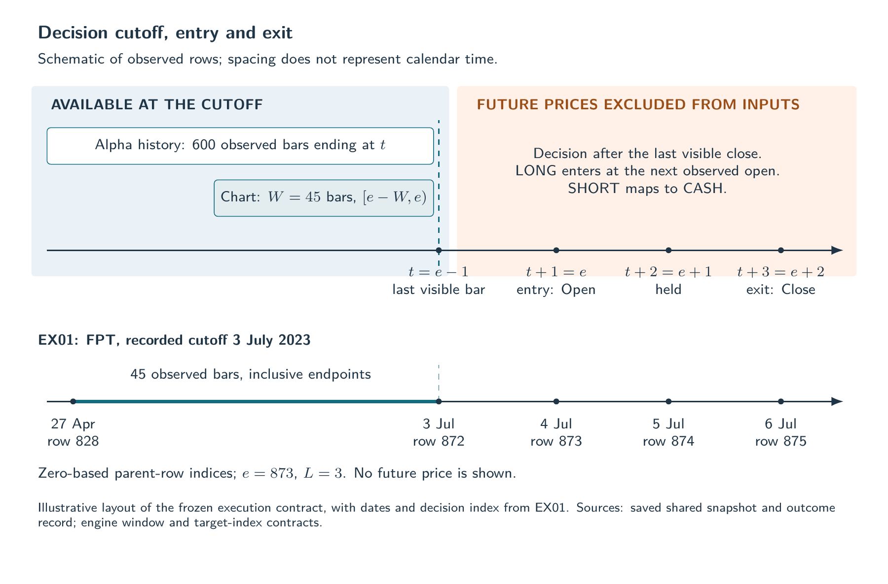
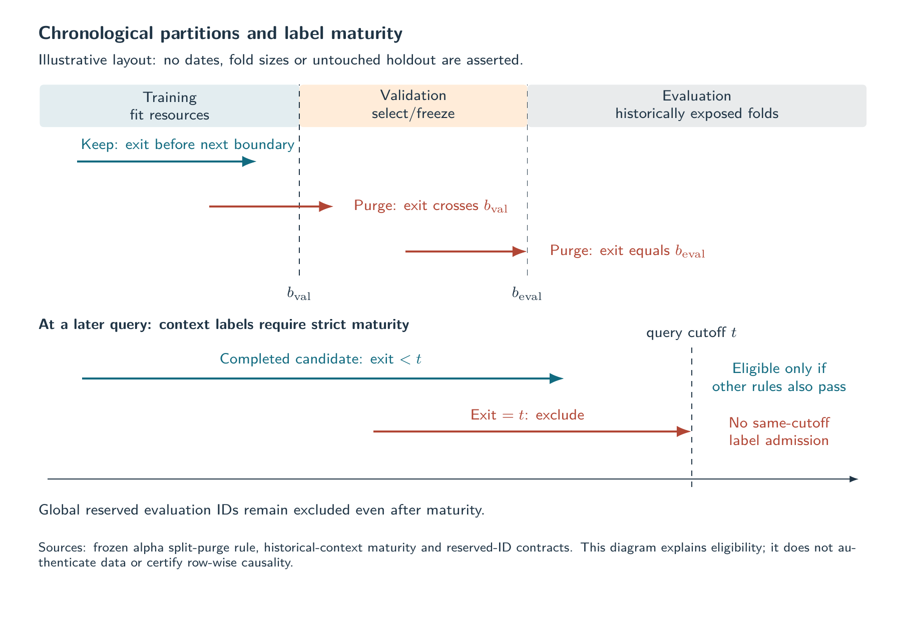

# Chapter 3. Theoretical Background and Problem Formulation

> **Draft status: initial complete chapter draft.** Sections 3.1–3.7 have source-checked drafts.
> This is internal drafting verification; final scientific, citation, language and layout reviews remain pending.

Writing aids: [chapter outline](../outline.md#chapter-3-theoretical-background-and-problem-formulation), [terminology and notation](../evidence.md#5-thuật-ngữ-tiếng-anh-ký-hiệu-và-quy-ước-diễn-đạt) and [shared evidence ledger](../evidence.md#8-khung-bản-thảo-và-đối-soát-luận-điểm).

## 3.1. Observations and time indexing

### 3.1.1. Daily observations

The historical studies represent each stock as an ordered sequence of daily
bars. For a single stock, let

$$
b_i=(d_i,O_i,H_i,L_i,C_i,V_i),\qquad i=0,\ldots,N-1,
$$

where $N$ is the number of observations in the declared analysis view and
$d_i$ is the date attached to observation $i$. The fields $O_i$, $H_i$,
$L_i$ and $C_i$ are the opening, highest, lowest and closing prices reported
for that bar. $V_i$ is its reported volume. Together these fields are called
OHLCV. Prices must retain the dataset's declared units and adjustment basis;
the field names alone do not establish either. In particular, the volume
field is distinct from a price or a net return.[^time-inputs]

An *observed session* in this thesis means one dated daily row used by the
protocol. Indices count these rows after the analysis view has been
established, with dates in strictly increasing order. They do not certify
that the vendor sequence contains every exchange session. Thus $i+1$ means
the next observation in this sequence, not the next calendar day. A weekend,
holiday, suspension or absent vendor record may separate consecutive dated
rows; the cause of a gap cannot be inferred from its length alone.

The subscripts above identify price fields: $L_i$ is a low price. The
unsubscripted $L$ introduced below instead denotes the execution horizon
in observed bars.

### 3.1.2. Decision cutoff and the exclusive window boundary

Let $t$ be the zero-based index of the last bar visible to a decision, and
let its date be $d_t$. The daily decision is modeled as occurring after this
bar has completed. Its OHLCV values may therefore be used, whereas the next
bar's open is still a future price. This is the study's information boundary,
not a claim that historical vendor data were published with verified
real-time latency.

The engine expresses the same boundary using $e=t+1$, the **exclusive** end
index of an input window. If $W$ is the chart-window length, the slice
$[e-W,e)$ contains indices $e-W,\ldots,e-1$: exactly $W$ observations,
ending at $t=e-1$. Row $e$ is excluded. Here $[a,b)$ denotes a half-open
interval of integer row positions, not a date range.[^time-engine]

The execution horizon $L$ counts the future bars starting with the entry bar.
Under the daily contract, $L=3$. The corresponding positions are:

| Event | Position in the parent sequence | Price used or information boundary |
| --- | --- | --- |
| First chart bar | $e-W=t-W+1$ | First included OHLCV observation |
| Decision bar | $e-1=t$ | Last visible completed bar |
| LONG entry | $e=t+1$ | Open of the first future observed bar |
| Intermediate bar | $e+1=t+2$ | Second future observed bar |
| LONG exit | $e+L-1=t+L$ | Close of the final horizon bar; $t+3$ when $L=3$ |

The horizon therefore comprises bars $t+1,t+2,t+3$, rather than three
calendar days added to $d_t$. The outcome record may be evaluated only once
the required future observations exist; their prices do not belong to the
forecast input. SHORT is executed as CASH in this research contract, so this
timeline does not imply a short sale. Section 3.2 will define the associated
net label, costs and LONG/CASH payoff.[^time-target]

These are positions in the **parent** analysis sequence. The engine resets
the index of an extracted chart window for local processing; local positions
$0,\ldots,W-1$ do not replace the parent cutoff or move the entry bar.

### 3.1.3. Chart windows, longer history and warm-up

A chart window and the complete history available at the cutoff serve
different purposes. The locked historical-data path gives the chart/report
pipeline the final $W=45$ bars and supplies a longer prefix of $A=600$ bars
through the Alpha history input. Both end at the same cutoff. Their row
intervals are $[e-W,e)$ and $[e-A,e)$ respectively. The 600-bar history is
not an additional block after the chart window: it contains the final
45-bar window.[^time-inputs]

Warm-up is the history needed before a query can be formed. The engine
requires $e\geq\max(W,A)$ so that both slices are available. A full horizon
also requires $e+L-1<N$. For the earliest possible single query, these
conditions imply at least $\max(W,A)+L$ rows: 603 when $W=45$, $A=600$ and
$L=3$. The final three rows in that minimum are evaluation observations,
not warm-up or forecast inputs.[^time-engine]

This minimum is a data-availability requirement. It does not show that every
indicator is numerically defined on its first row, that an estimator has
converged, or that model training used the same history length. An indicator's
own lookback/initialization, a model's training period, the query's chart
window and the future execution horizon are separate concepts. Their
component-specific rules are introduced in the later sections.

### 3.1.4. Missing and invalid records

The declared analysis view matters because removing observations can change
row positions. In the frozen historical-data path, the price-view check
requires unique increasing dates, finite positive OHLC prices and finite
nonnegative volumes with positive total volume. If OHLC ordering is invalid,
that path retains the suffix after the last such row and records the excluded
prefix. These are properties of this particular input path, not a claim that
all live or legacy loaders use identical cleaning.[^time-view]

An insufficient clean prefix or incomplete future horizon is not permission
to shorten $W$, borrow future warm-up data or use an earlier exit. The locked
historical provider rejects a query without the required history or exact
cutoff, and the canonical target contract rejects an incomplete horizon.
The engine's lower-level direction helper can return an UNKNOWN sentinel
when the target lies outside the frame; this is not a valid evaluated label
or a support-based CASH decision.[^time-inputs][^time-target][^time-engine]

The notation also provides no basis for manufacturing flat candles to fill
a gap or declaring every absent date a market holiday. Missing-data decisions
must retain their source and exclusions. Where the vendor calendar has not
been independently authenticated, the execution horizon should be described
as three subsequent observed bars. This local time boundary alone does not
establish row-wise causality of every historical feature; Section 3.7 will
address that wider validity question.

### 3.1.5. A dated example

The running example uses FPT at the recorded cutoff of **3 July 2023**. Its
shared snapshot contains 600 bars from 2 February 2021 through that date;
the final 45 bars span **27 April–3 July 2023**, inclusive. These are counts
of saved observations, not counts of all calendar dates in either interval.

The saved outcome record identifies the decision-bar index as $t=872$ in
the parent analysis sequence. Consequently $e=873$, the chart slice is
$[828,873)$, and its final included row is 872. The recorded subsequent
observations are 4, 5 and 6 July: LONG enters at the open of row 873 on
4 July and exits at the close of row 875 on 6 July. Reading these dates to
explain the schedule does not make the corresponding prices available to
the forecast. The later realized outcome is reserved for the case analysis
in Chapter 5.[^time-example]

*Figure F01. Decision cutoff, entry and exit of a trading cycle. The upper
panel illustrates the 45-bar chart inside the longer history and the three
future execution bars. The lower panel uses the dates and decision index
saved for EX01; spacing is schematic and no future price or return is shown.
This is an illustration of the study contract, not a measured trading result
or an authenticated exchange calendar.* [Vector PDF](../assets/diagrams/F01_trade_timeline.pdf).

[^time-engine]: Frozen execution source: `core/backtest_engine.py`, `required_backtest_rows`, `build_walk_forward_end_indices`, `_prepare_window` and `_get_actual_direction`. Exact source bindings are recorded as TIME01 in the shared evidence ledger.
[^time-target]: Frozen target source: `utils/target_contract.py`, `target_fields`; TIME02 in the shared evidence ledger. Its horizon is an execution convention of the study.
[^time-inputs]: Frozen historical provider and serialization: `HistoricalData.prefix/state` in `core/historical_evaluation_data.py`, and `snapshot_payload` in `core/historical_signals.py`; TIME03/TIME05 in the shared evidence ledger.
[^time-view]: Frozen input validation: `price_view` in `core/historical_asset_readiness.py`; TIME04 in the shared evidence ledger.
[^time-example]: Archived EX01-S and EX01-O, joined by point and price-source identity; the shared evidence ledger records their ZIP/member hashes and the derived row-index arithmetic. No forecast or outcome has been regenerated.

## 3.2. Economic contract and prediction target

### 3.2.1. A candidate LONG cycle

For a decision at bar $t$, consider the candidate trade that buys at the next
observed open $O_{t+1}$ and closes at $C_{t+3}$. These are the entry and exit
defined in Section 3.1. Let $f=0.0025$ denote the brokerage fee and $s=0.001$
the proportional slippage on **each** leg. Buying one unit requires
$O_{t+1}(1+s)(1+f)$ of capital; selling it yields
$C_{t+3}(1-s)(1-f)$. The canonical net return is therefore

$$
r_t^{\mathrm{net}}=
\frac{C_{t+3}}{O_{t+1}}
\frac{(1-s)(1-f)}{(1+s)(1+f)}-1.
$$

This is the equation implemented by the shared economic oracle,
`compute_round_trip_net_return`; canonical historical labels use the same
oracle. The numerator includes selling costs and the denominator includes
buying costs. Subtracting a fixed 0.70 percentage points from the gross return
is only an approximation and is not the calculation used here.
Entry/exit prices must be positive and finite. The date convention and costs
are study assumptions, not a statement of current exchange settlement rules
or proof of executable fills.[^economic-oracle]

For comparison, the cost-free return is
$r_t^{\mathrm{gross}}=C_{t+3}/O_{t+1}-1$. Net break-even requires a price ratio
of $(1+s)(1+f)/[(1-s)(1-f)]$, approximately 1.00702457 under these costs.
A small positive gross move can consequently have a negative net result.

### 3.2.2. Label, proposal and execution action

The supervised target describes the candidate LONG trade, regardless of the
action eventually taken:

$$
y_t=\mathbf{1}\{r_t^{\mathrm{net}}>0\}.
$$

UP means $y_t=1$; DOWN includes every nonpositive return, **including zero**.
The canonical implementation compares the unrounded net return with zero;
a rounded displayed value must not replace that comparison. A cost-free
direction, a close-to-close return, or the LLM's stated confidence is a
different quantity.[^economic-oracle]

The raw forecast is LONG or SHORT. In this long-only research contract,
SHORT maps to the execution action CASH; it does not open a short position.
Let $a_t\in\{\mathrm{LONG},\mathrm{CASH}\}$ be the action after any external
policy. The cycle payoff fraction is

$$
r_t^{\mathrm{strategy}}=
\mathbf{1}\{a_t=\mathrm{LONG}\}\,r_t^{\mathrm{net}}.
$$

CASH keeps the simulated capital unchanged over that cycle, with no
short-sale profit or modeled interest. Correctly choosing CASH when the
candidate LONG label is DOWN can improve classification without earning a
positive cycle return. Conversely, an UP label does not mean that an account
which stayed in CASH earned that candidate return. Account aggregation over
several cycles is a separate evaluation operation.

### 3.2.3. Illustrative calculation

The following numbers are **Illustrative**: they are chosen for arithmetic,
not taken from EX01 or from an experimental performance table. Prices use
one consistent arbitrary unit and both rows use the costs above.

| Entry Open | Exit Close | Gross return | Canonical net return | Net label | LONG payoff | CASH payoff |
| --- | --- | --- | --- | --- | --- | --- |
| 100 | 100 | 0.000000% | −0.697557% | DOWN | −0.697557% | 0% |
| 100 | 103 | +3.000000% | +2.281516% | UP | +2.281516% | 0% |

For the second row, the purchase cost is $100(1.001)(1.0025)=100.35025$,
and sale proceeds are $103(0.999)(0.9975)=102.6397575$. Their ratio minus
one is approximately 0.022815164885. At exact mathematical break-even,
$C_{t+3}=O_{t+1}(1+s)(1+f)/[(1-s)(1-f)]$, the net return is zero and belongs
to DOWN; this is a symbolic boundary, not a claim that rounded floating-point
prices necessarily produce an exactly zero machine value.

These examples explain the contract. They neither regenerate frozen labels
nor resolve discrepancies in legacy evidence. Recorded bank/query price-basis
differences remain a validity limitation to disclose when interpreting the
historical studies.

[^economic-oracle]: Frozen `core/backtest_engine.py`, `compute_round_trip_net_return` and `compute_account_metrics`, and `utils/target_contract.py`, `target_fields`; bindings TIME01/TIME02 in the shared ledger. Illustrative arithmetic and scope are mapped as CL007–CL008.

## 3.3. Technical, alpha and sentiment signals

### 3.3.1. Five deterministic indicator families

Indicators transform admissible prices into descriptions of momentum or
position within a recent range. They do not supply the future net label.
Let $\operatorname{SMA}_n$ be a trailing mean, $\operatorname{EMA}_n$ an
exponential moving average with update weight $2/(n+1)$ after initialization,
and $H_t^{(n)},L_t^{(n)}$ the highest high and lowest low in the last $n$ bars.
The configured families are as follows.[^signal-formulas]

| Indicator | Definition and configured lookback |
| --- | --- |
| MACD (12,26,9) | $M_t=\operatorname{EMA}_{12}(C)_t-\operatorname{EMA}_{26}(C)_t$, signal $\operatorname{EMA}_9(M)_t$, histogram $M_t-\operatorname{EMA}_9(M)_t$. The histogram measures separation from the signal, not from zero. |
| RSI (14) | For gains $g_t=\max(C_t-C_{t-1},0)$ and losses $\ell_t=\max(C_{t-1}-C_t,0)$, Wilder-smoothed averages $G_t,D_t$ give $100G_t/(G_t+D_t)$ when the denominator is nonzero. After initialization, the smoothing weight is $1/14$. The usual range is 0–100. |
| Slow Stochastic (14,3,3) | Raw $k_t=100(C_t-L_t^{(14)})/(H_t^{(14)}-L_t^{(14)})$; slow %K is $\operatorname{SMA}_3(k)$ and %D is $\operatorname{SMA}_3(\text{slow %K})$. These are range oscillators, not MACD histograms. |
| Williams %R (14) | $-100(H_t^{(14)}-C_t)/(H_t^{(14)}-L_t^{(14)})$, in [−100,0] for a valid nonflat range. It locates the close relative to the recent high. |
| ROC (10) | $100(C_t/C_{t-10}-1)$, a percentage change over ten observed bars, distinct from the net execution return. |

Library initialization and flat-range handling are part of an actual series.
The frozen toolkit calls TA-Lib with these settings; its recorded runtime,
rather than current upstream code, determines historical values. Missing
warm-up values and calculation failures differ from a finite value of zero.

The Indicator role computes values and heuristic classifications in Python.
For example, MACD crossover rules have priority over histogram rules. The
other oscillators have their own range and direction conditions. A bullish
vote means a configured heuristic fired, not that the probability of a
profitable LONG is known. Votes derived from the same prices are not
independent observations. Section 4.3.1 specifies the implemented
priorities for these indicator rules.[^signal-runtime]

### 3.3.2. Alpha transformations and selection

An alpha factor is a numerical transformation intended to describe a
potential predictive relation; its value need not be a probability or a
return. The [Alpha101 collection](https://arxiv.org/abs/1601.00991v3) is an
inherited source of candidates. Adapting a cross-sectional operation to a
single-stock time series changes the operation; a shared formula name alone
does not establish equivalent implementations.

In the causal-common profile, value $a_u$ is normalized with its expanding
prefix mean $\mu_u$ and sample standard deviation $\sigma_u$:

$$
\widetilde a_u=\tanh\!\left((a_u-\mu_u)/\sigma_u\right).
$$

A near-constant finite prefix is handled as zero, while missingness is
retained. Training information coefficient (IC) is a Spearman correlation
between factor values and candidate-LONG net returns. Its sign determines
orientation; declared validation support selects factors and thresholds
before the selector is frozen. Orientation and ranking are fitted choices,
not evidence of future profitability. Native construction and its row-wise
causality limits remain distinct.[^signal-alpha]

### 3.3.3. Sentiment and missing information

Sentiment summarizes textual evidence separately from price-derived alpha.
A language-model backbone, sentiment classifier, score and aggregation
recipe are different objects. A bounded score is not automatically the
probability that a stock price will rise.

The frozen historical provider uses verified scores in [−1,1], a
90-calendar-day availability window and a minimum of three eligible scores.
It averages them with weights proportional to $\exp[-(\log 2)a/30]$ for age
$a$ days, a 30-day half-life. Under its conservative date-only policy, an
article is unavailable before the day following publication. Undated and
future information is excluded. Fewer than three eligible scores produces
unavailable sentiment, not an observed neutral value.[^signal-news]

EX01 has no eligible verified articles. A zero-filled display or legacy
NEUTRAL code cannot supply the missing evidence. LLM confidence categories,
IC, indicator votes and sentiment scores must all remain separate from the
numerical label probabilities introduced in Section 3.6. None is called
empirically calibrated solely because it is numerical or confidently stated.

[^signal-formulas]: Official computational references consulted 15 November 2026: TA-Lib [MACD](https://raw.githubusercontent.com/TA-Lib/ta-lib/main/src/ta_func/ta_MACD.c), [RSI](https://raw.githubusercontent.com/TA-Lib/ta-lib/main/src/ta_func/ta_RSI.c), [STOCH](https://raw.githubusercontent.com/TA-Lib/ta-lib/main/src/ta_func/ta_STOCH.c), [WILLR](https://raw.githubusercontent.com/TA-Lib/ta-lib/main/src/ta_func/ta_WILLR.c) and [ROC](https://raw.githubusercontent.com/TA-Lib/ta-lib/main/src/ta_func/ta_ROC.c). These references do not replace the frozen study runtime.
[^signal-runtime]: Frozen `utils/graph_util.py`, `Toolkit.compute_*`, and Indicator calculation/classification; CL009. Live Indicator presentation changes were accepted as logic-equivalent by the author; the historical binding remains frozen.
[^signal-alpha]: Frozen `core/causal_alpha.py`, `normalize` and `fit_selector`; CL010.
[^signal-news]: Frozen `core/historical_evaluation_data.py`, `FrozenNews.get_sentiment_at`; TIME03/CL011. EX01 unavailability has its own saved-source binding.

## 3.4. Hidden Markov models for market regimes

### 3.4.1. Latent states and observed features

A regime is an inferred description of market conditions, not an observed
profitable-trade label. Regime-switching models represent changing behavior
through a latent state; [Hamilton (2005)](https://econweb.ucsd.edu/~jhamilto/palgrav1.pdf)
provides the economic modeling context. In an HMM, hidden state $S_u$ follows
a first-order Markov transition matrix $A$, where
$A_{ij}=P(S_u=j\mid S_{u-1}=i)$ and each row sums to one. The initial-state
distribution is $\boldsymbol\pi$. An emission density $b_j(\boldsymbol x_u)$
describes the observed feature vector conditional on state $j$.

The implemented detector uses four Gaussian states with diagonal covariance.
Its VN-Index feature vector contains log return
$\log(C_u/C_{u-1})$, the sample standard deviation of the last 20 log returns,
and $C_u/\operatorname{SMA}_n(C)_u-1$ for $n=20,50,200$. These are index-level
conditions, not each stock's return. The 200-bar moving average determines
the feature warm-up; the volatility uses sample standard deviation with
`ddof=1`.[^hmm-implementation]

### 3.4.2. Fitting, scaling and naming states

Feature scaling is fitted on the declared training features. Its means and
scales are then fixed when transforming later prefixes. HMM fitting estimates
the initial probabilities, transitions and emission parameters;
expectation–maximization is the standard iterative approach used by the
[hmmlearn implementation](https://hmmlearn.readthedocs.io/en/stable/tutorial.html).
Fitting and query-time state inference are separate operations.

Latent state numbers have no inherent BULL/BEAR meaning. The frozen detector
names the state with the largest training MA200 distance BULL and the smallest
remaining one BEAR; it distinguishes the two remaining states by volatility
as CHOPPY and CONSOLIDATION. Training convergence, occupancy and separation
checks can instead select a documented MULTI_FACTOR classifier based on
moving-average distances and training volatility thresholds. That result
must be identified as a fallback method rather than an HMM posterior. The
mapping and fallback thresholds remain part of the frozen fitted resource.

The source module permits training within 2018–2022 and registers numerical
settings, including four states and diagonal covariance. A permitted range
is not the actual fit cutoff of every saved model: the historical paths use
the resource and training dates recorded in their own manifests. For example,
EX01's numerical MT query uses a model trained through 31 December 2020.
Its BULL assignment is distinct from the signal-prior path's recorded
CONSOLIDATION assignment. Neither should be silently relabeled to make them
agree.[^hmm-implementation]

### 3.4.3. Endpoint inference and future observations

For a fixed fitted model, let
$\alpha_u(j)=P(\boldsymbol x_{1:u},S_u=j)$ be a forward quantity. Its recursion is

$$
\alpha_u(j)=b_j(\boldsymbol x_u)\sum_i\alpha_{u-1}(i)A_{ij},
\qquad
P(S_u=j\mid\boldsymbol x_{1:u})=
\frac{\alpha_u(j)}{\sum_k\alpha_u(k)}.
$$

Filtering conditions on observations through $u$. Smoothing at an earlier
index also conditions on subsequent observations in the supplied sequence.
At its final index there are no subsequent observations, so endpoint
smoothing and filtering give the same state marginal for fixed parameters.
This follows from the forward–backward construction in
[Rabiner (1989), Sections III.A–B](https://web.mit.edu/6.435/www/Rabiner89.pdf).
It does not make all earlier smoothed rows point-in-time valid.

The detector supplies only the permitted prefix to `predict_proba` and uses
the **last** posterior row, followed by the saved state-name mapping.
Thus the function may internally use forward–backward inference without
accessing observations after the query cutoff. Taking an earlier row from
a later, longer call would be a different operation. A Viterbi most-likely
state path is also different from these marginal probabilities.

Endpoint truncation is insufficient if fitting already used future data.
The implementation rejects a model trained after the query date and checks
the query history against the frozen training-prefix hash. Feature dates,
scaler, parameter fit, state interpretation and threshold calibration all
need appropriate temporal boundaries. No model is refitted or prediction
regenerated to write this explanation.[^hmm-implementation]

[^hmm-implementation]: Frozen `core/regime_detector.py`: `build_regime_features`, `fit`, `_regime_calibration`, `_fallback_regime` and `classify_regime`; CL012–CL013 and binding §8.6. EX01 resource dates/hash are recorded in the shared example, not inferred from module defaults.

## 3.5. Bayesian summaries of historical evidence

### 3.5.1. Counts and a conjugate update

A binary historical event may be modeled as $Y_i\mid\theta\sim
\operatorname{Bernoulli}(\theta)$. For $n$ conditionally independent events
with $s$ successes, the likelihood is proportional to
$\theta^s(1-\theta)^{n-s}$. Multiplying by a
$\operatorname{Beta}(a,b)$ prior gives

$$
\theta\mid Y_{1:n}\sim\operatorname{Beta}(a+s,b+n-s),\qquad
E[\theta\mid Y]=\frac{a+s}{a+b+n}.
$$

This follows by collecting powers in the Beta density. The
[Stan conjugate Bernoulli example](https://mc-stan.org/learn-stan/case-studies/mle-params.html)
illustrates this update for a uniform prior. The event and denominator must
be stated: a win rate counts profitable candidate LONG cycles, whereas a
bull-trap rate is conditional on the specified bullish reports. Those
denominators need not match.

**Illustrative:** a Beta(2,2) prior and seven successes in ten trials yield
Beta(9,5), mean $9/14\approx0.642857$, rather than the raw rate 0.7.
Using Beta quantiles gives an equal-tailed 95% interval of approximately
[0.385738,0.861421]. These are invented counts for explaining inference,
not a result for a stock or method.

### 3.5.2. Conditional evidence with a disjoint background

The implemented conditional prior first forms an eligible same-stock,
same-regime historical population $\mathcal P$ at the query cutoff. A signal
condition defines $\mathcal C\subseteq\mathcal P$; the background is
$\mathcal B=\mathcal P\setminus\mathcal C$. These sets are disjoint. For
metric $h$, write $(s_{c,h},n_{c,h})$ and $(s_{b,h},n_{b,h})$ for success and
support counts under that metric's event definition.

The plug-in background mean and prior shapes are

$$
\mu_{b,h}=\frac{s_{b,h}+1}{n_{b,h}+2},\quad
a_h=\tau\mu_{b,h},\quad b_h=\tau(1-\mu_{b,h}),
$$

where $\tau=4$ is the registered shrinkage strength. Only conditional counts
enter the subsequent likelihood:

$$
\theta_h\mid\mathcal C,\widehat\mu_{b,h}
\sim\operatorname{Beta}(a_h+s_{c,h},b_h+n_{c,h}-s_{c,h}).
$$

Thus the same conditional episode is not counted once in a whole-population
prior and again as conditional data. Background observations influence a
plug-in prior mean, not an additional likelihood term. This construction
does not integrate uncertainty in the estimated background mean.
With no background, the rule gives mean 0.5; with no conditional observations,
the implementation reports NO_CONDITIONAL_HISTORY and leaves its conditional
posterior fields unavailable rather than reporting an observed zero rate.
[^bayes-implementation]

**Illustrative:** take background support 18 with 11 successes and conditional
support 4 with 3 successes. Then $\mu_b=12/20=0.6$, $(a,b)=(2.4,1.6)$ and
the posterior is Beta(5.4,2.6), with mean 0.675. Its 95% interval is
approximately [0.339435,0.928893]. Population support is 22; it is not the
number of displayed examples. Despite having a computable posterior, this
metric fails the registered minimum conditional support of five.

### 3.5.3. Interval meaning, readiness and example counts

For positive Beta shapes, an equal-tailed interval uses quantiles at 0.025
and 0.975. The computational convention is documented by
[SciPy's Beta reference](https://docs.scipy.org/doc/scipy/reference/generated/scipy.stats.beta.html).
It is a model-conditional credible interval for a historical event rate.
It is not a net-return prediction interval, a confidence statement about
an LLM explanation, or proof of calibrated query probabilities. Dependence
between cycles, changing regimes and plug-in hyperparameters limit that
interpretation further.

Readiness adds engineering evidence requirements beyond obtaining a posterior.
In the split gate, population support must be at least 20; a statistic needs
conditional support at least five and interval width at most 0.75. Example
readiness is checked separately using feature/scaler availability and
qualified selections. Gate failure triggers the documented fallback path;
it does not mean that a numerical posterior is zero or that a trade should
automatically be CASH.[^bayes-implementation]

Finally, $K_{\mathrm{ex}}\leq3$ bounds examples shown in a signal-prior prompt.
It is neither $|\mathcal P|$ nor a metric-specific denominator. Bayesian v1
reports empirical counts/rates from its eligible population; that display
must not be silently described as the conditional shrinkage construction
above. Counts, posterior estimates, displayed examples and action policy
are distinct stages.

[^bayes-implementation]: Frozen `core/prior_conditional_statistics.py`, `conditional_metric/compute_conditional_statistics`; `core/prior_quality_gate.py`, `THRESHOLDS/_readiness`; and `core/bayesian_retriever.py` for v1 counts/denominators. CL014–CL016 and source bindings are in the shared ledger. All numerical examples in this section are explicitly illustrative.

## 3.6. Multi-task context and utility

### 3.6.1. Prior tasks, target observations and the query

Multi-task context concerns several datasets; multi-agent orchestration
concerns several computational roles. They are different forms of plurality.
Write a prior task as $\mathcal D_k=\{(\boldsymbol x_{ki},y_{ki})\}_{i=1}^{n_k}$,
the matured target context as $\mathcal C_q=\{(\boldsymbol x_j,y_j)\}_{j=1}^{m}$,
and the current query as $\boldsymbol x_q$ **without** $y_q$. The desired
predictive quantity conditions on the query, target context and prior tasks:
$p(y_q\mid\boldsymbol x_q,\mathcal C_q,\mathcal D_{1:K})$.

[Zhu et al. (2026), Section 4](https://arxiv.org/html/2606.20538v1#S4)
represent prior information as marked datasets preceding a target task.
The [PFN work](https://arxiv.org/abs/2112.10510v7) likewise motivates learning
a predictive mapping from datasets. These are inherited ideas; the stock
implementation below is an adaptation, not a reproduction of the source
paper's experiments or a demonstrated transfer of its performance.

In this implementation, a numerical task is a stock within a block of 63
observations of the declared reference calendar, not 63 elapsed calendar
days. Selected prior tasks preserve task boundaries and may contain several
observations; the target context contains completed cycles from the query's
task. Retrieval admits up to three prior tasks and up to eight observations
per selected task/target context. Feature, factual-bucket and maturity rules
further restrict eligibility. These numerical tasks are not the three
signal-bank examples displayed by Bayesian v1. EX01 has three prior tasks
and three target observations, while its query remains unlabeled.[^mt-context]

### 3.6.2. A frozen teacher and a learned student

The numerical teacher models task-specific sign probabilities with a mixture
of Beta priors. Let $h$ index a grid component with shapes $(a_h,b_h)$ and
fixed mixture weight $\pi_h$. For task $k$, positive/nonpositive counts are
$(s_k,f_k)$. Its component likelihood factor is
$B(a_h+s_k,b_h+f_k)/B(a_h,b_h)$, where $B$ is the Beta function.
At inference the implementation reweights components using the product of
these factors over prior tasks **and** target context. If $\lambda_h$ are
the normalized weights and $(s_q,f_q)$ are target-context counts, then

$$
p_{T,q}=\sum_h\lambda_h
\frac{a_h+s_q}{a_h+b_h+s_q+f_q}.
$$

Prior observations inform the shared component; they are not pooled into
the target task's Beta success/failure counts. Mixture weights $\pi_h$ were
fitted offline on training tasks and stay fixed; conditioning to obtain
$\lambda_h$ is not a refit. The implemented teacher likelihood uses sign
counts, not continuous query-feature regression. Features still affect
context selection and the student input.[^mt-teacher]

The student is a separate frozen numerical transformer receiving marked
prior/target data and query features. Its query label is masked. Offline
distillation uses the teacher probability as a soft target, with binary
cross-entropy $-p_T\log p_S-(1-p_T)\log(1-p_S)$. Query-time inference returns
$p_{S,q}$ without changing weights. It is distinct from the hosted Decision
LLM: placing numerical summaries in an LLM prompt does not train that LLM.
Teacher probability, student probability and an LLM confidence phrase must
be logged and interpreted separately. Neither distillation nor agreement
with a teacher establishes empirical calibration or a student-specific
trading benefit without the relevant ablation.[^mt-teacher]

### 3.6.3. From sign probability to net-return utility

Let $g$ denote positive net-return magnitude and $\ell$ nonnegative loss
magnitude conditional on the nonpositive class. For a sign probability
$\theta$, the modeled LONG utility relative to CASH is

$$
U=\theta g-(1-\theta)\ell.
$$

It is measured in net-return fractions; transaction costs are already in
the historical returns. **Illustrative:** $\theta=0.8$, $g=0.01$ and
$\ell=0.06$ give $U=0.8(0.01)-0.2(0.06)=-0.004$, or −0.4%.
An 80% chance of a positive label can therefore coexist with negative
expected utility. These numbers are invented, not an experiment or a
calibrated prediction.

The actual utility component draws sign probabilities from the **teacher**
mixture posterior and randomizes gain/loss magnitudes over unique eligible
historical observations. Within each sign group, independent exponential
weights are normalized to form weighted magnitude means, a Bayesian-bootstrap
style construction. It records 4,096 utility draws, their mean and Q10/Q90,
alongside an analytic mean and the separately logged student probability.
The student probability does not replace the teacher sign draw. Support
requires an available, known-bucket query, at least two prior tasks and at
least five positive and five nonpositive magnitude observations; zero net
returns belong to the latter group. These are registered support rules,
not proof of a well-specified market model.[^mt-utility]

### 3.6.4. Anchor-relative action revision

The Fact Anchor resolves an action from Common plus checked factual
assertions. Let $a_0$ be that anchor, and consider a different proposed
action. Its improvement is $\Delta U=U$ for CASH→LONG and $\Delta U=-U$ for
LONG→CASH. The external policy accepts a factually valid, eligible revision
only if $Q_{0.1}(\Delta U)>0$. Equivalently:

| Proposed change | Strict acceptance condition |
| --- | --- |
| CASH → LONG | $Q_{0.1}(U)>0$ |
| LONG → CASH | $-Q_{0.9}(U)>0$ |

Equality does not pass. Missing support or invalid revision assertions keeps
the resolved anchor; a proposal already equal to it is retained. Invalid
anchor assertions follow the documented Common fallback, not an invented
new action. The negative mean alone is not the revision criterion. A
utility quantile is a model-based policy input, not a measured guarantee;
technical failures must remain distinguishable from valid bypasses.
Sections 4.8–4.9 specify the corresponding policy contracts and
same-repeat dependencies.[^mt-utility]

[^mt-context]: Frozen `core/mt_bicl_bank.py`, `core/mt_bicl_tasks.py`, `core/mt_bicl_features.py` and context contracts; CL017. The saved EX01 membership is bound separately in the shared ledger.
[^mt-teacher]: Frozen `core/mt_bicl_teacher.py`, `BetaBernoulliTeacher.predict_counts`, and `core/mt_bicl_replica_student.py`, packing/query-mask and distillation path; CL018. The actual evaluated recipe/checkpoint remains the resource described in the source inventory.
[^mt-utility]: Frozen `core/mt_bicl_utility.py` and `core/mt_bicl_policy.py`; CL019–CL020. The magnitude estimator and support rules here describe the implemented construction, separately from the source paper's theoretical framework.

## 3.7. Temporal validity and evaluation principles

### 3.7.1. Availability at a query cutoff

A forecast must be constructed from information admissible at its cutoff,
before its own outcome is joined for evaluation. Let $d_t$ be the date of
the last observed query bar and $d^{\mathrm{exit}}_i$ the exit date of a
candidate historical cycle. The contracts distinguish several boundaries:

| Object | Availability requirement |
| --- | --- |
| Price prefix | Every included observation date is at or before $d_t$; the expected final query bar must exist. |
| Dated news | Publication and protocol-defined availability are at or before the cutoff; undated articles are excluded. The historical date-only policy can impose a later availability date than publication. |
| Labeled historical cycle | $d^{\mathrm{exit}}_i<d_t$, strictly; exit on the query date is excluded. |
| Fitted resource | Parameters, scaler, selector, mapping and calibration use only their declared earlier fit/selection data. The resource version must match the protocol. |
| Query target | The query's label and realized entry/exit prices are excluded from the forecast/context input, then joined only for evaluation. |

Maturity is necessary, not sufficient. A candidate also has to satisfy the
declared universe, feature, task/bucket and identity rules. The unified study
excludes all reserved evaluation IDs from context even after those cycles
would have matured. This prevents a later query from quietly consuming an
earlier reserved evaluation label.[^validity-contracts]

In the unified numerical-context path, the historical label pool is frozen
before the first query of each fold, an additional restriction beyond
exit-before-current-query. Later query features can advance to their own
cutoff, but the pool does not accumulate newly matured labels during that
fold. The recorded freeze boundary must therefore accompany a maturity
statement.

Outer-cutoff compliance concerns the supplied window. Row-wise causality
asks a further question: could the value stored for an earlier row have been
computed using observations later than that row? A full-prefix normalization
or retrospective selection can violate the latter while the final window
still ends at $d_t$. Correct prefix truncation does not repair such a value.
The recorded native row-wise causal audit remains FAIL and whole-system
causality NOT_CERTIFIED. Local source/contract checks in this chapter do not
supersede those findings.

### 3.7.2. Chronological partitions and purging

Training fits resources; validation selects configurations; evaluation measures
the frozen choices on the declared later support. Chronological order is
appropriate when nearby observations are dependent, as explained in the
[scikit-learn time-series evaluation guide](https://scikit-learn.org/stable/modules/cross_validation.html#cross-validation-of-time-series-data).
The actual study uses its own frozen schedule, not an assumed library split.

A decision before a partition boundary can still have an outcome extending
beyond it. For a next-partition boundary $b$, the implemented alpha split
rule admits a fitting/selection cycle only when its exit is strictly before
$b$. Cycles with exit equal to or later than $b$ are purged from that split.
This label-overlap rule differs from the separate query-time maturity test
and from the global reserved-ID exclusion. Nor does purging require erasing
admissible past price observations needed for a later feature window.

*Figure F02. Chronological partitions and historical-label maturity. The
upper panel illustrates cycles retained or purged at subsequent partition
boundaries; the lower panel illustrates the strict exit-before-query rule.
The layout is Illustrative: no actual fold dates, sizes or untouched holdout
are asserted. Global reserved IDs remain excluded even after maturity.*
[Vector PDF](../assets/diagrams/F02_temporal_partitions.pdf).

Exact boundaries, resource freezes and exclusions must be reported separately
for the component and historical-context studies in Chapter 5. Previously
exposed historical folds remain exploratory; neither this diagram nor a new
name turns them into a previously untouched holdout.[^validity-contracts]

### 3.7.3. Pairing and units of evidence

Paired comparison holds the market point, upstream realization, economic
target and relevant input contract fixed while changing the declared branch.
The upstream reports are produced once per point/realization and deep-copied
to dependent branches. Re-running a vision model independently for each
method would change both the intervention and its random input.

Decision repeats are downstream stochastic realizations conditional on that
shared upstream. A forecast slot, a new hosted response, a bypass and an
HTTP retry are different units. For the historical-context study,
$102\times3\times8=2,448$ research slots do not constitute 2,448 independent
market observations. A fallback reuses the appropriate same-repeat result
and remains in the primary comparison; it is not a new LLM response.
Stock–fold accounts, market dates and repeated decisions also remain distinct
from one another.[^validity-pairing]

Matched interventions must be interpreted as actually implemented. Native
versus Common changes alpha representation and instructions; Full versus
Base belongs to a separate response collection. Common→Anchor→MT combines
several changes. Neither pairing nor an observed bridge difference isolates
the numerical student, retrieval, statistics and utility without the matched
ablations required to do so.

### 3.7.4. Metrics, denominators and dependence

With UP as the positive label, define TP/TN as correct positive/negative
predictions and FP/FN as the corresponding errors. When classification is
based on execution actions, LONG is positive and CASH is negative; raw
proposals remain a separate record. Accuracy is $(TP+TN)/n$, while

$$
\operatorname{BA}=\tfrac12\left[\frac{TP}{TP+FN}+\frac{TN}{TN+FP}\right],
\qquad
\operatorname{MCC}=\frac{TP\,TN-FP\,FN}
{\sqrt{(TP+FP)(TP+FN)(TN+FP)(TN+FN)}}.
$$

[Official BA](https://scikit-learn.org/stable/modules/generated/sklearn.metrics.balanced_accuracy_score.html)
and [MCC](https://scikit-learn.org/stable/modules/generated/sklearn.metrics.matthews_corrcoef.html)
documentation supplies the general metric interpretation. The study's
explicit undefined-value policy is additionally important: its unified
consumer retains BA as unavailable if a truth class is missing and MCC as
unavailable if its denominator is zero. Undefined precision/F1 or risk-ratio
denominators are likewise not silently replaced by successful-looking zeros.
Always show the applicable class support and denominator.[^validity-metrics]

Account return compounds the realized LONG/CASH cycle payoffs within a
declared account. Averaging separately capitalized stock–fold accounts does
not simulate a shared-capital multi-stock portfolio. Net asset value (NAV)
also depends on when a position is marked; daily versus cycle-end maximum
drawdown can differ. Exposure and turnover describe trading activity rather
than classification correctness.

Risk ratios require an explicit sampling frequency and dispersion convention.
The historical-context consumer uses sample-standard-deviation cycle Sharpe
and an all-cycle lower-partial-second-moment Sortino. The legacy component
risk helper uses population standard deviation and the standard deviation
of the negative subset for its Sortino denominator. These conventions are
not interchangeable. Irregular sparse schedules must not be annualized by
assuming that every recorded return is a daily return.[^validity-metrics]

Temporal dependence, common market dates, repeated decisions and overlapping
labels constrain uncertainty analysis. Preserve each study's recorded
aggregation order and paired block/fold resampling family; do not substitute
independent-row error bars or recompute results to improve a presentation.
With the small, historically exposed fold set, the registered bands support
descriptive sensitivity analysis, not a claim of confirmatory significance,
calibrated coverage or prospective profitability. Chapter 4 now connects
these definitions to the implemented decision path; §5.5 specifies the
recorded estimators, and §§5.8–5.9 examine their limits.

[^validity-contracts]: Frozen `core/causal_alpha.py` split masks, `core/historical_evaluation_protocol.py` maturity/purge checks, `HistoricalData`/`FrozenNews`, and unified context providers/reserved-ID exclusions; CL021–CL022. F02 illustrates these rules without inventing a study calendar.
[^validity-pairing]: Frozen `core/unified_execution_providers.py`, `core/unified_methods.py`, unified protocol/contracts and saved U08/U09 support; CL023. The immutable parent and same-repeat dependencies are part of the comparison contract.
[^validity-metrics]: Frozen `core/free_pilot_statistics.py`, unified analysis consumer/statistics and `utils/account_risk.py`; CL024. General library documentation does not override a recorded study's undefined-value or risk-frequency convention.
