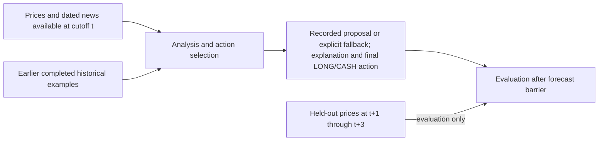

# Chapter 1. Introduction

> **Draft status: partial chapter.** Sections 1.1–1.2 define the motivation and problem; objectives, boundaries and contributions remain in progress.
> The title states the research direction; the recorded studies determine the strength of the findings.

Writing aids: [chapter outline](../outline.md#chapter-1-introduction) and [shared evidence ledger](../evidence.md#8-khung-bản-thảo-và-đối-soát-luận-điểm).

## 1.1. Context and motivation

A daily stock decision begins with incomplete information. A trader can
inspect earlier prices and volumes, calculate indicators, examine a chart
and read dated news, but cannot observe the prices at which a future
position will be closed. These inputs describe different aspects of the
same decision. An indicator summarizes a numerical pattern; a chart
presents its trajectory; a news item supplies a dated statement that may
or may not concern the company. Combining them requires an explicit rule
for resolving disagreement and deciding whether to commit capital.

Technical analysis provides ways to formalize price patterns rather than
relying only on visual impressions. Evidence that a pattern is associated
with a conditional return distribution, however, does not by itself
establish that a trading rule is profitable after costs. The distinction
between description, prediction and economic evaluation motivates the
separate outcomes used throughout this thesis. [@lo2000technical]
Formulaic alpha signals offer another representation of price and volume,
but an adapted implementation also changes the meaning of formulas when
its available data differ from the original cross-sectional setting.
The adaptation must therefore be described alongside the signal.
[@kakushadze2016formulaic]

Large language models can organize textual evidence, while models with
visual inputs can describe chart features. Assigning specialized analysis
roles and passing their reports to a final decision stage offers a
structured way to combine these representations. QuantAgent provides an
important architectural foundation for the price/chart role pipeline
adapted here; multi-agent financial analysis is consequently an inherited
idea, rather than an invention claimed by this thesis.
[@xiong2025quantagent] The research question is whether the particular
information and decision mechanisms implemented here alter recorded
outcomes under controlled comparisons. A persuasive explanation from an
agent is one recorded output, not independent evidence that its action
will be profitable.

Historical examples introduce a further possibility. The system can
consult earlier completed decisions and their outcomes before selecting
an action for a new date. Because market conditions may differ across
periods, it can condition this context on an estimated market state,
called a *regime*. It can also summarize evidence numerically instead of
placing every earlier report in a prompt. The title's *multi-task*
component concerns learning across historical datasets and conditioning
on a target task; *multi-agent* concerns the division of analysis roles.
These are distinct mechanisms. The referenced multi-task Bayesian
in-context learning work supplies a methodological foundation, whose
local adaptation and differences are explained in Chapters 2–4.
[@zhu2026multitask]

This thesis studies these mechanisms in a daily historical Vietnamese-stock
research setting. Its execution convention allows a candidate purchase
only at the following session's open and evaluates liquidation at the
third following session's close, with costs on both legs. A negative
recommendation retains cash. This is the study's common economic contract,
not a statement of current exchange rules or evidence of executable live
fills. Fixed conventions make comparisons interpretable: a better
classification score can coexist with worse returns, and a method can
benefit relative to one baseline while losing relative to another.
Separating these possibilities is essential to a defensible backtest.
[@arnott2019backtesting]

The motivation is thus both methodological and empirical: construct an
inspectable path from available information to action, and assess what
the recorded comparisons actually support. Historical-context coverage,
fallback behavior, failed validity checks and adverse outcomes are part
of that assessment. The title identifies a research direction; it does
not assume a successful trading strategy.

## 1.2. Problem statement

For a stock and a daily decision cutoff \(t\), the system receives a
price/volume history and the analysis resources assigned to its experimental
branch. The intended point-in-time input contains price rows dated no
later than \(t\). News is admitted only with an eligible recorded
publication date no later than \(t\); undated or unavailable news does not
become an observed neutral opinion. Historical examples must have
completed their outcome window strictly before \(t\). An example that is
still open at the cutoff cannot supply a known outcome. Fitting periods,
resource versions and the construction of earlier feature rows require
additional checks beyond this outer input cutoff.

The required output distinguishes an agent's directional proposal and
explanation from the final executable action. Depending on the branch,
the system may reuse a designated valid fallback instead of obtaining a
new proposal, or a policy may retain a factual anchor after inspecting a
proposal. Records must preserve those paths. Missing contextual evidence
and a technical failure are different states; neither may be silently
converted into a successful model decision. The final action vocabulary
is **LONG/CASH**. A model's **SHORT** proposal maps to CASH and opens no
short position.

**Problem input/output overview.** This schematic groups internal stages
for orientation; it is not an experiment or a claim that every branch
obtains a fresh model reply.

Under the common evaluator, LONG enters at \(Open(t+1)\) and exits at
\(Close(t+3)\): three observed trading sessions, not three calendar days.
Brokerage of 0.25% and slippage of 0.10% apply on each leg. The resulting
candidate-LONG net return defines an **UP** label when strictly positive
and **DOWN** otherwise, including zero. These labels ask whether the
hypothetical LONG would have earned a positive net return. They are
distinct from the realized outcome of a CASH action, whose return is zero
under the reference accounting. Section 3.1 specifies the equation and
the execution timeline; the introduction uses the same contract without
introducing a second labeling rule.

The evaluation problem has two parts. First, compare forecasts with the
candidate-LONG labels, retaining support for both classes. Second,
evaluate the final LONG/CASH sequence through the recorded account
rules, including exposure and costs. Future prices and labels are joined
only after forecasts have been durably recorded: the *forecast barrier*.
Shared upstream reports allow paired branches to face the same realized
analysis, so that an extra vision-model call does not create a different
input merely for a comparator. The resulting account averages are not a
validated capital-constrained multi-stock portfolio.

This thesis addresses that problem using the two recorded historical
studies described in Chapter 5. Their controls, response collections and
statistical conventions remain distinct. The intended temporal contract
defines what a valid decision should use; it does not erase the recorded
Native row-wise causality failure. The research objectives and boundaries
below specify how that unresolved limitation constrains the answers.

## 1.3. Objectives and research questions

> **Not yet drafted.** Present the four research questions from the outline with their objectives, comparison families and evidence types. Frame them without assuming a performance advantage; add the question–method–evidence table when its sources are mapped in the ledger.

## 1.4. Challenges and boundaries

> **Not yet drafted.** Explain nonstationarity, dependent small samples, missing news, bank coverage, temporal validity, provenance, profile differences and hosted-model constraints. State the daily historical scope and distinguish it from prospective trading and portfolio deployment.

## 1.5. Contributions and thesis organization

> **Not yet drafted.** Attribute inherited foundations and separate system adaptation, context/policy design, evaluation infrastructure and bounded empirical findings. Describe the six-chapter argument after checking the results; do not announce an unmeasured contribution or omit unfavorable findings.
