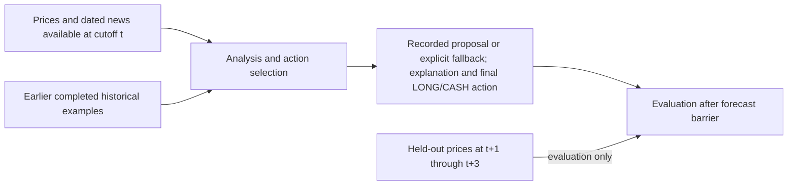

# Chapter 1. Introduction

> **Draft status: complete chapter draft.** The motivation, problem, research questions, boundaries and contributions are source-bound; final review and typesetting remain pending.
> The title states the research direction; the recorded studies determine the strength of the findings.

Writing aids: [chapter outline](../outline.md#chapter-1-introduction) and [shared evidence ledger](../evidence.md#8-khung-bản-thảo-và-đối-soát-luận-điểm).

## 1.1. Context and motivation

A daily stock decision begins with incomplete information. A trader can
inspect earlier prices and volumes, calculate indicators, examine a chart
and read dated news, but cannot observe the prices at which a future
position will be closed. These inputs describe different aspects of the
same decision. An indicator summarizes a numerical pattern; a chart
presents its trajectory; a news item supplies a dated statement that may
or may not concern the company. Combining them requires an explicit rule
for resolving disagreement and deciding whether to commit capital.

Technical analysis provides ways to formalize price patterns rather than
relying only on visual impressions. Evidence that a pattern is associated
with a conditional return distribution, however, does not by itself
establish that a trading rule is profitable after costs. The distinction
between description, prediction and economic evaluation motivates the
separate outcomes used throughout this thesis. [@lo2000technical]
Formulaic alpha signals offer another representation of price and volume,
but an adapted implementation also changes the meaning of formulas when
its available data differ from the original cross-sectional setting.
The adaptation must therefore be described alongside the signal.
[@kakushadze2016formulaic]

Large language models can organize textual evidence, while models with
visual inputs can describe chart features. Assigning specialized analysis
roles and passing their reports to a final decision stage offers a
structured way to combine these representations. QuantAgent provides an
important architectural foundation for the price/chart role pipeline
adapted here; multi-agent financial analysis is consequently an inherited
idea, rather than an invention claimed by this thesis.
[@xiong2025quantagent] The research question is whether the particular
information and decision mechanisms implemented here alter recorded
outcomes under controlled comparisons. A persuasive explanation from an
agent is one recorded output, not independent evidence that its action
will be profitable.

Historical examples introduce a further possibility. The system can
consult earlier completed decisions and their outcomes before selecting
an action for a new date. Because market conditions may differ across
periods, it can condition this context on an estimated market state,
called a *regime*. It can also summarize evidence numerically instead of
placing every earlier report in a prompt. The title's *multi-task*
component concerns learning across historical datasets and conditioning
on a target task; *multi-agent* concerns the division of analysis roles.
These are distinct mechanisms. The referenced multi-task Bayesian
in-context learning work supplies a methodological foundation, whose
local adaptation and differences are explained in Chapters 2–4.
[@zhu2026multitask]

This thesis studies these mechanisms in a daily historical Vietnamese-stock
research setting. Its execution convention allows a candidate purchase
only at the following session's open and evaluates liquidation at the
third following session's close, with costs on both legs. A negative
recommendation retains cash. This is the study's common economic contract,
not a statement of current exchange rules or evidence of executable live
fills. Fixed conventions make comparisons interpretable: a better
classification score can coexist with worse returns, and a method can
benefit relative to one baseline while losing relative to another.
Separating these possibilities is essential to a defensible backtest.
[@arnott2019backtesting]

The motivation is thus both methodological and empirical: construct an
inspectable path from available information to action, and assess what
the recorded comparisons actually support. Historical-context coverage,
fallback behavior, failed validity checks and adverse outcomes are part
of that assessment. The title identifies a research direction; it does
not assume a successful trading strategy.

## 1.2. Problem statement

For a stock and a daily decision cutoff \(t\), the system receives a
price/volume history and the analysis resources assigned to its experimental
branch. The intended point-in-time input contains price rows dated no
later than \(t\). News is admitted only with an eligible recorded
publication date no later than \(t\); undated or unavailable news does not
become an observed neutral opinion. Historical examples must have
completed their outcome window strictly before \(t\). An example that is
still open at the cutoff cannot supply a known outcome. Fitting periods,
resource versions and the construction of earlier feature rows require
additional checks beyond this outer input cutoff.

The required output distinguishes an agent's directional proposal and
explanation from the final executable action. Depending on the branch,
the system may reuse a designated valid fallback instead of obtaining a
new proposal, or a policy may retain a factual anchor after inspecting a
proposal. Records must preserve those paths. Missing contextual evidence
and a technical failure are different states; neither may be silently
converted into a successful model decision. The final action vocabulary
is **LONG/CASH**. A model's **SHORT** proposal maps to CASH and opens no
short position.

**Problem input/output overview.** This schematic groups internal stages
for orientation; it is not an experiment or a claim that every branch
obtains a fresh model reply.

Under the common evaluator, LONG enters at \(Open(t+1)\) and exits at
\(Close(t+3)\): three observed trading sessions, not three calendar days.
Brokerage of 0.25% and slippage of 0.10% apply on each leg. The resulting
candidate-LONG net return defines an **UP** label when strictly positive
and **DOWN** otherwise, including zero. These labels ask whether the
hypothetical LONG would have earned a positive net return. They are
distinct from the realized outcome of a CASH action, whose return is zero
under the reference accounting. Section 3.2 specifies the equation and
the execution timeline; the introduction uses the same contract without
introducing a second labeling rule.

The evaluation problem has two parts. First, compare forecasts with the
candidate-LONG labels, retaining support for both classes. Second,
evaluate the final LONG/CASH sequence through the recorded account
rules, including exposure and costs. Future prices and labels are joined
only after forecasts have been durably recorded: the *forecast barrier*.
Shared upstream reports allow paired branches to face the same realized
analysis, so that an extra vision-model call does not create a different
input merely for a comparator. The resulting account averages are not a
validated capital-constrained multi-stock portfolio.

This thesis addresses that problem using the two recorded historical
studies described in Chapter 5. Their controls, response collections and
statistical conventions remain distinct. The intended temporal contract
defines what a valid decision should use; it does not erase the recorded
Native row-wise causality failure. The research objectives and boundaries
below specify how that unresolved limitation constrains the answers.

## 1.3. Objectives and research questions

The first objective is to explain the implemented decision path well
enough that its inputs, transformations, dependencies and outputs can be
inspected without reading the source code. The second is to assess the
recorded changes associated with information components and historical
context under common trading rules. The third is to identify which
validity and recovery properties the available evidence supports. None
of these objectives presupposes a return advantage.

The four questions below connect those objectives to their comparison
families and observable evidence. The component study's **Base** and the
historical-context study's **Native/Common** are distinct controls, not
interchangeable names for one baseline. Chapter 4 defines the branch
identities before Chapter 5 reports their outcomes.

**Research-question overview.** The questions follow the thesis outline;
the comparison column specifies the intended unit of interpretation.

| ID and research question | Objective and comparison | Evidence and answer boundary |
| --- | --- | --- |
| **RQ1.** How does the multi-agent system combining price, alpha and sentiment behave relative to its controls? | Assess the combined information system: paired component Full/Base on 102 points, recorded numerical controls and the separate nine-unit upstream/factorial panels. | Section 5.6: class support, balanced accuracy (BA), Matthews correlation coefficient (MCC), account returns and exposure. Information and prompt representation change together; classification gain is not profitability. |
| **RQ2.** How does regime-aware historical context and conditional evidence change outcomes under the same upstream realization? | Assess historical-context extensions: Bayesian v1, C2, A_tp_pool and B_semantic each against both Common and Native on paired support. | Sections 5.7 and 5.8.1: contrasts, prior traces, readiness, example age/similarity and fallback. Sparse activation and baseline differences prevent an isolated regime-effect claim. |
| **RQ3.** How do Fact Anchor, MT-BICL and the utility policy affect final actions? | Explain how the combined revision path changes actions through the Common → Fact Anchor → MT-BICL bridge. | Sections 5.7.5 and 5.8.2: proposals, fact assertions, eligibility, bypasses, accepted/rejected changes and utility traces. No separate student, target-task or utility benefit is identified. |
| **RQ4.** Which temporal, economic and operational contracts are supported by evidence, and which limitations remain? | Audit temporal, economic and operational requirements against the scoped records and receipts. | Sections 5.1, 5.3 and 5.8–5.9: cutoff/maturity, canonical labels/P&L, shared inputs, prompts, retry/checkpoints and cold replay. This is a contract-to-evidence audit; failures and uncertified paths remain explicit. |

For RQ1, a numerical control is informative about the performance of its
own rule, but does not isolate the language model's factor selection.
For RQ2, comparing an extension with Common and with Native is necessary
because those baselines differ in alpha projection and instructions.
For RQ3, the final policy action can differ from the raw reply; an action
agreement alone cannot identify which internal mechanism mattered.
RQ4 therefore complements the performance questions by asking whether
the recorded predictions and outcomes have the claimed temporal,
economic and operational interpretation. Table B09 in §5.9 and §6.2
return to these same questions with bounded answers.

## 1.4. Challenges and boundaries

Historical context is useful only to the extent that it is relevant,
available and interpretable at the decision date. Market nonstationarity
motivates conditioning on regimes, but a fitted state label is an
estimated summary rather than a true market state or a guarantee that
older outcomes transfer. Completed examples can be scarce after strict
maturity and readiness filters. Primary results therefore retain
unsupported points and their designated fallback actions. A secondary
covered subset describes a different population and cannot replace that
primary comparison.

Temporal validity also has several layers. Restricting a dataframe to the
query date does not establish that every earlier feature row used only
information available at that earlier date. Likewise, a publication date
in a cache is not independent authentication of historical news
availability. The Native row-wise causality gate is **FAIL**, and the
whole-system status is **NOT_CERTIFIED_HISTORICAL_EXPLORATORY**. Bank/query
provenance and missing original signal journals remain limitations.
These findings bound the thesis rather than being treated as issues
already repaired by the proposed context mechanisms.

The empirical collection covers a purposive sample of nine Vietnamese
stocks and six already exposed temporal folds. The context study has
102 market points, 51 stock–fold accounts, three Decision repeats and
eight forecast roles, producing 2,448 slots. Those slots are conditional
on one upstream realization per point, not independent draws from the
market. Repetition of the Decision stage does not measure upstream
variability. The component study is a separate response collection with
its own estimators and support. Small dependent samples, unequal context
readiness and previously examined folds constrain statistical and causal
interpretation.

The system must also operate with bounded prompts, hosted request limits
and interruptions. Distilled reports, retry handling and checkpoints
support completion and traceability, but do not authenticate an external
model's training data or immutable served weights. A stored reply and a
successful offline replay answer different reproducibility questions.
Similarly, packet-based factual assertions do not independently validate
the financial meaning of every chart interpretation or explanation.

The scope is daily historical LONG/CASH evaluation. It excludes actual
short selling, high-frequency execution, an authenticated capital-constrained
multi-stock portfolio and demonstrated prospective profitability. The
realtime 1D interface illustrates implementation; the author's statement
that the three identified modules retain the research behavior does not
complete browser acceptance. UI/F11 remains **PENDING**. These boundaries
are reflected in the evaluation and future-work priorities rather than
extended by the interface's availability.

## 1.5. Contributions and thesis organization

The thesis makes four kinds of contribution, each with a different
evidential basis.

1. **System adaptation.** It integrates price/chart reports, adapted alpha
   signals and dated Vietnamese sentiment into a shared-input LONG/CASH
   pipeline with explicit accounting. Sections 4.1–4.4 explain the graph
   and branch contracts; §5.6 reports the component comparisons. The
   inherited QuantAgent-style role specialization, technical indicators
   and Alpha101 foundations are attributed in §§2.1–2.2. The contribution
   is the described adaptation and integration, not invention of these
   foundations or validation of market execution.

2. **Historical-context and policy design.** Sections 4.5–4.8 connect
   matured episodes and estimated regimes to bounded Bayesian summaries,
   alternative conditional priors, numerical multi-task context, factual
   anchoring and utility-gated revision. Sections 5.7–5.8 examine their
   recorded contrasts and traces. HMMs, Beta–Bernoulli inference and
   Bayesian/MT in-context learning are inherited foundations, with the
   local student/teacher differences stated explicitly in §§2.4–2.5 and
   §4.8. Integration choices are distinct from a new Bayesian theorem or
   a faithful replication of the reference model's experiments.

3. **Evaluation and reproducibility.** The research pipeline preserves a
   common economic oracle, shared upstream identities, separate
   proposal/action/outcome records, fallback accounting and source-bound
   recovery/replay. Sections 4.9–4.10 and 5.1–5.3 define these mechanisms; §§5.8–5.9
   state the receipt and audit scope. The contribution includes making
   failures and provenance gaps inspectable. Passing specific engineering
   checks does not establish whole-system causality or live acceptance.

4. **Bounded empirical findings.** Chapter 5 reports two historical
   studies, including adverse results. Classification and financial
   outcomes diverge; historical-context differences depend on the
   baseline and support; the MT path largely retains its anchor; the
   eight context research means are negative. These observations describe
   the recorded system. They do not identify a student-specific gain or
   establish prospective trading advantage.

This ordering also defines the thesis's argument. Chapter 2 attributes
the relevant literature and positions the integration problem. Chapter 3
establishes time indexing, economic labels, signal representations,
regime/Bayesian/MT concepts and evaluation principles. Chapter 4 follows
the implemented path from input to final action, including policy and
recovery. Chapter 5 states the two experimental designs before presenting
results, cases, sensitivity and validity limits. Chapter 6 answers the
four questions, separates engineering work from empirical evidence and
prioritizes the research still required. Thus each contribution leads to
a mechanism and an observed or explicitly missing form of evidence.
