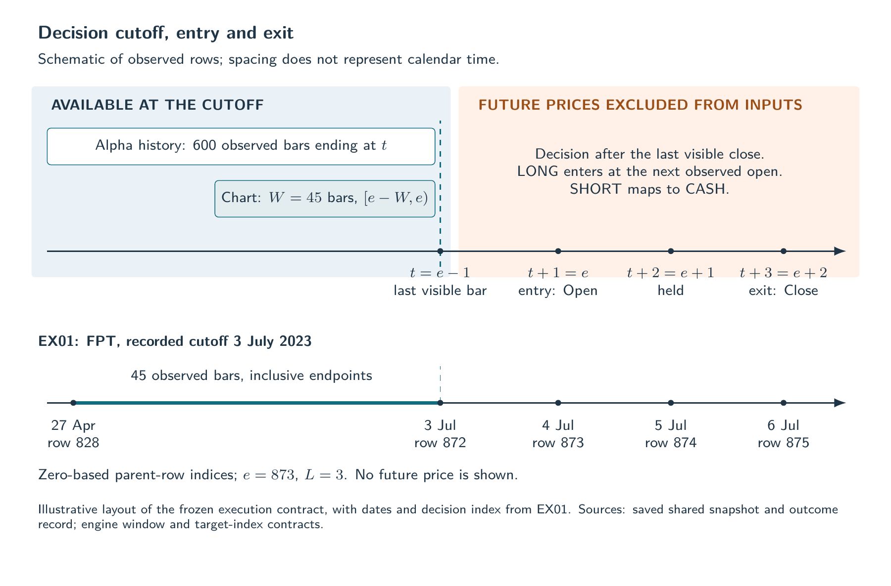

# Chapter 3. Theoretical Background and Problem Formulation

> **Draft status: partial chapter.** Sections 3.1–3.2 have source-checked drafts.
> Sections 3.3–3.7 remain placeholders; the chapter has not undergone final manuscript review.

Writing aids: [chapter outline](../outline.md#chapter-3-theoretical-background-and-problem-formulation), [terminology and notation](../evidence.md#5-thuật-ngữ-tiếng-anh-ký-hiệu-và-quy-ước-diễn-đạt) and [shared evidence ledger](../evidence.md#8-khung-bản-thảo-và-đối-soát-luận-điểm).

## 3.1. Observations and time indexing

### 3.1.1. Daily observations

The historical studies represent each stock as an ordered sequence of daily
bars. For a single stock, let

$$
b_i=(d_i,O_i,H_i,L_i,C_i,V_i),\qquad i=0,\ldots,N-1,
$$

where $N$ is the number of observations in the declared analysis view and
$d_i$ is the date attached to observation $i$. The fields $O_i$, $H_i$,
$L_i$ and $C_i$ are the opening, highest, lowest and closing prices reported
for that bar. $V_i$ is its reported volume. Together these fields are called
OHLCV. Prices must retain the dataset's declared units and adjustment basis;
the field names alone do not establish either. In particular, the volume
field is distinct from a price or a net return.[^time-inputs]

An *observed session* in this thesis means one dated daily row used by the
protocol. Indices count these rows after the analysis view has been
established, with dates in strictly increasing order. They do not certify
that the vendor sequence contains every exchange session. Thus $i+1$ means
the next observation in this sequence, not the next calendar day. A weekend,
holiday, suspension or absent vendor record may separate consecutive dated
rows; the cause of a gap cannot be inferred from its length alone.

The subscripts above identify price fields: $L_i$ is a low price. The
unsubscripted $L$ introduced below instead denotes the execution horizon
in observed bars.

### 3.1.2. Decision cutoff and the exclusive window boundary

Let $t$ be the zero-based index of the last bar visible to a decision, and
let its date be $d_t$. The daily decision is modeled as occurring after this
bar has completed. Its OHLCV values may therefore be used, whereas the next
bar's open is still a future price. This is the study's information boundary,
not a claim that historical vendor data were published with verified
real-time latency.

The engine expresses the same boundary using $e=t+1$, the **exclusive** end
index of an input window. If $W$ is the chart-window length, the slice
$[e-W,e)$ contains indices $e-W,\ldots,e-1$: exactly $W$ observations,
ending at $t=e-1$. Row $e$ is excluded. Here $[a,b)$ denotes a half-open
interval of integer row positions, not a date range.[^time-engine]

The execution horizon $L$ counts the future bars starting with the entry bar.
Under the daily contract, $L=3$. The corresponding positions are:

| Event | Position in the parent sequence | Price used or information boundary |
| --- | --- | --- |
| First chart bar | $e-W=t-W+1$ | First included OHLCV observation |
| Decision bar | $e-1=t$ | Last visible completed bar |
| LONG entry | $e=t+1$ | Open of the first future observed bar |
| Intermediate bar | $e+1=t+2$ | Second future observed bar |
| LONG exit | $e+L-1=t+L$ | Close of the final horizon bar; $t+3$ when $L=3$ |

The horizon therefore comprises bars $t+1,t+2,t+3$, rather than three
calendar days added to $d_t$. The outcome record may be evaluated only once
the required future observations exist; their prices do not belong to the
forecast input. SHORT is executed as CASH in this research contract, so this
timeline does not imply a short sale. Section 3.2 will define the associated
net label, costs and LONG/CASH payoff.[^time-target]

These are positions in the **parent** analysis sequence. The engine resets
the index of an extracted chart window for local processing; local positions
$0,\ldots,W-1$ do not replace the parent cutoff or move the entry bar.

### 3.1.3. Chart windows, longer history and warm-up

A chart window and the complete history available at the cutoff serve
different purposes. The locked historical-data path gives the chart/report
pipeline the final $W=45$ bars and supplies a longer prefix of $A=600$ bars
through the Alpha history input. Both end at the same cutoff. Their row
intervals are $[e-W,e)$ and $[e-A,e)$ respectively. The 600-bar history is
not an additional block after the chart window: it contains the final
45-bar window.[^time-inputs]

Warm-up is the history needed before a query can be formed. The engine
requires $e\geq\max(W,A)$ so that both slices are available. A full horizon
also requires $e+L-1<N$. For the earliest possible single query, these
conditions imply at least $\max(W,A)+L$ rows: 603 when $W=45$, $A=600$ and
$L=3$. The final three rows in that minimum are evaluation observations,
not warm-up or forecast inputs.[^time-engine]

This minimum is a data-availability requirement. It does not show that every
indicator is numerically defined on its first row, that an estimator has
converged, or that model training used the same history length. An indicator's
own lookback/initialization, a model's training period, the query's chart
window and the future execution horizon are separate concepts. Their
component-specific rules are introduced in the later sections.

### 3.1.4. Missing and invalid records

The declared analysis view matters because removing observations can change
row positions. In the frozen historical-data path, the price-view check
requires unique increasing dates, finite positive OHLC prices and finite
nonnegative volumes with positive total volume. If OHLC ordering is invalid,
that path retains the suffix after the last such row and records the excluded
prefix. These are properties of this particular input path, not a claim that
all live or legacy loaders use identical cleaning.[^time-view]

An insufficient clean prefix or incomplete future horizon is not permission
to shorten $W$, borrow future warm-up data or use an earlier exit. The locked
historical provider rejects a query without the required history or exact
cutoff, and the canonical target contract rejects an incomplete horizon.
The engine's lower-level direction helper can return an UNKNOWN sentinel
when the target lies outside the frame; this is not a valid evaluated label
or a support-based CASH decision.[^time-inputs][^time-target][^time-engine]

The notation also provides no basis for manufacturing flat candles to fill
a gap or declaring every absent date a market holiday. Missing-data decisions
must retain their source and exclusions. Where the vendor calendar has not
been independently authenticated, the execution horizon should be described
as three subsequent observed bars. This local time boundary alone does not
establish row-wise causality of every historical feature; Section 3.7 will
address that wider validity question.

### 3.1.5. A dated example

The running example uses FPT at the recorded cutoff of **3 July 2023**. Its
shared snapshot contains 600 bars from 2 February 2021 through that date;
the final 45 bars span **27 April–3 July 2023**, inclusive. These are counts
of saved observations, not counts of all calendar dates in either interval.

The saved outcome record identifies the decision-bar index as $t=872$ in
the parent analysis sequence. Consequently $e=873$, the chart slice is
$[828,873)$, and its final included row is 872. The recorded subsequent
observations are 4, 5 and 6 July: LONG enters at the open of row 873 on
4 July and exits at the close of row 875 on 6 July. Reading these dates to
explain the schedule does not make the corresponding prices available to
the forecast. The later realized outcome is reserved for the case analysis
in Chapter 5.[^time-example]

*Figure F01. Decision cutoff, entry and exit of a trading cycle. The upper
panel illustrates the 45-bar chart inside the longer history and the three
future execution bars. The lower panel uses the dates and decision index
saved for EX01; spacing is schematic and no future price or return is shown.
This is an illustration of the study contract, not a measured trading result
or an authenticated exchange calendar.* [Vector PDF](../assets/diagrams/F01_trade_timeline.pdf).

[^time-engine]: Frozen execution source: `core/backtest_engine.py`, `required_backtest_rows`, `build_walk_forward_end_indices`, `_prepare_window` and `_get_actual_direction`. Exact source bindings are recorded as TIME01 in the shared evidence ledger.
[^time-target]: Frozen target source: `utils/target_contract.py`, `target_fields`; TIME02 in the shared evidence ledger. Its horizon is an execution convention of the study.
[^time-inputs]: Frozen historical provider and serialization: `HistoricalData.prefix/state` in `core/historical_evaluation_data.py`, and `snapshot_payload` in `core/historical_signals.py`; TIME03/TIME05 in the shared evidence ledger.
[^time-view]: Frozen input validation: `price_view` in `core/historical_asset_readiness.py`; TIME04 in the shared evidence ledger.
[^time-example]: Archived EX01-S and EX01-O, joined by point and price-source identity; the shared evidence ledger records their ZIP/member hashes and the derived row-index arithmetic. No forecast or outcome has been regenerated.

## 3.2. Economic contract and prediction target

### 3.2.1. A candidate LONG cycle

For a decision at bar $t$, consider the candidate trade that buys at the next
observed open $O_{t+1}$ and closes at $C_{t+3}$. These are the entry and exit
defined in Section 3.1. Let $f=0.0025$ denote the brokerage fee and $s=0.001$
the proportional slippage on **each** leg. Buying one unit requires
$O_{t+1}(1+s)(1+f)$ of capital; selling it yields
$C_{t+3}(1-s)(1-f)$. The canonical net return is therefore

$$
r_t^{\mathrm{net}}=
\frac{C_{t+3}}{O_{t+1}}
\frac{(1-s)(1-f)}{(1+s)(1+f)}-1.
$$

This is the equation implemented by the shared economic oracle,
`compute_round_trip_net_return`; canonical historical labels use the same
oracle. The numerator includes selling costs and the denominator includes
buying costs. Subtracting a fixed 0.70 percentage points from the gross return
is only an approximation and is not the calculation used here.
Entry/exit prices must be positive and finite. The date convention and costs
are study assumptions, not a statement of current exchange settlement rules
or proof of executable fills.[^economic-oracle]

For comparison, the cost-free return is
$r_t^{\mathrm{gross}}=C_{t+3}/O_{t+1}-1$. Net break-even requires a price ratio
of $(1+s)(1+f)/[(1-s)(1-f)]$, approximately 1.00702457 under these costs.
A small positive gross move can consequently have a negative net result.

### 3.2.2. Label, proposal and execution action

The supervised target describes the candidate LONG trade, regardless of the
action eventually taken:

$$
y_t=\mathbf{1}\{r_t^{\mathrm{net}}>0\}.
$$

UP means $y_t=1$; DOWN includes every nonpositive return, **including zero**.
The canonical implementation compares the unrounded net return with zero;
a rounded displayed value must not replace that comparison. A cost-free
direction, a close-to-close return, or the LLM's stated confidence is a
different quantity.[^economic-oracle]

The raw forecast is LONG or SHORT. In this long-only research contract,
SHORT maps to the execution action CASH; it does not open a short position.
Let $a_t\in\{\mathrm{LONG},\mathrm{CASH}\}$ be the action after any external
policy. The cycle payoff fraction is

$$
r_t^{\mathrm{strategy}}=
\mathbf{1}\{a_t=\mathrm{LONG}\}\,r_t^{\mathrm{net}}.
$$

CASH keeps the simulated capital unchanged over that cycle, with no
short-sale profit or modeled interest. Correctly choosing CASH when the
candidate LONG label is DOWN can improve classification without earning a
positive cycle return. Conversely, an UP label does not mean that an account
which stayed in CASH earned that candidate return. Account aggregation over
several cycles is a separate evaluation operation.

### 3.2.3. Illustrative calculation

The following numbers are **Illustrative**: they are chosen for arithmetic,
not taken from EX01 or from an experimental performance table. Prices use
one consistent arbitrary unit and both rows use the costs above.

| Entry Open | Exit Close | Gross return | Canonical net return | Net label | LONG payoff | CASH payoff |
| --- | --- | --- | --- | --- | --- | --- |
| 100 | 100 | 0.000000% | −0.697557% | DOWN | −0.697557% | 0% |
| 100 | 103 | +3.000000% | +2.281516% | UP | +2.281516% | 0% |

For the second row, the purchase cost is $100(1.001)(1.0025)=100.35025$,
and sale proceeds are $103(0.999)(0.9975)=102.6397575$. Their ratio minus
one is approximately 0.022815164885. At exact mathematical break-even,
$C_{t+3}=O_{t+1}(1+s)(1+f)/[(1-s)(1-f)]$, the net return is zero and belongs
to DOWN; this is a symbolic boundary, not a claim that rounded floating-point
prices necessarily produce an exactly zero machine value.

These examples explain the contract. They neither regenerate frozen labels
nor resolve discrepancies in legacy evidence. Recorded bank/query price-basis
differences remain a validity limitation to disclose when interpreting the
historical studies.

[^economic-oracle]: Frozen `core/backtest_engine.py`, `compute_round_trip_net_return` and `compute_account_metrics`, and `utils/target_contract.py`, `target_fields`; bindings TIME01/TIME02 in the shared ledger. Illustrative arithmetic and scope are mapped as CL007–CL008.

## 3.3. Technical, alpha and sentiment signals

> **Not yet drafted.** Introduce MACD, RSI, Stochastic, Williams %R and ROC before report rules. Define alpha transformations, normalization, orientation and selection; explain dated sentiment and missingness separately. Distinguish votes, confidence, selection diagnostics and calibrated probabilities.

## 3.4. Hidden Markov models for market regimes

> **Not yet drafted.** Define hidden states, emissions, transitions, fitting and endpoint inference with primary citations. Introduce the evaluated VN-Index features, scaler/model cutoffs, state interpretation and fallback; explain why future observations cannot enter endpoint inference.

## 3.5. Bayesian summaries of historical evidence

> **Not yet drafted.** Derive Beta–Bernoulli updates, posterior means and credible intervals, then explain disjoint background shrinkage. Define every count and denominator, separate population support from displayed examples, and add an explicitly illustrative posterior calculation with appropriately limited interval interpretation.

## 3.6. Multi-task context and utility

> **Not yet drafted.** Define prior tasks, matured target observations, an unlabeled query, factual buckets and teacher/student roles. Explain why sign probability differs from expected net return, introduce gain/loss magnitudes and utility differences relative to an anchor, and give a clearly labeled numerical illustration.

## 3.7. Temporal validity and evaluation principles

> **Not yet drafted.** State the price/news cutoffs, exclusion of undated news, strict historical-exit condition and reserved-ID rules. Explain purging, row-wise causality versus outer-cutoff compliance, paired upstream and repeated decisions. Define classification/account evaluation units and undefined-denominator handling; add the chronological partition diagram.
