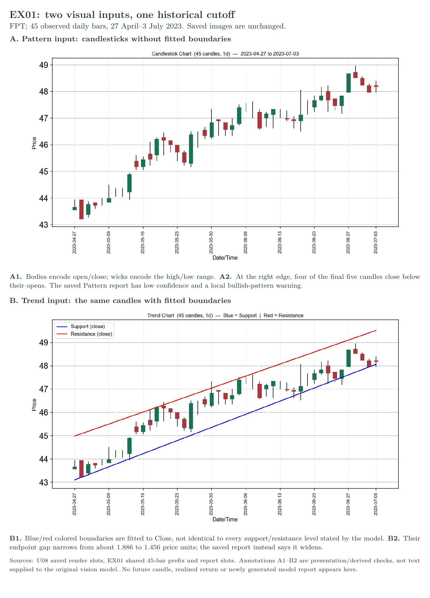

# Chapter 4. Proposed System: Regime-Aware Bayesian Context for Multi-Agent Trading

> **Draft status: partial chapter.** Sections 4.1–4.2 and the Indicator, Pattern, Trend, Alpha and Decision parts of 4.3 have source-checked drafts.
> The remaining placeholders identify missing content; naming a component does not establish its isolated effect.

Writing aids: [chapter outline](../outline.md#chapter-4-proposed-system-regime-aware-bayesian-context-for-multi-agent-trading), [EX01](../evidence.md#7-ví-dụ-xuyên-suốt-có-truy-vết), [artifact catalogue](../evidence.md#6-danh-mục-hình-bảng-và-thuật-toán-có-nguồn) and [shared evidence ledger](../evidence.md#8-khung-bản-thảo-và-đối-soát-luận-điểm).

## 4.1. System overview and one-decision walkthrough

### 4.1.1. What the system decides

At the end of an observed daily bar, the system summarizes admissible price
and textual information and proposes whether to enter the next candidate
LONG cycle. As defined in Chapter 3, execution is LONG or CASH, with entry
at the next observed open and exit at the third future observed close.
The explanation accompanying a proposal is useful for tracing evidence;
it is not a substitute for the subsequent economic outcome.

The proposed system adds historical context to a price-driven multi-agent
pipeline. Its purpose is to present relevant completed experience and
explicit numerical evidence when synthesizing current reports. That purpose
does not imply that every query has sufficient history or that adding
context improves profitability. The component and historical-context studies
remain separate evidence collections, as introduced in the research scope.

### 4.1.2. Computation, interpretation and external policy

Figure F03 distinguishes four kinds of work. **Offline fitting and selection**
produce versioned resources: the Common alpha selector, market-regime
models/scalers and numerical teacher/student. Their permitted fit cutoffs
are checked separately from the price cutoff of each forecast. Query-time
conditioning or retrieval uses these resources without refitting them.

**Deterministic processing** prepares price windows and chart images,
computes indicator values/votes and processes alpha/news inputs. In the
historical path, Indicator returns the computed report directly; it does not
request an additional LLM interpretation. **Hosted interpretation** is used
for Pattern and Trend and for eligible Decision requests. A role name is
therefore not a count of hosted calls.[^overview-source]

The historical execution order is Indicator, Pattern, Trend, followed by
the joint alpha/sentiment stage. F03 groups processing by type rather than
reproducing that node sequence. The resulting **shared snapshot** is a
versioned bundle of reports, visible inputs and provenance. All compared
branches receive protected copies of the same upstream realization. Common
alpha projection and historical/numerical context are subsequently resolved
for the appropriate profile; sharing the parent does not mean every branch
receives an identical final prompt.

The Decision family includes Native/Common foundations, historical-prior
variants and the Fact Anchor/MT path. Dependencies are resolved within the
same repeat. Some branches issue a new request; unsupported branches can
reuse a documented dependency. In the MT path, the numerical student is a
separate model from the hosted Decision LLM. Context and utility estimates
are numerical inputs rather than free-form claims invented by that LLM.

**External resolution** validates the reply, maps LONG/SHORT to executable
actions and, where applicable, keeps or revises an anchor under the utility
rule. Thus a raw proposal and the final action can differ. Technical failure
is recorded as failure, not silently recoded as a legitimate CASH decision.
Only after the forecast/policy record is durable does the evaluation path
join the query outcome and compute classification/account measures. No query
outcome flows back into its forecasting context.[^overview-source]

*Figure F03. System overview from available inputs to evaluated actions.
This is an Illustrative architecture of the locked historical research path.
The grouped processing boxes distinguish computation types; the text gives
the actual upstream order. Same-repeat dependencies and bypasses remain
explicit, and later outcome data enter evaluation only. Colors do not imply
measured latency, isolated benefits or live acceptance.*
[Vector PDF](../assets/diagrams/F03_system_overview.pdf).

### 4.1.3. Opening the FPT example

The running case, EX01, is FPT at the **3 July 2023** cutoff, with upstream
realization 0 and Decision repeat 0. The saved price prefix ends on that date.
Its final 45 bars supply the chart/Indicator window, while a 600-bar prefix
supports the longer-history path. The case is a saved historical research
execution, not evidence that a trade was executed in July 2023.[^overview-case]

The snapshot reports MACD below its signal line while remaining positive,
and a close above SMA20. Pattern and Trend provide visual interpretations;
news is explicitly unavailable. A reader can now ask which observations
support the reports, whether matured context exists, and how a proposed
action would be resolved. The following sections answer those questions
without treating missing news as observed neutrality.

For this case, the scheduled entry and exit observations are 4 and 6 July.
Their realized prices and net result are deliberately not used to explain
what was known at the cutoff; Chapter 5 will reveal the outcome. The same
case will connect input contracts, report interpretation, context and policy,
with distinct IDs for each saved record rather than a reconstructed successful
example.

[^overview-source]: Frozen graph, unified providers/methods/contracts, alpha projection and MT policy, bound in the shared ledger §9.1 and the earlier BG/TIME source tables. The live graph/Indicator/Decision presentation changes are accepted by the author as logic-equivalent; this does not replace frozen byte identities or complete application acceptance.
[^overview-case]: EX01-S and the declared EX01 selection/source record in the shared ledger §7. CL026–CL028 map this overview, the figure and the case opening; no new inference or market data were collected.

## 4.2. Input preparation and shared state

### 4.2.1. Preparing a query without its outcome

Input preparation answers three questions before an agent runs: which stock
and cutoff are being analyzed, which observations are admissible, and which
versioned resources belong to the study. The historical-data provider reads
the pinned price series and applies its declared clean-suffix view. Separate
raw/event evidence supplies corporate-action barriers; it is not silently
spliced into the donor price series. This separation preserves reproducibility
without claiming independently authenticated adjustment histories.

For the daily path, the provider requires an exact cutoff bar and at least
600 clean observations through it. The final 45 form the chart/Indicator
input; the final 600 form the longer-history input. VN-Index history has a
separate role in regime features and the reference calendar. Its fitted
resource metadata must not be replaced by the stock chart's window dates.
The dated-news store applies publication and conservative availability rules
before aggregation, returning unavailable sentiment when support is missing.
These are the frozen research interfaces; a fresh live API response is not
an interchangeable historical input.[^input-source]

All these objects refer to the same query identity. A date label alone is
insufficient: the price source, window end, resource and upstream realization
must agree. In EX01, the final chart bar and longer prefix both end on
3 July 2023. The observed close is 48.18 in the stored price unit. Unit
conversion for economic accounting must be declared separately and applied
consistently; changing units inside one agent while retaining another's
support/resistance values would break their common reference frame.

### 4.2.2. Component input/output contracts

Table B02 summarizes the interfaces used in this chapter. Types are readable
contract descriptions, not a replacement for the complete schemas. The
cutoff conditions apply to the data, not merely to the date printed in a
report. Every component should be understood in terms of its input,
processing, output and downstream consumer.

| Interface | Input and temporal requirement | Output and consumer | Missingness or failure contract |
| --- | --- | --- | --- |
| Query preparation | Stock/cutoff strings, ordered pinned OHLCV; exact last bar and sufficient past history | 45-bar `kline_data` and 600-bar `point_in_time_df`; chart/indicator and Alpha paths | Insufficient history or absent cutoff is an error; no borrowed future warm-up |
| Chart rendering | Same 45-bar OHLCV dictionary, no target fields | PNG/base64 images plus descriptions; Pattern and Trend | Image identity is traced independently of the model's report |
| Indicator | Numeric OHLCV lists through cutoff | Indicator table, per-indicator signals and consensus text; shared reports/Decision | Nonfinite/missing values and tool errors are not silently counted as numeric zero |
| Pattern / Trend | Their respective saved chart; chart metadata and permitted report context | Structured report text; shared reports/Decision | Fallback or repair must retain its path; successful formatting is not proof of visual correctness |
| Alpha / news | Declared longer prefix, stock/cutoff, frozen news store; profile-specific selector | `alpha_report`, factor records, sentiment data/report; snapshot and Decision | Strict historical errors propagate; missing news is unavailable, not manufactured neutrality |
| Regime resources | Prefix VN-Index features and fitted model/scaler with admissible training dates | Regime state and provenance; historical-context builders | Fit-quality fallback has its own method label; invalid resource identity is an error |
| Shared snapshot | Query identity, five report strings, optional images/price prefix/causal projection and provenance | Sealed JSON bytes; fresh document copy for each branch | Whitelist, primitive numeric/date and forbidden-target checks; no branch owns a mutable reference to the sealed parent |
| Historical / numerical context | Query facts plus the permitted frozen/matured history and resource identities | Selected examples/statistics or task membership and utility; branch preparation | Reserved IDs and temporal/support checks apply; valid insufficiency can cause explicit bypass |
| Decision request | Profile projection of shared reports and permitted context; same-repeat dependencies | Versioned messages/schema/request identity; hosted Decision | A bypass has no new request; a technical failure is not a fabricated valid response |
| Resolution and evaluation | Saved proposal and policy inputs; query outcome joined only after durable forecasting | Final LONG/CASH record, then classification/account artifacts | Keep proposal/action/outcome distinct and preserve undefined values and failure reasons |

*Table B02. Component input/output and availability contracts for the locked
historical path. A role may expose different live presentation behavior;
the historical evidence remains tied to its frozen source/profile.*

### 4.2.3. Working state versus a sealed shared snapshot

The graph's working state accumulates reports and operational fields during
execution. The shared snapshot is a narrower projection intended for paired
forecasting. It contains the stock/cutoff identity, report payload, upstream
realization and provenance. Its constructor checks required nonempty report
strings, primitive finite JSON values, allowed fields and matching query
metadata. A price-prefix payload must have aligned OHLCV arrays, ordered
unique dates, a matching final cutoff and no more than 600 rows; the producer
requires the complete 600-bar history for this study.[^input-snapshot]

The snapshot is stored as immutable bytes. Calling its document interface
decodes a new dictionary, so changing one branch's copy cannot change the
sealed parent or another branch's input. A bridge can bind the Common alpha
projection to a specific native parent. The branch obtains the appropriate
projection without rerunning Pattern or Trend. This is input sharing, not
a promise that all prompts, dependencies or actions are identical.

The contract recursively excludes query outcomes, realized entry/exit prices,
query labels and prior/Decision material from this base snapshot. Historical
context is supplied later through its own checked interface, where matured
historical labels have a legitimate role. That exception never authorizes
the current query's label. Numeric/date validation and checksums establish
internal consistency and identity; they do not authenticate the economic
meaning of every upstream observation or certify row-wise causality.

### 4.2.4. Identity and explicit absence in EX01

EX01's shared-snapshot content hash is
`e6c16c36dd776a804922f466af1c9742bf3ba70015d60929e4112992e269a103`.
This identifies the parent used by its eight research branches. It differs
from the raw ZIP-member hash, the original price-source hash, a causal-alpha
projection hash and a numerical-context membership hash. Those hashes bind
different objects and cannot be substituted for one another.

The same snapshot records no eligible verified news, with
`is_unavailable=True`. An unavailable observation is an explicit part of the
input contract, not a reason to invent a score. Similarly, a nonempty report
can contain warnings or uncertain interpretations; the presence of text does
not certify the content. In the following sections, the actual EX01 report
and image records will be kept alongside these limitations.[^input-snapshot]

[^input-source]: Frozen `HistoricalData.prefix/state`, `FrozenNews`, price-view and event/barrier path; TIME03/TIME04 and BG17 in the ledger. This section explains input preparation, not independent verification of historical vendor data.
[^input-snapshot]: Frozen `SharedSnapshot.create/document`, `forecast_only`, `json_bytes`, `snapshot_from_graph` and `causal_bridge.decision_payload`; SYS04/SYS05, BG18 and EX01-S. CL029–CL032 map the table, identity and failure/absence distinctions.

## 4.3. The base multi-agent pipeline

The base pipeline turns one observation window into complementary reports.
Indicator provides numerical momentum/range summaries; Pattern interprets
candlestick structure; Trend interprets support/resistance. Alpha and
sentiment contribute different quantitative/textual context. Reports can
disagree, and a majority vote does not guarantee profitability. Each component
below is explained through its inputs, processing, outputs and limitations.

### 4.3.1. Indicator

Indicator receives the 45-bar OHLCV dictionary, calls the five TA-Lib
families in Section 3.3 and classifies them in Python. The historical
`is_backtest=True` path returns the computed table and classification text
directly. Optional live prose interpretation is a separate path, not an
extra historical response or a recalculation of the votes.[^indicator-contract]

The rule order matters. This table summarizes usable numerical inputs;
initialization and edge handling remain bound to the frozen source.

| Family | Classifier priority |
| --- | --- |
| MACD | Recent upward/downward MACD–signal crossover first; otherwise histogram sign and strengthening/contraction. With insufficient crossover history, available histogram sign is used. |
| RSI | ≥70 bearish; ≤30 bullish; otherwise ≥55 bullish and ≤45 bearish. Inside (45,55), compare latest with third-last available value when present. |
| ROC | Above +0.5% bullish, below −0.5% bearish, otherwise neutral. This is ROC's ten-bar change, not candidate-LONG net return. |
| Stochastic | Recent %K/%D crossover first; otherwise %K≥80 bearish, %K≤20 bullish, then the available relation between %K and %D in the middle range; otherwise neutral. |
| Williams %R | ≥−20 bearish, ≤−80 bullish; in the middle compare latest with third-last available value. Insufficient history leaves neutral. |

The classifier counts bullish, bearish and neutral entries. A dominant
direction with three votes has medium confidence, increased to high at
four or more; a smaller directional majority is low confidence and a tie
is mixed/low. These are heuristic agreement labels, not probabilities.
The denominator counts emitted classifications, not independent observations.

Finite zero is retained as a value; missing/nonfinite values are filtered,
and retained values are rounded to four decimal places by the classification
helper. Its last-value comparisons use the cleaned sequence, so availability
at the original last row cannot be inferred merely from a returned number.
Some error or insufficient-data paths emit neutral classifications with an
error/missing annotation, and these entries can enter the summary. Neutral
therefore does not certify a successfully observed neutral market signal.

In EX01, MACD, Stochastic and Williams %R are bearish; RSI and ROC are
bullish. The full saved report records 2/5 bullish, 3/5 bearish, 0/5 neutral
and bearish/medium consensus. This is an English presentation summary of
the Vietnamese archive, not a guarantee that every line reached Decision.

### 4.3.2. Pattern

Pattern asks what price-action structure is visible in the current window.
Its input is a candlestick image of the same 45 admissible bars used by
Indicator. A body shows the open-to-close interval and a wick the high/low
range; colors distinguish upward and downward candles. The renderer supplies
axes, date labels and the window title. Rendering these observations is a
deterministic operation, distinct from recognizing a pattern in them.

The historical runner renders once and supplies the saved image to the
Pattern node; the node can render an image when one is not supplied in other
paths. A hosted vision request asks for six fields: pattern, confidence,
directional bias, evidence, key candles and trading implication. The saved
report passes formatting/field handling and an OHLCV consistency check before
downstream use. General agent code also has text fallback paths. Their
existence is not evidence that the fallback was used for every archived case.
Image, execution path and saved report must be traced separately.
[^pattern-source]

The local verifier inspects recent candle bodies/ranges, including the final
five observations. It can flag a bullish claim opposed by a strongly bearish
last candle or a predominantly bearish recent group, and symmetrically for
a bearish claim. A detected conflict adds a warning and can lower confidence.
This is a limited consistency rule: it does not establish a correct pattern
taxonomy, validate all prose, or prove the direction of the next cycle.

**EX01 saved-report example, translated for presentation.** The report calls
the pattern an upward trend, gives low confidence and an upward directional
bias, cites higher highs/lows from roughly 43 to 48, and identifies the green
27 June candle. It suggests buying on a pullback around 47.5 with a stop
below 46.5. It also preserves the warning: “Actual candle structure contradicts
the bullish pattern.” Four of the final five saved candles close below their
opens. A rising full window and a bearish recent subgroup can coexist; the
warning does not by itself disprove every longer-window trend statement.
The pullback/stop suggestion is report prose, not an order that changes the
fixed execution contract.

Figure F04-A uses the exact archived image. The labels outside the image are
new explanatory annotations; they were not part of the original vision
input. No future candle or realized return is appended.

### 4.3.3. Trend

Trend instead asks how the price window relates to fitted support/resistance
geometry. It receives the same candles with additional lines. The blue and
red boundaries in the saved chart are fitted to **Close** values. The helper
starts from a linear fit, selects residual pivots and adjusts a slope under
support/resistance constraints. The renderer also computes high/low-based
fits and line segments. The colored Close boundaries are not claims that
every intraday wick must stay inside them, nor are they automatically equal
to horizontal levels later named by the model.[^trend-source]

The vision report provides trend direction, support, resistance, line slope,
price relation to support, analysis, forecast and confidence. Formatting
helpers can populate missing fields from numerical price summaries. The
direction verifier compares the reported direction with short/long price
means and slopes. For a 45-bar window, the nominal long-window comparison
uses the available history rather than pretending that 50 bars exist.
It can flag an obviously opposed directional claim; it does not verify every
claimed level, breakout, pattern name or change in channel width.

**EX01 saved-report example, translated for presentation.** Trend reports
an upward direction, support 47.8, resistance 49.2, increasing slope, a bounce
from support and high confidence. Its narrative says the two boundaries
are widening and predicts a possible break above 49.2. These are archived
report assertions, not independently established geometric facts or realized
price movements.

A source-bound geometric check exposes a limitation. Applying only the frozen
Close-line fitting primitive to the 45 saved closes gives support/resistance
values of about 43.097/44.983 at the first plotted position and
48.063/49.519 at the final position. The fitted gap decreases from 1.885784
to 1.456185 price units. Thus the widening statement is inconsistent with
these colored boundaries, despite the saved high confidence. This calculation
is a new explanatory derivation from saved inputs, not a rerendered research
chart, replacement report or new forecast. The report's 47.8/49.2 level fields
must not be relabeled as exact endpoints of those fitted lines.

*Figure F04. Two saved visual inputs for FPT at the 3 July 2023 cutoff,
covering 27 April–3 July. Panel A shows candlesticks; panel B adds fitted
Close boundaries. Original PNGs are preserved byte-for-byte. A1–B2 are
external presentation notes and documented derived checks, not material
shown to the original vision model. The case retains the Pattern warning
and the Trend geometry inconsistency; no future result is displayed.*
[Vector-layout PDF](../assets/diagrams/F04_chart_pair.pdf).

The paired views explain why Pattern and Trend are distinct roles while
remaining dependent on the same prices. Reusing a shared upstream prevents
new vision randomness across comparison branches; it does not establish
correct visual grounding. Neither formatting success, a local verifier nor
high stated confidence can substitute for comparison with saved OHLCV and
the actual image geometry.

[^pattern-source]: Frozen Pattern node, `_verify_pattern_against_ohlcv` and renderer; saved EX01 render/pattern graph slots. CL038–CL039 and §9.5 in the shared ledger distinguish original bitmap, processed report and English translation.
[^trend-source]: Frozen Trend node, `_compute_levels/_verify_trend_against_ohlcv`, `static_util.generate_trend_image` and toolkit line-fitting primitives. CL040–CL042 bind the saved image/report and separate geometric derivation; the old CMG illustration is not relabeled as this FPT case.

### 4.3.4. Alpha

Alpha supplies numerical transformations of price and volume, followed by a
declared selection procedure. Its factor values summarize transformed market
observations; neither their magnitude nor their historical accuracy is a
calibrated probability of the next profitable trade. The historical numerical
stage does not request an additional LLM interpretation. Native and Common
use different transformations and selectors, as explained below.
[^alpha-native]

**Candidate construction and attribution.** The registry contains 85
candidates: five system-specific factors and 80 single-stock adaptations
named after entries in the [Alpha101 collection](https://arxiv.org/abs/1601.00991v3).
They combine returns, candle bodies, moving averages, lagged differences,
rolling ranks/correlations and decays. The code's VWAP input is the
typical-price proxy $(H+L+C)/3$, not an observed volume-weighted transaction
price. Rolling time-series comparisons replace operations that originally
ranked a cross-section; industry-neutralized information is not recreated
from one stock's OHLCV. These are adapted candidates, not a replication of
all 101 original formulas or their reported performance.

For example, the implemented WQ18 handler computes

$$
x_{18,i}=-R_{20}^{\mathrm{ts}}\left[
\operatorname{Std}_5(|C-O|)+(C-O)+\operatorname{Corr}_{10}(C,O)
\right]_i.
$$

Here $R_{20}^{\mathrm{ts}}$ is the implementation's trailing comparison of
the current value with prior values in the window, using strict greater-than
comparisons and partial-window rules. It is not a cross-stock rank. The
report's short formula field comes from a display template; the executable
handler and its bound source determine the calculation. An abbreviated
template containing ellipses, such as the saved WQ29 description, cannot
serve as a complete executable specification.

**Native selection on the current historical prefix.** The selector copies
the supplied historical frame, applies the cutoff and retains at most 600
bars. Backtest mode requires this frame and cannot fall through to the live
loader. Every candidate is evaluated over that same prefix. Its default
normalization is

$$
z_{j,i}=\tanh\!\left(\frac{\widetilde{x}_{j,i}-\mu_{j,D}}
{s_{j,D}}\right),
$$

where $D$ is the entire supplied selection window, nonfinite raw values are
first replaced with zero, and the standard deviation uses the sample
convention. A near-constant series returns zero. Alternative native modes
use full-window min–max scaling or full-window ranks; none of these is the
Common expanding normalizer.

For daily data, ranking labels are net returns from Open$(i+1)$ to
Close$(i+3)$ with the same two-sided fee/slippage factors as Section 3.2.
This native helper expresses the arithmetic directly; the Common selector
below calls the canonical scalar oracle. Unmatured tail labels are missing.
Spearman IC is computed on finite signal/label pairs. Diagnostic accuracy
uses signals stronger than 0.05 after orienting by IC; economic UP is a
strictly positive net return. The native ranking score is

$$
S_j=0.40\,N(|\mathrm{IC}_j|)+0.35\,N(\mathrm{Accuracy}_j)
+0.25\,N(\mathrm{Sharpe}^{\mathrm{diag}}_j),
$$

for the default weights, where $N$ rescales a metric across candidates to
[0,1] and returns 0.5 for a constant metric. Long-only accuracy is reported
but does not enter this score. The Sharpe diagnostic uses
$\operatorname{sign}(z^{\mathrm{oriented}})r^{\mathrm{net}}$ on overlapping
historical rows. A negative signal can therefore earn a positive diagnostic
return when the candidate LONG return is negative. This is a symmetric
ranking diagnostic, not the implemented CASH payoff or an account equity
curve. Minimum-support paths also use default diagnostic values; a ranking
row is not a certificate of adequate predictive support.

The top five scores determine the report. Their latest normalized values
are flipped when the stored IC is negative; that stored IC is rounded to
four decimals. Values above 0.10 are bullish, below −0.10 bearish, and the
remaining values neutral, including the boundaries. The agent rounds values
to four decimals for output and summarizes bullish/bearish counts; the
signal is assigned before this display rounding. A nonfinite latest value
is coerced to zero, so a neutral output alone does not certify availability.
An empty dynamic selection stops a historical point. Strict research mode
propagates selected-handler errors; the general five-factor fallback is not
a substitute for a failed historical selection.

**Native validity limitation.** Selecting, orienting and reporting accuracy
on the same history produces in-sample diagnostics. Moreover, a cutoff at
the end of $D$ does not make every historical row causal: full-window
normalization can change old values when later rows are appended. Native
lag backfilling, the whole-window real-volume/proxy decision and
length-dependent factor windows introduce additional row-wise problems.
The recorded native row-wise causal gate remains **FAIL**. This differs from
claiming that the outer query read prices after its cutoff; passing that
outer-cutoff check does not repair the historical transformations or
selection bias.[^alpha-validity]

**Common: prefix transformations and a frozen selector.** The separate
`causal_common_v1` profile retains the candidate identities in its own
namespace while replacing the affected operators: expanding-prefix
normalization, lagging without backward filling, observed volume without
a range proxy, and fixed versions of six length-dependent window
expressions. A 300-bar observed-volume mask, the normalizer's minimum of
20 observations and finite-value requirements govern availability. Common
preserves a fixed history origin instead of resetting to Native's 600 bars.
An unavailable selected query factor raises an error; it is not filled with
zero or replaced by another candidate.[^alpha-common]

Orientation is estimated on train Spearman IC against labels from
`compute_round_trip_net_return`. Validation then chooses five factors and
one threshold from 0.05, 0.10 and 0.20 by mean LONG/CASH return on common
finite support. Each candidate must meet train support with nondegenerate
signal and return series; validation requires
at least 30 common observations and five LONGs per admitted candidate.
Training requires at least 60 valid pairs. Three-session decision grids and
strict exit-before-next-split boundaries separate orientation, selection and
test. Ranking ties use alpha ID; threshold-search ties prefer the smaller
threshold. This validation choice remains model selection, not test evidence.

The artifact freezes IDs, signs, threshold, schedule, source/runtime and
price hashes. Loading verifies it by reproducing the train/validation fit;
prediction does not select again or use the query outcome. The verification
is part of the recorded implementation, not a new fit performed for this
manuscript. This profile's scoped checks do not turn the Native gate into
PASS or certify the whole system as causal.

**EX01 selected-report example, translated for presentation.** The saved
Native table is:

| Selected factor | Oriented displayed value | Signal | Stored IC | Historical accuracy | Composite score |
| --- | --- | --- | --- | --- | --- |
| WQ18, Std + Body + Corr Rank | −0.2871 | Bearish | +0.1266 | 56.9% | 0.8509 |
| WQ29, Nested Rank Log | −0.2071 | Bearish | −0.1312 | 54.1% | 0.8217 |
| WQ57, VWAP Argmax Decay | −0.0133 | Neutral | +0.1024 | 55.2% | 0.7575 |
| WQ42, VWAP-Close Ratio | −0.2701 | Bearish | +0.0718 | 60.1% | 0.7514 |
| LVR, Liquidity Void Reversion | +0.7355 | Bullish | +0.1269 | 52.7% | 0.7239 |

The archived consensus is bearish: one bullish, three bearish and one
neutral. WQ29 explicitly records the negative-IC flip. These accuracies and
scores describe the selector's historical sample, not EX01's future outcome.
The full report contains the table, display formulas, metrics and consensus;
Decision receives a distilled, capped projection rather than all detail.

For the same shared parent, the saved Common projection instead contains
WQ57 (−0.033616, neutral), WQ52 (+0.861779, bullish), WQ02 (+0.758270,
bullish), WQ21 (+0.874219, bullish) and WQ83 (−0.086067, bearish).
Its frozen threshold is **0.05**, not Native's 0.10; WQ52/WQ02 have negative
orientations. The EX01 artifact fits through 30 June 2023 with history
origin 2 January 2020, train 14 April 2021–30 September 2022 and validation
6 October 2022–27 June 2023, before the 3 July query. Values here are
rounded for presentation; the saved full-precision projection and hashes
remain the evidence. This change of both factors and selection procedure
must be disclosed when interpreting Native/Common comparisons.

[^alpha-native]: Frozen `agents/alpha_agent.py`, `utils/alpha_selector.py` and `core/alpha_compare.py`: registry, features, normalization, execution-return helper, metrics, ranking and report assembly. CL043–CL044 in the shared ledger bind implementation statements and EX01's saved Native factors. Alpha101 attribution uses the version read for Section 3.3, not a claim of formula equivalence.
[^alpha-validity]: Frozen `core/revision_alpha_contract.py` and the recorded audit scope; CL045. PASS_DETECTION and an outer-cutoff PASS differ from the native row-wise FAIL. No counterexample suite or research run was repeated to write this section.
[^alpha-common]: Frozen `core/causal_alpha.py`, BG03, and EX01's selector/projection in U06 assets v2, checked against U08's saved Common projection. CL046–CL047 and ledger §9.6 distinguish artifact verification from new training, and Common Alpha scope from whole-system certification.

### 4.3.5. Sentiment

> **Not yet drafted.** Explain dated articles or frozen aggregates, scoring provenance, aggregation and coverage. Describe explicit unavailability and its relationship to Alpha; preserve EX01's missing news rather than interpreting it as observed neutral sentiment.

### 4.3.6. Decision

Decision synthesizes report text under a declared profile; it does not
recompute indicators or read future prices. Its compact historical request
states the LONG/CASH economic contract, with Trend/Pattern for direction
and timing, Indicator for momentum confirmation, Alpha for quantitative
evidence and sentiment at the lowest priority. These instructions do not
prove that every response obeys them. Native/Common projections and
instructions are separated in Section 4.4.[^decision-contract]

Deterministic helpers distill each report and enforce character caps. Alpha
condensation retains its leading table and final summary when the expected
separators exist; sentiment removes the article-list/prose tail. Indicator
condensation searches for recognized convergence headings. If none matches,
generic capping keeps leading/trailing portions with a truncation marker,
potentially dropping meaningful middle content.

| Report | Native/general cap | Integrated backtest cap in the common base builder |
| --- | --- | --- |
| Trend / Pattern / Indicator, each | 900 characters | 800 characters |
| Alpha | 1,200 characters | 1,100 characters |
| Sentiment | 600 characters | 500 characters |

The complete backtest prompt must be strictly below 6,500 characters; the
historical-prior prefix has its own 600-character bound. Characters are not
tokens. A final assembled-prompt check is still necessary. Prior/MT wrappers
and schemas will be explained separately, rather than assumed to have the
base request's shape.

**Observed EX01 projection limitation.** Its full Indicator report has 3,661
characters, but its summary heading does not match the frozen distiller's
convergence headings. The Native/Common Indicator fragments consequently
use head/tail truncation and contain 899/798 characters. The 2/5–3/5 count
lines are absent from these fragments. The exact fragments occur in the
archived requests, with full prompt lengths 3,699/4,186 characters. These
are measurements of saved requests, not new forecasts. The evidence does
not support saying that Decision saw the entire numerical summary.

The base structured output contains binary `decision`, `forecast_horizon`,
textual `confidence`, `risk_reward_ratio` constrained to [1,5], evidence
for/against and justification. Confidence is not a calibrated probability;
R:R is not an executable order or a validated target-price estimate.
Schema/binary parsing validates output form. Unrecoverable direction/schema
or transport failures are surfaced by the execution contract, not replaced
with a newly invented valid SHORT/CASH response.

At EX01 repeat 0, Native returned SHORT/high stated confidence/R:R 1.5;
Common returned LONG/high stated confidence/R:R 2.5. SHORT executes as CASH.
The Native prose uses “short position”, but this does not change execution.
Common's expected-profit explanation is also a model claim, not a verified
outcome. Proposals, final actions, request IDs and later realized results
remain separate records.

[^indicator-contract]: Frozen Indicator `_compute_all_indicators/_classify_signals/_clean/create_indicator_agent`, BG02, and toolkit BG01. EX01-S preserves the full report; CL033–CL034 map priorities, missingness and the translated case summary.
[^decision-contract]: Frozen Decision SYS02, `TradeDecisionOutput`, `_distill_report/_cap_report`, compact builders and final guard; EX01 Native/Common request records. CL035–CL037 map schema and measured projection. Pure string-helper verification neither calls the model nor replays the study.

## 4.4. Native and Common foundations

> **Not yet drafted.** Identify shared inputs and the changes to alpha projection, selector fitting and common instructions. Explain the Native/Common profile bridge and distinguish it from the Full/Base intervention in the separate component study.

## 4.5. Historical memory and market regimes

> **Not yet drafted.** Define episode fields, canonical labels, maturity filtering, reserved IDs and bank provenance. Explain HMM/scaler fitting and query-time regime assignment. Distinguish signal memory from numerical task context, retaining EX01's separate regime sources.

## 4.6. Bayesian Prior v1

> **Not yet drafted.** Explain the purpose of same-stock historical retrieval, temporal filtering, regime/signal matching, ranking and tie-breaking under the evaluated protocol. Annotate a bounded BRPP and explain unsupported-case reuse of the same-repeat Common result; use EX01's recorded examples and support without substituting displayed counts for population size.

## 4.7. Conditional and alternative priors

> **Not yet drafted.** Explain C2's disjoint conditional/background counts, shrinkage and separate readiness gates; contrast Trend/Pattern pooling and explicit-count presentation. Create the comparison table for filtering, statistics, examples, prompt content and fallback. Do not infer embedding search from the name B_semantic; preserve EX01's recorded bypasses.

## 4.8. MT-BICL and action revision

> **Not yet drafted.** Introduce the numerical context and action-revision path before its details. Separate resources trained offline, numerical inference, hosted proposals and external policy, using the source-bound EX01 records.

### 4.8.1. Fact packet and Fact Anchor

> **Not yet drafted.** Define numeric facts, assertions, Common dependency and anchor validation/failure behavior. Explain the limited scope of assertion validity and identify the anchor action before evaluating a proposed revision.

### 4.8.2. Task construction

> **Not yet drafted.** Explain factual buckets, prior tasks, target observations, query vectors, scaling and membership cutoffs. Use EX01 to distinguish task counts from observation counts and displayed signal examples; keep the query unlabeled.

### 4.8.3. Teacher and student

> **Not yet drafted.** Describe the actual locked architecture, teacher targets, training objective, sampling and checkpoint selection with verified attribution. Separate fitting from frozen inference and identify what the student predicts; do not replace the evaluated resource with a generic architecture.

### 4.8.4. Utility

> **Not yet drafted.** Explain posterior sampling of sign and gain/loss magnitude, support requirements, mean/quantiles and insufficient-evidence behavior. Separate student probability, teacher estimates, utility and realized query return; use the recorded EX01 utility values only with their source and units.

### 4.8.5. Context projection

> **Not yet drafted.** Explain complete membership summaries, representative examples, numerical estimates and bounded prompt projection. Distinguish the underlying context from the material displayed to the LLM; provide a source-bound annotated prompt excerpt when prepared.

### 4.8.6. External policy

> **Not yet drafted.** Define anchor retention, eligibility, assertion checks and the strict utility conditions for accepting a different action, including both action directions. Create the policy diagram and distinguish invalid proposals from technical failures; EX01 illustrates retention, not a veto.

### 4.8.7. Traceability

> **Not yet drafted.** Trace raw proposal, anchor, validity, eligibility, bypass, reason and final action as separate records. Identify decisions attributable to the LLM versus external policy and connect them to EX01 without revealing outcome labels as inputs.

## 4.9. Variant orchestration and complete algorithms

> **Not yet drafted.** Present the eight-role dependency table/DAG, one shared upstream realization per point and same-repeat dependency resolution. Distinguish forecast slots, bypasses and actual hosted calls. Write the three algorithms for PIT preparation, method/policy execution and paired forecasting followed by outcome/account joining.

## 4.10. Prompt limits, recovery and application

> **Not yet drafted.** Explain report distillation/capping, BRPP and complete-prompt character limits, retry/backoff, schema handling, checkpoints, resume and UNKNOWN reconciliation. Separate support fallback from technical errors, describe the realtime 1D application with versioned context, and revisit EX01 through final action before explaining when evaluation becomes possible. Application demonstration must retain its actual acceptance limits.
