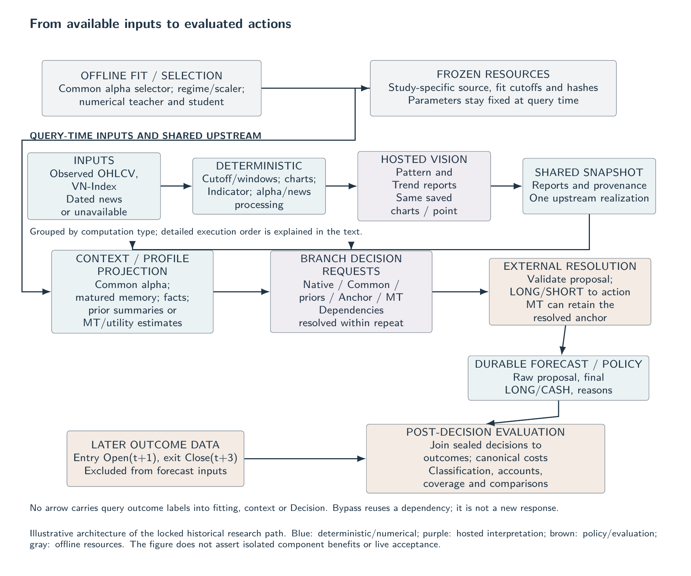
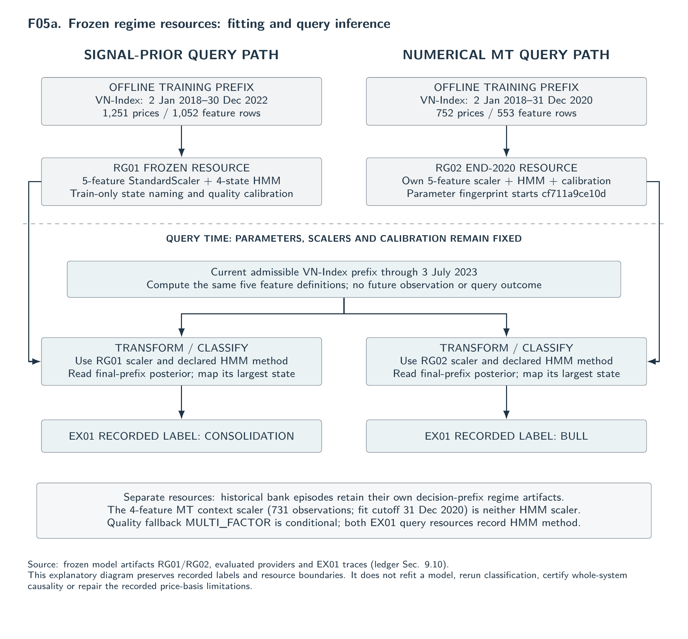
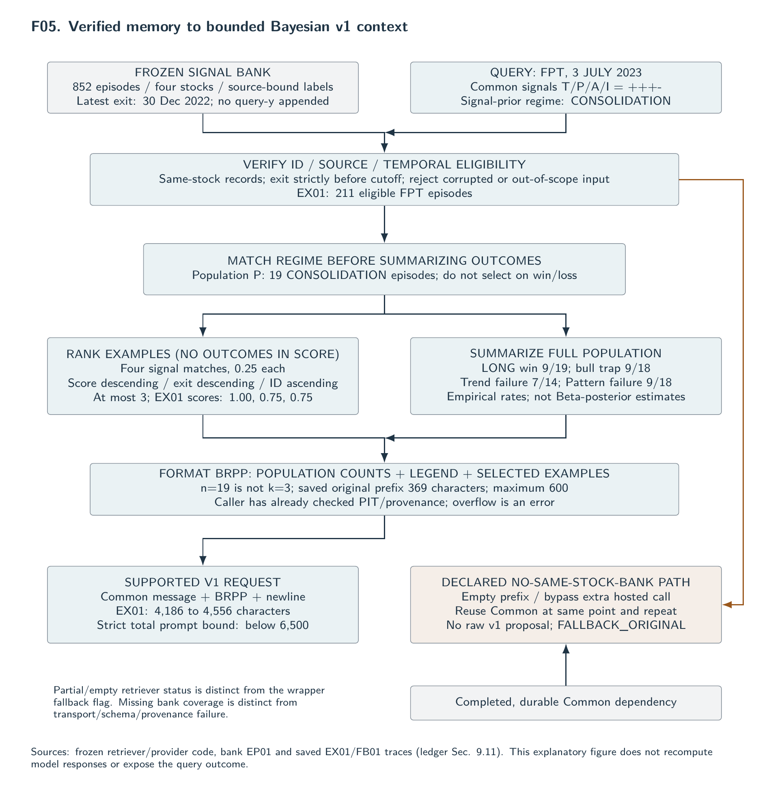
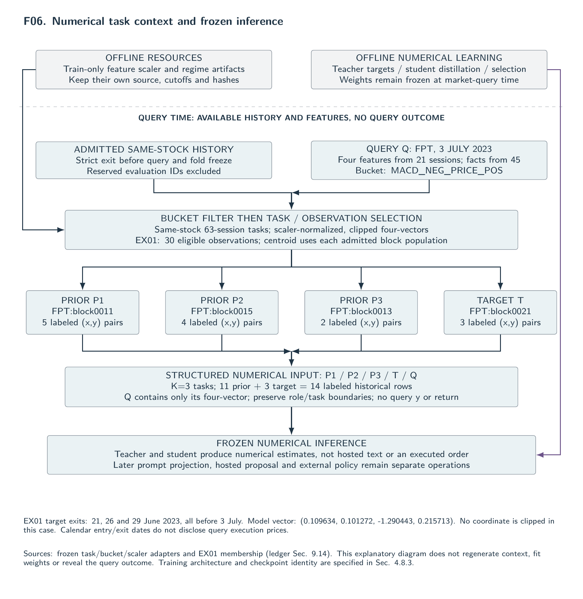

# Chapter 4. Proposed System: Regime-Aware Bayesian Context for Multi-Agent Trading

> **Draft status: partial chapter.** Sections 4.1–4.7 have source-checked drafts.
> The remaining placeholders identify missing content; naming a component does not establish its isolated effect.

Writing aids: [chapter outline](../outline.md#chapter-4-proposed-system-regime-aware-bayesian-context-for-multi-agent-trading), [EX01](../evidence.md#7-ví-dụ-xuyên-suốt-có-truy-vết), [artifact catalogue](../evidence.md#6-danh-mục-hình-bảng-và-thuật-toán-có-nguồn) and [shared evidence ledger](../evidence.md#8-khung-bản-thảo-và-đối-soát-luận-điểm).

## 4.1. System overview and one-decision walkthrough

### 4.1.1. What the system decides

At the end of an observed daily bar, the system summarizes admissible price
and textual information and proposes whether to enter the next candidate
LONG cycle. As defined in Chapter 3, execution is LONG or CASH, with entry
at the next observed open and exit at the third future observed close.
The explanation accompanying a proposal is useful for tracing evidence;
it is not a substitute for the subsequent economic outcome.

The proposed system adds historical context to a price-driven multi-agent
pipeline. Its purpose is to present relevant completed experience and
explicit numerical evidence when synthesizing current reports. That purpose
does not imply that every query has sufficient history or that adding
context improves profitability. The component and historical-context studies
remain separate evidence collections, as introduced in the research scope.

### 4.1.2. Computation, interpretation and external policy

Figure F03 distinguishes four kinds of work. **Offline fitting and selection**
produce versioned resources: the Common alpha selector, market-regime
models/scalers and numerical teacher/student. Their permitted fit cutoffs
are checked separately from the price cutoff of each forecast. Query-time
conditioning or retrieval uses these resources without refitting them.

**Deterministic processing** prepares price windows and chart images,
computes indicator values/votes and processes alpha/news inputs. In the
historical path, Indicator returns the computed report directly; it does not
request an additional LLM interpretation. **Hosted interpretation** is used
for Pattern and Trend and for eligible Decision requests. A role name is
therefore not a count of hosted calls.[^overview-source]

The historical execution order is Indicator, Pattern, Trend, followed by
the joint alpha/sentiment stage. F03 groups processing by type rather than
reproducing that node sequence. The resulting **shared snapshot** is a
versioned bundle of reports, visible inputs and provenance. All compared
branches receive protected copies of the same upstream realization. Common
alpha projection and historical/numerical context are subsequently resolved
for the appropriate profile; sharing the parent does not mean every branch
receives an identical final prompt.

The Decision family includes Native/Common foundations, historical-prior
variants and the Fact Anchor/MT path. Dependencies are resolved within the
same repeat. Some branches issue a new request; unsupported branches can
reuse a documented dependency. In the MT path, the numerical student is a
separate model from the hosted Decision LLM. Context and utility estimates
are numerical inputs rather than free-form claims invented by that LLM.

**External resolution** validates the reply, maps LONG/SHORT to executable
actions and, where applicable, keeps or revises an anchor under the utility
rule. Thus a raw proposal and the final action can differ. Technical failure
is recorded as failure, not silently recoded as a legitimate CASH decision.
Only after the forecast/policy record is durable does the evaluation path
join the query outcome and compute classification/account measures. No query
outcome flows back into its forecasting context.[^overview-source]



*Figure F03. System overview from available inputs to evaluated actions.
This is an Illustrative architecture of the locked historical research path.
The grouped processing boxes distinguish computation types; the text gives
the actual upstream order. Same-repeat dependencies and bypasses remain
explicit, and later outcome data enter evaluation only. Colors do not imply
measured latency, isolated benefits or live acceptance.*
[Vector PDF](../assets/diagrams/F03_system_overview.pdf).

### 4.1.3. Opening the FPT example

The running case, EX01, is FPT at the **3 July 2023** cutoff, with upstream
realization 0 and Decision repeat 0. The saved price prefix ends on that date.
Its final 45 bars supply the chart/Indicator window, while a 600-bar prefix
supports the longer-history path. The case is a saved historical research
execution, not evidence that a trade was executed in July 2023.[^overview-case]

The snapshot reports MACD below its signal line while remaining positive,
and a close above SMA20. Pattern and Trend provide visual interpretations;
news is explicitly unavailable. A reader can now ask which observations
support the reports, whether matured context exists, and how a proposed
action would be resolved. The following sections answer those questions
without treating missing news as observed neutrality.

For this case, the scheduled entry and exit observations are 4 and 6 July.
Their realized prices and net result are deliberately not used to explain
what was known at the cutoff; Chapter 5 will reveal the outcome. The same
case will connect input contracts, report interpretation, context and policy,
with distinct IDs for each saved record rather than a reconstructed successful
example.

[^overview-source]: Frozen graph, unified providers/methods/contracts, alpha projection and MT policy, bound in the shared ledger §9.1 and the earlier BG/TIME source tables. The live graph/Indicator/Decision presentation changes are accepted by the author as logic-equivalent; this does not replace frozen byte identities or complete application acceptance.
[^overview-case]: EX01-S and the declared EX01 selection/source record in the shared ledger §7. CL026–CL028 map this overview, the figure and the case opening; no new inference or market data were collected.

## 4.2. Input preparation and shared state

### 4.2.1. Preparing a query without its outcome

Input preparation answers three questions before an agent runs: which stock
and cutoff are being analyzed, which observations are admissible, and which
versioned resources belong to the study. The historical-data provider reads
the pinned price series and applies its declared clean-suffix view. Separate
raw/event evidence supplies corporate-action barriers; it is not silently
spliced into the donor price series. This separation preserves reproducibility
without claiming independently authenticated adjustment histories.

For the daily path, the provider requires an exact cutoff bar and at least
600 clean observations through it. The final 45 form the chart/Indicator
input; the final 600 form the longer-history input. VN-Index history has a
separate role in regime features and the reference calendar. Its fitted
resource metadata must not be replaced by the stock chart's window dates.
The dated-news store applies publication and conservative availability rules
before aggregation, returning unavailable sentiment when support is missing.
These are the frozen research interfaces; a fresh live API response is not
an interchangeable historical input.[^input-source]

All these objects refer to the same query identity. A date label alone is
insufficient: the price source, window end, resource and upstream realization
must agree. In EX01, the final chart bar and longer prefix both end on
3 July 2023. The observed close is 48.18 in the stored price unit. Unit
conversion for economic accounting must be declared separately and applied
consistently; changing units inside one agent while retaining another's
support/resistance values would break their common reference frame.

### 4.2.2. Component input/output contracts

Table B02 summarizes the interfaces used in this chapter. Types are readable
contract descriptions, not a replacement for the complete schemas. The
cutoff conditions apply to the data, not merely to the date printed in a
report. Every component should be understood in terms of its input,
processing, output and downstream consumer.

| Interface | Input and temporal requirement | Output and consumer | Missingness or failure contract |
| --- | --- | --- | --- |
| Query preparation | Stock/cutoff strings, ordered pinned OHLCV; exact last bar and sufficient past history | 45-bar `kline_data` and 600-bar `point_in_time_df`; chart/indicator and Alpha paths | Insufficient history or absent cutoff is an error; no borrowed future warm-up |
| Chart rendering | Same 45-bar OHLCV dictionary, no target fields | PNG/base64 images plus descriptions; Pattern and Trend | Image identity is traced independently of the model's report |
| Indicator | Numeric OHLCV lists through cutoff | Indicator table, per-indicator signals and consensus text; shared reports/Decision | Nonfinite/missing values and tool errors are not silently counted as numeric zero |
| Pattern / Trend | Their respective saved chart; chart metadata and permitted report context | Structured report text; shared reports/Decision | Fallback or repair must retain its path; successful formatting is not proof of visual correctness |
| Alpha / news | Declared longer prefix, stock/cutoff, frozen news store; profile-specific selector | `alpha_report`, factor records, sentiment data/report; snapshot and Decision | Strict historical errors propagate; missing news is unavailable, not manufactured neutrality |
| Regime resources | Prefix VN-Index features and fitted model/scaler with admissible training dates | Regime state and provenance; historical-context builders | Fit-quality fallback has its own method label; invalid resource identity is an error |
| Shared snapshot | Query identity, five report strings, optional images/price prefix/causal projection and provenance | Sealed JSON bytes; fresh document copy for each branch | Whitelist, primitive numeric/date and forbidden-target checks; no branch owns a mutable reference to the sealed parent |
| Historical / numerical context | Query facts plus the permitted frozen/matured history and resource identities | Selected examples/statistics or task membership and utility; branch preparation | Reserved IDs and temporal/support checks apply; valid insufficiency can cause explicit bypass |
| Decision request | Profile projection of shared reports and permitted context; same-repeat dependencies | Versioned messages/schema/request identity; hosted Decision | A bypass has no new request; a technical failure is not a fabricated valid response |
| Resolution and evaluation | Saved proposal and policy inputs; query outcome joined only after durable forecasting | Final LONG/CASH record, then classification/account artifacts | Keep proposal/action/outcome distinct and preserve undefined values and failure reasons |

*Table B02. Component input/output and availability contracts for the locked
historical path. A role may expose different live presentation behavior;
the historical evidence remains tied to its frozen source/profile.*

### 4.2.3. Working state versus a sealed shared snapshot

The graph's working state accumulates reports and operational fields during
execution. The shared snapshot is a narrower projection intended for paired
forecasting. It contains the stock/cutoff identity, report payload, upstream
realization and provenance. Its constructor checks required nonempty report
strings, primitive finite JSON values, allowed fields and matching query
metadata. A price-prefix payload must have aligned OHLCV arrays, ordered
unique dates, a matching final cutoff and no more than 600 rows; the producer
requires the complete 600-bar history for this study.[^input-snapshot]

The snapshot is stored as immutable bytes. Calling its document interface
decodes a new dictionary, so changing one branch's copy cannot change the
sealed parent or another branch's input. A bridge can bind the Common alpha
projection to a specific native parent. The branch obtains the appropriate
projection without rerunning Pattern or Trend. This is input sharing, not
a promise that all prompts, dependencies or actions are identical.

The contract recursively excludes query outcomes, realized entry/exit prices,
query labels and prior/Decision material from this base snapshot. Historical
context is supplied later through its own checked interface, where matured
historical labels have a legitimate role. That exception never authorizes
the current query's label. Numeric/date validation and checksums establish
internal consistency and identity; they do not authenticate the economic
meaning of every upstream observation or certify row-wise causality.

### 4.2.4. Identity and explicit absence in EX01

EX01's shared-snapshot content hash is
`e6c16c36dd776a804922f466af1c9742bf3ba70015d60929e4112992e269a103`.
This identifies the parent used by its eight research branches. It differs
from the raw ZIP-member hash, the original price-source hash, a causal-alpha
projection hash and a numerical-context membership hash. Those hashes bind
different objects and cannot be substituted for one another.

The same snapshot records no eligible verified news, with
`is_unavailable=True`. An unavailable observation is an explicit part of the
input contract, not a reason to invent a score. Similarly, a nonempty report
can contain warnings or uncertain interpretations; the presence of text does
not certify the content. In the following sections, the actual EX01 report
and image records will be kept alongside these limitations.[^input-snapshot]

[^input-source]: Frozen `HistoricalData.prefix/state`, `FrozenNews`, price-view and event/barrier path; TIME03/TIME04 and BG17 in the ledger. This section explains input preparation, not independent verification of historical vendor data.
[^input-snapshot]: Frozen `SharedSnapshot.create/document`, `forecast_only`, `json_bytes`, `snapshot_from_graph` and `causal_bridge.decision_payload`; SYS04/SYS05, BG18 and EX01-S. CL029–CL032 map the table, identity and failure/absence distinctions.

## 4.3. The base multi-agent pipeline

The base pipeline turns one observation window into complementary reports.
Indicator provides numerical momentum/range summaries; Pattern interprets
candlestick structure; Trend interprets support/resistance. Alpha and
sentiment contribute different quantitative/textual context. Reports can
disagree, and a majority vote does not guarantee profitability. Each component
below is explained through its inputs, processing, outputs and limitations.

### 4.3.1. Indicator

Indicator receives the 45-bar OHLCV dictionary, calls the five TA-Lib
families in Section 3.3 and classifies them in Python. The historical
`is_backtest=True` path returns the computed table and classification text
directly. Optional live prose interpretation is a separate path, not an
extra historical response or a recalculation of the votes.[^indicator-contract]

The rule order matters. This table summarizes usable numerical inputs;
initialization and edge handling remain bound to the frozen source.

| Family | Classifier priority |
| --- | --- |
| MACD | Recent upward/downward MACD–signal crossover first; otherwise histogram sign and strengthening/contraction. With insufficient crossover history, available histogram sign is used. |
| RSI | ≥70 bearish; ≤30 bullish; otherwise ≥55 bullish and ≤45 bearish. Inside (45,55), compare latest with third-last available value when present. |
| ROC | Above +0.5% bullish, below −0.5% bearish, otherwise neutral. This is ROC's ten-bar change, not candidate-LONG net return. |
| Stochastic | Recent %K/%D crossover first; otherwise %K≥80 bearish, %K≤20 bullish, then the available relation between %K and %D in the middle range; otherwise neutral. |
| Williams %R | ≥−20 bearish, ≤−80 bullish; in the middle compare latest with third-last available value. Insufficient history leaves neutral. |

The classifier counts bullish, bearish and neutral entries. A dominant
direction with three votes has medium confidence, increased to high at
four or more; a smaller directional majority is low confidence and a tie
is mixed/low. These are heuristic agreement labels, not probabilities.
The denominator counts emitted classifications, not independent observations.

Finite zero is retained as a value; missing/nonfinite values are filtered,
and retained values are rounded to four decimal places by the classification
helper. Its last-value comparisons use the cleaned sequence, so availability
at the original last row cannot be inferred merely from a returned number.
Some error or insufficient-data paths emit neutral classifications with an
error/missing annotation, and these entries can enter the summary. Neutral
therefore does not certify a successfully observed neutral market signal.

In EX01, MACD, Stochastic and Williams %R are bearish; RSI and ROC are
bullish. The full saved report records 2/5 bullish, 3/5 bearish, 0/5 neutral
and bearish/medium consensus. This is an English presentation summary of
the Vietnamese archive, not a guarantee that every line reached Decision.

### 4.3.2. Pattern

Pattern asks what price-action structure is visible in the current window.
Its input is a candlestick image of the same 45 admissible bars used by
Indicator. A body shows the open-to-close interval and a wick the high/low
range; colors distinguish upward and downward candles. The renderer supplies
axes, date labels and the window title. Rendering these observations is a
deterministic operation, distinct from recognizing a pattern in them.

The historical runner renders once and supplies the saved image to the
Pattern node; the node can render an image when one is not supplied in other
paths. A hosted vision request asks for six fields: pattern, confidence,
directional bias, evidence, key candles and trading implication. The saved
report passes formatting/field handling and an OHLCV consistency check before
downstream use. General agent code also has text fallback paths. Their
existence is not evidence that the fallback was used for every archived case.
Image, execution path and saved report must be traced separately.
[^pattern-source]

The local verifier inspects recent candle bodies/ranges, including the final
five observations. It can flag a bullish claim opposed by a strongly bearish
last candle or a predominantly bearish recent group, and symmetrically for
a bearish claim. A detected conflict adds a warning and can lower confidence.
This is a limited consistency rule: it does not establish a correct pattern
taxonomy, validate all prose, or prove the direction of the next cycle.

**EX01 saved-report example, translated for presentation.** The report calls
the pattern an upward trend, gives low confidence and an upward directional
bias, cites higher highs/lows from roughly 43 to 48, and identifies the green
27 June candle. It suggests buying on a pullback around 47.5 with a stop
below 46.5. It also preserves the warning: “Actual candle structure contradicts
the bullish pattern.” Four of the final five saved candles close below their
opens. A rising full window and a bearish recent subgroup can coexist; the
warning does not by itself disprove every longer-window trend statement.
The pullback/stop suggestion is report prose, not an order that changes the
fixed execution contract.

Figure F04-A uses the exact archived image. The labels outside the image are
new explanatory annotations; they were not part of the original vision
input. No future candle or realized return is appended.

### 4.3.3. Trend

Trend instead asks how the price window relates to fitted support/resistance
geometry. It receives the same candles with additional lines. The blue and
red boundaries in the saved chart are fitted to **Close** values. The helper
starts from a linear fit, selects residual pivots and adjusts a slope under
support/resistance constraints. The renderer also computes high/low-based
fits and line segments. The colored Close boundaries are not claims that
every intraday wick must stay inside them, nor are they automatically equal
to horizontal levels later named by the model.[^trend-source]

The vision report provides trend direction, support, resistance, line slope,
price relation to support, analysis, forecast and confidence. Formatting
helpers can populate missing fields from numerical price summaries. The
direction verifier compares the reported direction with short/long price
means and slopes. For a 45-bar window, the nominal long-window comparison
uses the available history rather than pretending that 50 bars exist.
It can flag an obviously opposed directional claim; it does not verify every
claimed level, breakout, pattern name or change in channel width.

**EX01 saved-report example, translated for presentation.** Trend reports
an upward direction, support 47.8, resistance 49.2, increasing slope, a bounce
from support and high confidence. Its narrative says the two boundaries
are widening and predicts a possible break above 49.2. These are archived
report assertions, not independently established geometric facts or realized
price movements.

A source-bound geometric check exposes a limitation. Applying only the frozen
Close-line fitting primitive to the 45 saved closes gives support/resistance
values of about 43.097/44.983 at the first plotted position and
48.063/49.519 at the final position. The fitted gap decreases from 1.885784
to 1.456185 price units. Thus the widening statement is inconsistent with
these colored boundaries, despite the saved high confidence. This calculation
is a new explanatory derivation from saved inputs, not a rerendered research
chart, replacement report or new forecast. The report's 47.8/49.2 level fields
must not be relabeled as exact endpoints of those fitted lines.


*Figure F04. Two saved visual inputs for FPT at the 3 July 2023 cutoff,
covering 27 April–3 July. Panel A shows candlesticks; panel B adds fitted
Close boundaries. Original PNGs are preserved byte-for-byte. A1–B2 are
external presentation notes and documented derived checks, not material
shown to the original vision model. The case retains the Pattern warning
and the Trend geometry inconsistency; no future result is displayed.*
[Vector-layout PDF](../assets/diagrams/F04_chart_pair.pdf).

The paired views explain why Pattern and Trend are distinct roles while
remaining dependent on the same prices. Reusing a shared upstream prevents
new vision randomness across comparison branches; it does not establish
correct visual grounding. Neither formatting success, a local verifier nor
high stated confidence can substitute for comparison with saved OHLCV and
the actual image geometry.

[^pattern-source]: Frozen Pattern node, `_verify_pattern_against_ohlcv` and renderer; saved EX01 render/pattern graph slots. CL038–CL039 and §9.5 in the shared ledger distinguish original bitmap, processed report and English translation.
[^trend-source]: Frozen Trend node, `_compute_levels/_verify_trend_against_ohlcv`, `static_util.generate_trend_image` and toolkit line-fitting primitives. CL040–CL042 bind the saved image/report and separate geometric derivation; the old CMG illustration is not relabeled as this FPT case.

### 4.3.4. Alpha

Alpha supplies numerical transformations of price and volume, followed by a
declared selection procedure. Its factor values summarize transformed market
observations; neither their magnitude nor their historical accuracy is a
calibrated probability of the next profitable trade. The historical numerical
stage does not request an additional LLM interpretation. Native and Common
use different transformations and selectors, as explained below.
[^alpha-native]

**Candidate construction and attribution.** The registry contains 85
candidates: five system-specific factors and 80 single-stock adaptations
named after entries in the [Alpha101 collection](https://arxiv.org/abs/1601.00991v3).
They combine returns, candle bodies, moving averages, lagged differences,
rolling ranks/correlations and decays. The code's VWAP input is the
typical-price proxy $(H+L+C)/3$, not an observed volume-weighted transaction
price. Rolling time-series comparisons replace operations that originally
ranked a cross-section; industry-neutralized information is not recreated
from one stock's OHLCV. These are adapted candidates, not a replication of
all 101 original formulas or their reported performance.

For example, the implemented WQ18 handler computes

$$
x_{18,i}=-R_{20}^{\mathrm{ts}}\left[
\operatorname{Std}_5(|C-O|)+(C-O)+\operatorname{Corr}_{10}(C,O)
\right]_i.
$$

Here $R_{20}^{\mathrm{ts}}$ is the implementation's trailing comparison of
the current value with prior values in the window, using strict greater-than
comparisons and partial-window rules. It is not a cross-stock rank. The
report's short formula field comes from a display template; the executable
handler and its bound source determine the calculation. An abbreviated
template containing ellipses, such as the saved WQ29 description, cannot
serve as a complete executable specification.

**Native selection on the current historical prefix.** The selector copies
the supplied historical frame, applies the cutoff and retains at most 600
bars. Backtest mode requires this frame and cannot fall through to the live
loader. Every candidate is evaluated over that same prefix. Its default
normalization is

$$
z_{j,i}=\tanh\!\left(\frac{\widetilde{x}_{j,i}-\mu_{j,D}}
{s_{j,D}}\right),
$$

where $D$ is the entire supplied selection window, nonfinite raw values are
first replaced with zero, and the standard deviation uses the sample
convention. A near-constant series returns zero. Alternative native modes
use full-window min–max scaling or full-window ranks; none of these is the
Common expanding normalizer.

For daily data, ranking labels are net returns from Open$(i+1)$ to
Close$(i+3)$ with the same two-sided fee/slippage factors as Section 3.2.
This native helper expresses the arithmetic directly; the Common selector
below calls the canonical scalar oracle. Unmatured tail labels are missing.
Spearman IC is computed on finite signal/label pairs. Diagnostic accuracy
uses signals stronger than 0.05 after orienting by IC; economic UP is a
strictly positive net return. The native ranking score is

$$
S_j=0.40\,N(|\mathrm{IC}_j|)+0.35\,N(\mathrm{Accuracy}_j)
+0.25\,N(\mathrm{Sharpe}^{\mathrm{diag}}_j),
$$

for the default weights, where $N$ rescales a metric across candidates to
[0,1] and returns 0.5 for a constant metric. Long-only accuracy is reported
but does not enter this score. The Sharpe diagnostic uses
$\operatorname{sign}(z^{\mathrm{oriented}})r^{\mathrm{net}}$ on overlapping
historical rows. A negative signal can therefore earn a positive diagnostic
return when the candidate LONG return is negative. This is a symmetric
ranking diagnostic, not the implemented CASH payoff or an account equity
curve. Minimum-support paths also use default diagnostic values; a ranking
row is not a certificate of adequate predictive support.

The top five scores determine the report. Their latest normalized values
are flipped when the stored IC is negative; that stored IC is rounded to
four decimals. Values above 0.10 are bullish, below −0.10 bearish, and the
remaining values neutral, including the boundaries. The agent rounds values
to four decimals for output and summarizes bullish/bearish counts; the
signal is assigned before this display rounding. A nonfinite latest value
is coerced to zero, so a neutral output alone does not certify availability.
An empty dynamic selection stops a historical point. Strict research mode
propagates selected-handler errors; the general five-factor fallback is not
a substitute for a failed historical selection.

**Native validity limitation.** Selecting, orienting and reporting accuracy
on the same history produces in-sample diagnostics. Moreover, a cutoff at
the end of $D$ does not make every historical row causal: full-window
normalization can change old values when later rows are appended. Native
lag backfilling, the whole-window real-volume/proxy decision and
length-dependent factor windows introduce additional row-wise problems.
The recorded native row-wise causal gate remains **FAIL**. This differs from
claiming that the outer query read prices after its cutoff; passing that
outer-cutoff check does not repair the historical transformations or
selection bias.[^alpha-validity]

**Common: prefix transformations and a frozen selector.** The separate
`causal_common_v1` profile retains the candidate identities in its own
namespace while replacing the affected operators: expanding-prefix
normalization, lagging without backward filling, observed volume without
a range proxy, and fixed versions of six length-dependent window
expressions. A 300-bar observed-volume mask, the normalizer's minimum of
20 observations and finite-value requirements govern availability. Common
preserves a fixed history origin instead of resetting to Native's 600 bars.
An unavailable selected query factor raises an error; it is not filled with
zero or replaced by another candidate.[^alpha-common]

Orientation is estimated on train Spearman IC against labels from
`compute_round_trip_net_return`. Validation then chooses five factors and
one threshold from 0.05, 0.10 and 0.20 by mean LONG/CASH return on common
finite support. Each candidate must meet train support with nondegenerate
signal and return series; validation requires
at least 30 common observations and five LONGs per admitted candidate.
Training requires at least 60 valid pairs. Three-session decision grids and
strict exit-before-next-split boundaries separate orientation, selection and
test. Ranking ties use alpha ID; threshold-search ties prefer the smaller
threshold. This validation choice remains model selection, not test evidence.

The artifact freezes IDs, signs, threshold, schedule, source/runtime and
price hashes. Loading verifies it by reproducing the train/validation fit;
prediction does not select again or use the query outcome. The verification
is part of the recorded implementation, not a new fit performed for this
manuscript. This profile's scoped checks do not turn the Native gate into
PASS or certify the whole system as causal.

**EX01 selected-report example, translated for presentation.** The saved
Native table is:

| Selected factor | Oriented displayed value | Signal | Stored IC | Historical accuracy | Composite score |
| --- | --- | --- | --- | --- | --- |
| WQ18, Std + Body + Corr Rank | −0.2871 | Bearish | +0.1266 | 56.9% | 0.8509 |
| WQ29, Nested Rank Log | −0.2071 | Bearish | −0.1312 | 54.1% | 0.8217 |
| WQ57, VWAP Argmax Decay | −0.0133 | Neutral | +0.1024 | 55.2% | 0.7575 |
| WQ42, VWAP-Close Ratio | −0.2701 | Bearish | +0.0718 | 60.1% | 0.7514 |
| LVR, Liquidity Void Reversion | +0.7355 | Bullish | +0.1269 | 52.7% | 0.7239 |

The archived consensus is bearish: one bullish, three bearish and one
neutral. WQ29 explicitly records the negative-IC flip. These accuracies and
scores describe the selector's historical sample, not EX01's future outcome.
The full report contains the table, display formulas, metrics and consensus;
Decision receives a distilled, capped projection rather than all detail.

For the same shared parent, the saved Common projection instead contains
WQ57 (−0.033616, neutral), WQ52 (+0.861779, bullish), WQ02 (+0.758270,
bullish), WQ21 (+0.874219, bullish) and WQ83 (−0.086067, bearish).
Its frozen threshold is **0.05**, not Native's 0.10; WQ52/WQ02 have negative
orientations. The EX01 artifact fits through 30 June 2023 with history
origin 2 January 2020, train 14 April 2021–30 September 2022 and validation
6 October 2022–27 June 2023, before the 3 July query. Values here are
rounded for presentation; the saved full-precision projection and hashes
remain the evidence. This change of both factors and selection procedure
must be disclosed when interpreting Native/Common comparisons.

[^alpha-native]: Frozen `agents/alpha_agent.py`, `utils/alpha_selector.py` and `core/alpha_compare.py`: registry, features, normalization, execution-return helper, metrics, ranking and report assembly. CL043–CL044 in the shared ledger bind implementation statements and EX01's saved Native factors. Alpha101 attribution uses the version read for Section 3.3, not a claim of formula equivalence.
[^alpha-validity]: Frozen `core/revision_alpha_contract.py` and the recorded audit scope; CL045. PASS_DETECTION and an outer-cutoff PASS differ from the native row-wise FAIL. No counterexample suite or research run was repeated to write this section.
[^alpha-common]: Frozen `core/causal_alpha.py`, BG03, and EX01's selector/projection in U06 assets v2, checked against U08's saved Common projection. CL046–CL047 and ledger §9.6 distinguish artifact verification from new training, and Common Alpha scope from whole-system certification.

### 4.3.5. Sentiment

Sentiment supplies textual evidence alongside price-derived reports. Its
source, scoring procedure, temporal availability and coverage must be known
before a number can be interpreted. The live entry point and the two
historical adapters have different contracts; a current crawler response
cannot replace a frozen historical input.[^sentiment-paths]

**Live collection and scoring.** The general agent collects CafeF articles
and checks ticker/company relevance, although it retains the original group
when the relevance filter finds no matches. It scores title/snippet text
through a configured endpoint/local sentiment backend, with lexicon fallback.
The configured classifier identifier is
`5CD-AI/Vietnamese-Sentiment-visobert`; an identifier in code is not proof
that this backend produced every archived score. Returned records identify
the scorer, backend and fallback status. The classifier path multiplies a
negative/neutral/positive sign by its confidence; lexicon fallback instead
uses its own bounded keyword score. These are different measurement recipes.

The live aggregate is an arithmetic mean, rounded to four decimals. It is
labeled positive above 0.10, negative below −0.10, and neutral otherwise.
Related-company discovery and optional narrative analysis belong to the
live path. Their output is not assumed to exist in historical providers.
Empty live collection can produce a zero/neutral fallback in the general
code. This is an implementation fallback, not observed evidence of balanced
market sentiment or historical point-in-time validity.

**Historical adapters.** The following distinction prevents a threshold or
aggregation rule from being transferred to the wrong study.

| Path | Admissible news and aggregation | Insufficient coverage |
| --- | --- | --- |
| Component-study frozen signal adapter | Dated, pre-scored cache entries with publication date at or before cutoff and within 90 calendar days; undated/future items excluded. Strict cache aggregation uses the arithmetic mean and ±0.10 label thresholds. | Fewer than three dated items yields an explicit insufficient-history, neutral-coded fallback with reliability false. Retained items support provenance, not a claim of neutral market evidence. |
| Context-study `FrozenNews` | Pinned records; availability cannot precede the day after a date-only publication. A declared later `available_at` is respected. Available timestamp must fall within the 90-day window ending at cutoff-day 23:59:59. Scores must be finite in [−1,1] with an admitted `visobert` or `lexicon` scorer tag. | Fewer than three admitted scores sets `is_unavailable=True`, aggregate score null and downstream article count zero; `verified_article_count` preserves the admitted count. |

For the context provider, let $A_t$ be the admitted records and $d_a$ the
age in days since **availability**, including fractional days. When
$|A_t|\ge3$, its aggregate is

$$
\bar s_t=\frac{\sum_{a\in A_t}e^{-(\log2)d_a/30}s_a}
{\sum_{a\in A_t}e^{-(\log2)d_a/30}}.
$$

Thus the weighting has a 30-day half-life. This provider returns an aggregate
and count without a per-article display list or peer aggregate, and it does
not apply the live positive/negative label thresholds to manufacture a new
label. Its “verified” count means admitted under the stored-field contract;
it does not independently verify a publication's truth, completeness or
original release timestamp. The stricter availability rule also differs
from the component adapter's inclusive publication-date filter.

**Connection to Alpha and Decision.** The Alpha node obtains the selected
provider's data/report and carries sentiment as a separate report. The
historical dynamic factor ranking described in Section 4.3.4 uses price and
volume; a system-specific candidate named Sentiment-Flow uses a technical
proxy in that registry. The name does not show that observed news entered
the selected numerical score. General fixed-factor fallback code has other
inputs, so it must not be substituted for the historical dynamic path.

The downstream normalizer requires three articles to compute its ordinary
summary and marks main sentiment reliable only from eight articles. These
are distinct from the context provider's three-score availability gate. It
can carry a finite aggregate while reliability is false. When the provider
does not expose individual scores or peers, within-article z-score and peer
contrast remain placeholders; they are not newly observed neutral signals.
The field called `delta_1d_proxy` is half a normalized score, not an observed
day-on-day news change. Decision receives the capped sentiment report, not
an invented article list.[^sentiment-normalization]

**EX01.** The saved context-study input has zero admitted articles,
`is_unavailable=True`, null aggregate score, empty scored-article/peer lists
and reliability false. Its report explicitly states that sentiment is
unavailable because fewer than three verified scores exist. Normalized
display fields are zero, but no observed neutral sentiment is inferred.
The signal-bank's legacy `NEUTRAL` code, discussed below, cannot supply the
missing news or authorize a retrospective crawl.

[^sentiment-paths]: Frozen `agents/sentiment_agent.py`, `data_manager/sentiment_cache.py`, `core/historical_signals.py` and `core/historical_evaluation_data.py`, bound as SYS13–SYS16; CL048–CL049 in ledger §9.7. This is a description of the saved implementation and providers, not a new live collection or classifier evaluation.
[^sentiment-normalization]: Frozen Alpha node and `_normalize_sentiment_scores`, SYS03; EX01-S `sentiment_data/sentiment_report`, CL050. Availability, reliability, stored score, report projection and scorer provenance are separate fields.

### 4.3.6. Decision

Decision synthesizes report text under a declared profile; it does not
recompute indicators or read future prices. Its compact historical request
states the LONG/CASH economic contract, with Trend/Pattern for direction
and timing, Indicator for momentum confirmation, Alpha for quantitative
evidence and sentiment at the lowest priority. These instructions do not
prove that every response obeys them. Native/Common projections and
instructions are separated in Section 4.4.[^decision-contract]

Deterministic helpers distill each report and enforce character caps. Alpha
condensation retains its leading table and final summary when the expected
separators exist; sentiment removes the article-list/prose tail. Indicator
condensation searches for recognized convergence headings. If none matches,
generic capping keeps leading/trailing portions with a truncation marker,
potentially dropping meaningful middle content.

| Report | Native/general cap | Integrated backtest cap in the common base builder |
| --- | --- | --- |
| Trend / Pattern / Indicator, each | 900 characters | 800 characters |
| Alpha | 1,200 characters | 1,100 characters |
| Sentiment | 600 characters | 500 characters |

The complete backtest prompt must be strictly below 6,500 characters; the
historical-prior prefix has its own 600-character bound. Characters are not
tokens. A final assembled-prompt check is still necessary. Prior/MT wrappers
and schemas will be explained separately, rather than assumed to have the
base request's shape.

**Observed EX01 projection limitation.** Its full Indicator report has 3,661
characters, but its summary heading does not match the frozen distiller's
convergence headings. The Native/Common Indicator fragments consequently
use head/tail truncation and contain 899/798 characters. The 2/5–3/5 count
lines are absent from these fragments. The exact fragments occur in the
archived requests, with full prompt lengths 3,699/4,186 characters. These
are measurements of saved requests, not new forecasts. The evidence does
not support saying that Decision saw the entire numerical summary.

The base structured output contains binary `decision`, `forecast_horizon`,
textual `confidence`, `risk_reward_ratio` constrained to [1,5], evidence
for/against and justification. Confidence is not a calibrated probability;
R:R is not an executable order or a validated target-price estimate.
Schema/binary parsing validates output form. Unrecoverable direction/schema
or transport failures are surfaced by the execution contract, not replaced
with a newly invented valid SHORT/CASH response.

At EX01 repeat 0, Native returned SHORT/high stated confidence/R:R 1.5;
Common returned LONG/high stated confidence/R:R 2.5. SHORT executes as CASH.
The Native prose uses “short position”, but this does not change execution.
Common's expected-profit explanation is also a model claim, not a verified
outcome. Proposals, final actions, request IDs and later realized results
remain separate records.

[^indicator-contract]: Frozen Indicator `_compute_all_indicators/_classify_signals/_clean/create_indicator_agent`, BG02, and toolkit BG01. EX01-S preserves the full report; CL033–CL034 map priorities, missingness and the translated case summary.
[^decision-contract]: Frozen Decision SYS02, `TradeDecisionOutput`, `_distill_report/_cap_report`, compact builders and final guard; EX01 Native/Common request records. CL035–CL037 map schema and measured projection. Pure string-helper verification neither calls the model nor replays the study.

## 4.4. Native and Common foundations

There are two different comparison designs. The context study compares a
Native serving path with a Common foundation and extensions of that
foundation. The component study instead compares the presence of the
Alpha/Sentiment bundle. Calling both controls “baseline” would hide what
actually changes.[^profile-bridge]

### 4.4.1. Native and Common in the context study

Native, archived as `original_fix`, uses `original_fix_serving_v1` and the
existing Decision factory. Its prompt is captured at the invocation
boundary, preserving the native report condensation, instructions and
guards. It is a comparator with Alpha and Sentiment enabled, not a
three-report control with those components removed.

Common, archived as `original_common`, starts from the same sealed parent.
The bridge preserves price prefix, images, Indicator/Pattern/Trend reports
and sentiment. It replaces the top-level `alpha_report` and `alpha_factors`
with the verified `causal_common_v1` projection. The raw Native material and
its parent identity remain available for provenance; this is not a rewrite
of every nested field in the saved snapshot. Common factors retain the
anchored history and frozen selector described in Section 4.3.4.

The Common builder also changes the Decision presentation. It uses the
integrated backtest report caps, inserts `COMMON_INSTRUCTION`, and accepts
a separately bounded historical-context prefix. That instruction explains
prior/target/query notation, permits disagreement with context, separates
net-positive probability from expected return and R:R, and restates
SHORT=CASH and the fixed exit schedule. Common itself supplies an **empty
context prefix**; mentioning prior-task notation in an instruction does not
create historical examples or a posterior for that control.

Both requests use the common serving envelope for point/repeat, model,
sampling/output settings, client options and structured-output schema.
Sharing this envelope does not make the prompts identical. A same-repeat
Common result is also the declared dependency for unsupported prior
branches, so reuse must refer to that completed result rather than a new
Native call or a fabricated SHORT response.

### 4.4.2. Full and Base in the component study

The separate component study's Full branch enables both Alpha factors and
Sentiment. Base, implemented as `baseline`, disables both. Indicator,
Pattern and Trend run once for a paired point; the engine deep-copies that
upstream state to each branch. A Base decision then proceeds without the
feature-preparation node, while Full prepares its additional reports before
Decision. Thus a Full/Base difference concerns the **joint bundle** and
the prompt it supplies, not Alpha alone.[^component-control]

The implementation also defines `alpha_only` and `sentiment_only` switches.
Their existence does not establish that a particular archived panel ran
them, and their results must be tied to that panel's own protocol. Likewise,
component Full is not silently relabeled as a new context-study Native
execution: the studies have separate request records and evidence versions.

*Table B03, foundation portion. Controls and interventions; historical-context
variants are described in the following sections. These rows define inputs
and procedures, not isolated causal effects or performance results.*

| Study / role | Shared material | Alpha / Sentiment presented to Decision | Decision presentation and intervention |
| --- | --- | --- | --- |
| Context / Native (`original_fix`) | The point's single sealed upstream realization and pinned source prefix | Native dynamic Alpha report; saved sentiment report | Native factory/profile; native caps; no added historical prefix |
| Context / Common (`original_common`) | Same parent, images, three upstream reports and sentiment | Frozen causal-common Alpha replaces the two top-level Alpha fields; sentiment preserved | Common instruction and integrated caps; empty context prefix |
| Component / Full (`full`) | Deep copy of the paired point's Indicator/Pattern/Trend state | Both Alpha and Sentiment enabled | Component protocol's Decision path with both added reports |
| Component / Base (`baseline`) | The same paired upstream state | Both disabled | Component Decision receives the three upstream reports without the added bundle; this is not Common |

### 4.4.3. What the bridge can establish

Native/Common changes factor construction/normalization, selector fitting,
history origin, selected factors, report representation, report caps and
instructions together. It does not isolate a causal-common normalizer,
prompt wording or any single factor. Holding the visual upstream fixed
removes repeated vision sampling as one source of variation, while hosted
response variation and the declared input differences remain. Comparisons
of a later extension with Common answer a different question from
comparisons with Native. Neither should be presented as a pure
student-only effect or as proof of whole-system causal validity.

**EX01 trace.** Native and Common repeat 0 have identical non-message
serving-envelope fields, including the model/output schema, but different
archived prompts of 3,699 and 4,186 characters. The saved Native report has
one bullish/three bearish/one neutral Alpha; Common's projection has three
bullish/one bearish/one neutral factors and a different threshold. Native
returns SHORT, executed as CASH; Common returns LONG. This single contrast
illustrates the declared profile change. It does not identify which change
caused the response difference, nor does it reveal the later query outcome.

[^profile-bridge]: SYS05 `decision_payload/bind_snapshot`, SYS17 profile constants, SYS18 `build_prompt/canonical_request/COMMON_INSTRUCTION`, SYS02 Native factory and BG18 `native_request/MethodAdapters`. CL051–CL052 and ledger §9.8 bind field preservation, changed inputs and saved EX01 requests.
[^component-control]: Frozen graph SYS01 `ABLATION_CONFIGS/compile_upstream/compile_decision` and TIME01 `_run_ablation_variants/_run_paired_point`; component evidence identity at ledger §3.2. CL053–CL054 distinguish switches, actual paired execution and study-level interpretation.

## 4.5. Historical memory and market regimes

Historical evidence has two representations. Signal memory stores completed
trading cycles with categorical agent conclusions. Numerical MT context
groups price-derived observations into tasks. Both require mature labels,
but they have different fields, membership rules and sources; a count of
signal examples cannot be substituted for a count of tasks or observations.

### 4.5.1. A completed signal episode

A signal episode contains an ID, stock, decision/entry/exit dates, a regime
label, five agent signals and the candidate-LONG outcome. Signals describe
what the agents concluded at the historical decision; the outcome describes
what subsequently happened under the fixed economic contract. A bullish
signal is not retrospectively changed to bearish because the trade lost.
[^episode-contract]

| Field group | Meaning and validation |
| --- | --- |
| `episode_id`, `symbol` | Stable identity and admitted stock; duplicate IDs or duplicate stock/decision cycles are rejected. |
| `as_of_date`, `entry_date`, `exit_date` | Exact ISO dates on the source's observed-session calendar: decision, next open, third future close. Dates must increase and execution-price/event checks must admit the cycle. |
| `regime` | Stored category BULL, BEAR, CHOPPY or CONSOLIDATION; it is not the candidate trade's future label. |
| `agent_signals` | Nonempty `trend`, `pattern`, `alpha_consensus`, `indicator_consensus`, `sentiment`; retrieval additionally validates declared aliases instead of searching arbitrary prose for a direction. |
| `outcome` | Finite `net_return_pct`, UP/DOWN, WIN_IF_LONG/LOSS_IF_LONG, and Boolean `was_bull_trap`; all must agree with canonical execution arithmetic. |

The memory validator obtains the admissible entry/exit prices and calls
`compute_round_trip_net_return`, then expresses its result as a percentage.
UP and WIN_IF_LONG require a strictly positive return; nonpositive values,
including zero, are DOWN and LOSS_IF_LONG. Bull trap means that at least one
of Trend or Pattern was bullish while the candidate LONG return was
nonpositive. It is a retrospective label of this convention, not proof of
market manipulation. LOSS_IF_LONG does not mean that a CASH action lost
money. The loader rejects missing/extra fields, invalid dates/types,
inconsistent economics, duplicate cycles and overlapping holding intervals
for a stock; it does not silently repair a malformed bank.

**Saved record example.** The first EX01 signal example is reproduced with
its original field names and numerical precision:

```json
{
  "episode_id": "FPT:2022-04-07",
  "symbol": "FPT",
  "as_of_date": "2022-04-07",
  "entry_date": "2022-04-08",
  "exit_date": "2022-04-13",
  "regime": "CONSOLIDATION",
  "agent_signals": {
    "trend": "BULLISH",
    "pattern": "BULLISH",
    "indicator_consensus": "BEARISH",
    "alpha_consensus": "BULLISH",
    "sentiment": "NEUTRAL"
  },
  "outcome": {
    "actual_direction": "UP",
    "net_return_pct": 0.8800636494421088,
    "was_bull_trap": false,
    "result": "WIN_IF_LONG"
  }
}
```

The sentiment code preserves the bank's categorical representation. It does
not establish that reliable news existed for this record, or replace the
query's unavailable news. The bank's recorded sentiment-reliability coverage
remains a separate limitation.

### 4.5.2. Temporal eligibility and frozen membership

An episode can be a historical observation at cutoff $t$ only when its
exit is **strictly before** $t$. A decision date before $t$ is insufficient
if the holding interval still crosses $t$. Outcomes may be aggregated only
after this maturity filter; the query's outcome remains outside forecast
inputs. Memory returns independent copies of eligible records so a branch
cannot mutate another branch's evidence.

| Timeline example at EX01 cutoff 3 July 2023 | Decision → entry → exit | Eligibility |
| --- | --- | --- |
| Saved `FPT:2022-04-07` | 7 April → 8 April → 13 April 2022 | Mature: exit precedes cutoff. |
| Saved `FPT:2022-04-13` | 13 April → 14 April → 18 April 2022 | Mature, although its candidate LONG lost. Eligibility does not depend on winning. |
| Saved `FPT:2022-04-18` | 18 April → 19 April → 21 April 2022 | Mature, with a stored bullish-trap label. |
| **Illustrative boundary**, not an archived episode | Any earlier decision with exit on 3 July 2023 | Excluded: equality is not strict precedence. |
| **Illustrative boundary**, not an archived episode | Any earlier decision with exit after 3 July 2023 | Excluded: outcome is not yet admissible. |

The evaluated signal bank contains 852 completed records for FPT, MWG, VCB
and VNM, with the latest exit on 30 December 2022. Its manifest and published
QA bind the records, schema and provenance. The context-study adapter reuses
this frozen bank; it does not append later query outcomes or manufacture
same-stock memory for the other five query stocks. Source prices used to
validate bank labels differ from the query vendor series. This explicit
transfer is retained, including recorded label-basis discrepancies; the
bank is not relabeled using query prices to make the sources appear equal.
Published QA and normalized signals do not imply a newly recovered raw
signal-call journal.[^bank-provenance]

Numerical MT context is separately frozen before the first query of a fold.
Its observation stream admits only exits before that boundary, and all
102 reserved evaluation IDs are withheld before historical labels can enter
context construction. Later queries can have new unlabeled features while
the fold's admitted labeled history remains fixed. This is stricter than
simply appending every cycle that has become mature by each later query.
The fitted scaler and its membership are separate frozen resources.

### 4.5.3. Signal memory versus numerical context in EX01

EX01's signal retrieval starts from 211 admissible FPT records, with 19 in
the requested regime and at most three displayed examples. The three saved
IDs in the timeline belong to that signal bank. The numerical context
instead has three prior tasks containing 11 observations and three target
observations: 14 labeled historical rows in total. Its query belongs to
the target task but has no `y` or realized return in the context. These
groups are not the three signal episodes above; task construction and
numerical feature scaling are detailed in Section 4.8.

Signal memory's CONSOLIDATION and numerical context's BULL also come from
different regime resources. Their provenance is explained next; the labels
must not be silently unified for this example. IDs, sources and membership
checks establish traceability, while frozen-resource integrity alone cannot
certify the validity of every historical signal or hosted-model training
exposure.

[^episode-contract]: SYS19 `bayesian_memory`, TIME01 economic oracle, and the frozen HistoricalTaskRecord schema; CL055–CL056 in ledger §9.9. The saved example is joined by ID to both the original bank and the U08 retrieval trace, not reconstructed from a model narrative.
[^bank-provenance]: SYS21 `free_pilot_assets.FrozenBank`, BG16 `FrozenStudyBank/FrozenStudyStream`, BG17 execution-provider freeze, SYS20 historical signal adapter and BG23 context gates. CL057–CL058 preserve CORE4 membership, raw-bank/query transfer, reserved IDs and numerical-context distinctions.

### 4.5.4. Regime fitting and query-time assignment

Regime is a description of the market state used to organize historical
evidence. It is computed from VN-Index, not from the query's eventual trade
outcome. The feature definitions and HMM interpretation were introduced in
Section 3.4. Here the important distinction is between **fitting a resource**
and applying an already frozen resource to the admissible query prefix.
[^regime-integration]

**Offline fitting and naming.** The primitive constructs five features:
log return, 20-session return volatility and relative distances to the
20/50/200-session moving averages. It needs 200 observed sessions for the
longest moving average and at least 300 feature rows to fit. A train-only
StandardScaler feeds a four-state diagonal Gaussian HMM. The configured
seed is 42, iteration ceiling 500, convergence tolerance 0.001 and minimum
covariance 0.001. These settings describe the evaluated implementation;
the effective date range comes from each artifact, not the generic
2018–2022 fitting bounds in the class.

Latent state numbers have no intrinsic BULL/BEAR meaning. Train posterior
weights produce state feature means and occupancies. The highest mean
distance to MA200 names BULL, the lowest remaining mean names BEAR, and the
higher-volatility state among the two remaining states names CHOPPY. The
last state names CONSOLIDATION; deterministic state-index tie-breaking makes
the mapping reproducible. Mapping and calibration are stored with the
model, scaler, source/runtime versions and training-data hash.

**Fit-quality fallback.** The primitive checks its registered EM convergence
criterion, posterior occupancy of at least 5% per state, BULL/BEAR means on
opposite sides of MA200, sufficient separation relative to train MA200
dispersion, and a CHOPPY volatility mean at least 1.1 times the remaining
neutral state's mean. If a check fails, metadata records reasons and sets
`classification_method=MULTI_FACTOR`. The deterministic fallback uses
MA50/MA200 distances with a train-derived trend threshold, followed by an
upper-train-volatility-quantile rule; otherwise it returns CONSOLIDATION.
It does not silently refit on the query or claim a reliable HMM posterior.
Missing/invalid artifacts and malformed price prefixes are technical errors,
not reasons to fabricate a market regime.

**Frozen query inference.** At a query date, feature construction rejects
rows after cutoff and requires the model's training prefix/hash to match.
It transforms with the stored scaler, then either maps the final-prefix
HMM posterior's largest component or applies the declared fallback. The
posterior at the prefix endpoint has no later observed rows; retrospective
states inside an extended prefix must not be mistaken for the state known
at each earlier decision. Query inference does not re-estimate the scaler,
transition/emission parameters, naming rule or fallback thresholds.

The model also returns source symbol, feature end date, volatility level
and trend strength. These are descriptive outputs. A regime ID is an index
into the named categories, not necessarily the original latent component
number, a calibrated profitable-trade probability or a recommendation.

**Resources actually used.** The evaluated paths must be kept distinct:

| Use | Fitted resource and application |
| --- | --- |
| Historical signal-bank episode regime | The memory-building contract uses a VN-Index prefix artifact ending at that episode's decision date. Stored episode labels are retained, not reassigned using the later query model. Published bank QA remains the evidence scope. |
| Signal-prior query regime | `Regimes` loads the frozen end-2022 resource and verifies its training-data hash. EX01 uses the artifact trained 2 January 2018–30 December 2022: 1,251 price rows, 1,052 feature rows, HMM method. |
| Numerical MT task/query regime | `RegimeTimeline` uses block-prefix fits no later than end-2020. Queries after 2020 use the final 31 December 2020 resource: 752 price rows, 553 feature rows, HMM method. `FrozenTimeline` hydrates saved parameters and fails if a required artifact is missing; it does not launch a new fit. |

For early MT prefixes shorter than 499 price rows, the timeline explicitly
returns UNKNOWN for insufficient regime history. This is a different path
from a fitted model's MULTI_FACTOR fallback. A task's block-start metadata
also differs from a query's current-prefix assignment. These distinctions
prevent an end-2022 model from being retroactively attached to an earlier
task or to the evaluated end-2020 MT resource.



*Figure F05a. Fitting versus query inference for EX01. Each column retains
its own train-only five-feature HMM scaler, model and calibration. The
current VN-Index prefix can be transformed by either frozen resource without
refitting it. The separate four-feature MT context scaler is not either
HMM scaler. Historical episode-prefix artifacts are a third provenance
path. The diagram describes computation and source identity, not a new fit
or isolated causal effect.* [PDF](../assets/diagrams/F05a_regime_training.pdf).

**EX01 identity and assignment.** The signal-prior trace records
CONSOLIDATION from the end-2022 query path; the numeric query records BULL
with feature end date 3 July 2023 and end-2020 model fingerprint beginning
`cf711a9ce10d`. Both artifacts record HMM method and no quality-fallback
reasons. The model/scaler fingerprints are bound separately in ledger §9.10;
the labels are preserved even though they differ.

The MT context's four-feature scaler is another resource. EX01 records
`mode=frozen_train`, 731 fitted observations, cutoff 31 December 2020 and
latest fitted exit 29 December 2020. This scaler normalizes context
momentum/volatility/MA-distance observations, not the HMM's five-feature
vector. Its fit-ID hash and full scaler fingerprint distinguish it from the
HMM scalers. Neither model integrity nor a successful regime assignment
resolves the recorded price-basis limitations or certifies overall causal
validity.[^regime-artifacts]

[^regime-integration]: BG04 `regime_detector`, SYS22 `historical_evaluation_runner.Regimes`, SYS23 `mt_bicl_regimes.RegimeTimeline`, BG23 `hydrate/FrozenTimeline`, and SYS24 historical prefix provider. CL059–CL061 and ledger §9.10 bind settings, mapping, fallback and the absence of query-time fitting.
[^regime-artifacts]: RG01–RG02 frozen model packages, EX01-C and U08 v1 trace; CL062–CL063. The end-2020 fingerprint hashes serialized metadata/model/scaler parameters, while a ZIP-member hash identifies the enclosing artifact bytes. The four-feature context scaler has its own identity; no model or scaler was refitted for this draft.

## 4.6. Bayesian Prior v1

Bayesian Prior v1 adds a compact description of completed, regime-matched
history to the Common decision request. It asks whether similar agent
conclusions in that market state previously supported a profitable
candidate LONG. Retrieval is categorical and deterministic in this mode;
it is not an embedding search or a new learned trading model. The version's
name also does not mean that its displayed rates are Beta-posterior
probabilities: this implementation reports empirical counts and ratios.
[^v1-retrieval]

### 4.6.1. Filtering and ranking without outcome-based selection

Let $E_t$ be the verified same-stock episodes with exit strictly before
cutoff $t$. The evaluated request fixes `scope=same_symbol` and
`mode=bayesian_regime`. Its candidate population is

$$
P_t=\{e\in E_t:\operatorname{regime}(e)=r_t\},
$$

where $r_t$ is the signal-prior query regime from Section 4.5.4. Bank
identity, exact record contents, date/scope/regime and signal aliases are
validated. A corrupted or out-of-cutoff record is an error, not a candidate
to be silently accepted or repaired.
Checking a stored outcome for economic consistency is an integrity check;
it does not allow its value to determine similarity or ranking.

The query uses the stored Trend, Pattern and Indicator conclusion fields,
the majority direction of Common's five causal Alpha factors, and the
declared sentiment code. The extraction adapter uses the sign of an
available sentiment aggregate, while null/zero becomes its legacy NEUTRAL
code. This differs from live sentiment's ±0.10 labeling and does not convert
missing news into observed evidence. Sentiment must be a valid alias but
does not contribute to v1's similarity score.

For the four scored fields $F=\{T,P,A,I\}$, normalized to categorical
directions, similarity is

$$
\operatorname{sim}(e,q)=\frac14\sum_{f\in F}\mathbf{1}
\{s_f(e)=s_f(q)\}.
$$

Scores therefore lie in $\{0,0.25,0.50,0.75,1\}$. Candidates sort by
descending score, then descending exit date, then ascending episode ID.
The selected list has at most $k\le3$ records; the evaluated setting requests
three. No return, win/loss label or bull-trap outcome enters this ranking.
The seed field is retained in metadata, but this deterministic mode has no
effective random seed. Random/recent/general-similarity controls are
different modes and must not be inferred from this setting.

### 4.6.2. Population statistics and the displayed examples

After eligibility and matching, statistics use **all of $P_t$**, not just
the selected list. LONG win rate counts positive-net candidate cycles over
the full population. Bull-trap rate counts nonpositive-net cycles among
episodes where Trend or Pattern was bullish. Trend-failure and
Pattern-failure rates each use their own bullish subset as denominator.
Trend and Pattern subsets can overlap; their denominators must not be
added as independent evidence. A zero denominator is undefined and appears
as `0/0(N/A)`, not an estimated zero risk.

These are unsmoothed descriptive rates; v1 does not compute a credible
interval or fit a Beta posterior here. The LLM may compare this history
with current evidence under the Common instruction. Neither a majority
of winning examples nor a population rate establishes a calibrated query
probability, expected return or compulsory LONG action.

**EX01 selection.** The pinned bank supplies 211 mature FPT episodes;
19 match CONSOLIDATION. The current scored tuple is bullish Trend,
bullish Pattern, bullish Common Alpha and bearish Indicator. Filtering the
bank first and ranking its 19 matches gives:

| Rank / episode ID | T/P/A/I | Similarity | Exit | Saved candidate-LONG result |
| --- | --- | --- | --- | --- |
| 1 / `FPT:2022-04-07` | `+++-` | 1.00 | 13 April 2022 | WIN_IF_LONG, +0.8800636494% |
| 2 / `FPT:2022-04-18` | `++0-` | 0.75 | 21 April 2022 | LOSS_IF_LONG, −4.5332734971% |
| 3 / `FPT:2022-04-13` | `++--` | 0.75 | 18 April 2022 | LOSS_IF_LONG, −0.4389566948% |

The equal-score pair is ordered by the later exit, not by its return.
The selected list has one win, but the population LONG win rate is
**9/19**, not 1/3. Its other saved counts are bull trap 9/18, Trend failure
7/14 and Pattern failure 9/18. These are archived-context quantities,
distinct from EX01's later outcome.[^v1-example]

### 4.6.3. The bounded prefix

The BRPP renderer emits population/support fields, a legend and the
selected historical lines. The following is an **English translation for
presentation** of EX01's saved Vietnamese prefix, not the language sent to
the original request:

```text
[BRPP v1] R=CONSOLIDATION; n=19; k=3
LONGwin=9/19(47.4%); Trap=9/18(50.0%); TrendFail=7/14(50.0%); PatternFail=9/18(50.0%)
T/P/A/I: + bullish, - bearish, 0 neutral; W/L=net LONG after costs; SHORT=CASH; S=missing news.
FPT@2022-04-07 R=CONSOLIDATION T/P/A/I=+++- W +0.88%
FPT@2022-04-18 R=CONSOLIDATION T/P/A/I=++0- L -4.53%
FPT@2022-04-13 R=CONSOLIDATION T/P/A/I=++-- L -0.44%
```

`R` identifies the matched regime; `n` is population size and `k` the number
of examples. Counts retain their denominators even when percentages are
rounded. T/P/A/I refer to historical conclusions, W/L to the subsequent
candidate LONG after costs, and signed returns use percentage units. The
legend's missing-news notation does not add a fifth scored signal: each
example line displays only T/P/A/I. The v1 formatter accepts this frozen
bank's neutral-coded sentiment, not arbitrary replacement news labels.

The actual saved prefix has **369 characters**. Insertion plus one newline
changes the EX01 Common prompt from 4,186 to 4,556 characters; removing that
exact substring recovers the archived Common message. The prefix is bounded
at 600 characters and the assembled request must be strictly below 6,500.
Overflow raises an error rather than silently truncating selected examples
or changing support. The renderer checks formatting and count consistency;
the caller must already have verified membership, PIT and provenance.

### 4.6.4. Partial support, bypass and traceability

The low-level retriever can return fewer than three examples, with a
`partial` status, or an empty set with a recorded reason. It does not fill
the list with future, other-regime or undeclared cross-stock episodes.
Its `k=0` path disables retrieval. Common directly builds an empty-prefix
request and need not load memory merely to represent that control.

A retriever status is distinct from the evaluated wrapper's **fallback
flag**. For stocks outside the four-stock frozen signal bank, the wrapper
records `NO_SAME_SYMBOL_FROZEN_BANK_OOD`, empty tasks/null statistics and an
empty prefix. The method adapter verifies equality with the empty-prefix
Common request, then bypasses an additional hosted call. Resolution reuses
the completed **same-point, same-repeat Common** final action, records
`FALLBACK_ORIGINAL`, and leaves raw proposal/request/response absent.
Transport, parsing, provenance and cutoff errors still raise; they are not
legitimate evidence-based fallbacks.[^v1-fallback]

For example, the saved HVN cutoff 3 July 2023, realization 0/repeat 0 trace
has that no-bank reason, null request and null raw v1 response. It points to
the completed Common dependency and retains Common's LONG action. This is
not a second LLM prediction or evidence that the unavailable prior favored
LONG. EX01 FPT itself does not bypass v1. Its population of 19 also does
not trigger the separate minimum-population rule of C2; the following
section distinguishes that readiness logic.



*Figure F05. Frozen signal memory to Bayesian v1 context. Membership and
maturity are checked before outcomes are summarized. Population statistics
and at most three ranked examples have separate branches into the prefix.
The declared no-bank path reuses Common from the same point/repeat without
a new hosted response. Counts illustrate the saved FPT EX01 trace; the
diagram does not add a new experiment.* [PDF](../assets/diagrams/F05_memory_retrieval.pdf).

[^v1-retrieval]: BG07 `prepare_query/_select_similarity/select_prior_tasks/_compute_statistics`, BG16 `FrozenStudyBank`, SYS20 `signals`; CL064–CL065 in ledger §9.11. Source describes matching/ranking without economic labels; the mathematical notation is a presentation of that implementation.
[^v1-example]: EP01 frozen bank and EX01 U08 v1 retrieval/request; CL066–CL067. Selection/count arithmetic is checked from saved records, with no model call or benchmark replay. The English prefix is labeled as a translation; the original bytes remain archived.
[^v1-fallback]: BG16 request wrapper and BG18 `prepare/resolve`, plus FB01 HVN v1/Common U08 slots; CL068–CL069. Dependency hash, missing raw response and bypass are checked separately from the inherited action. F05's source and rendered outputs are bound in ledger §9.11.

## 4.7. Conditional and alternative priors

The conditional family separates historical-rate estimation from selecting
examples for the prompt. C2 makes that separation explicit; A and B change
specific parts of its evidence or presentation rather than replacing the
whole pipeline. All retain the temporal/source checks of Section 4.5.

### 4.7.1. C2: disjoint shrinkage and separate readiness

**Population and partition.** Start with the complete verified same-stock,
same-regime population $\mathcal P$ whose exits precede the cutoff. C2
defines $\mathcal C$ by exact agreement with the query's four categorical
signals T/P/A/I; sentiment is validated but is not part of this condition.
The disjoint background is $\mathcal B=\mathcal P\setminus\mathcal C$.
No top-$k$, age, numerical-feature-availability or example-diversity filter
shrinks these statistical sets. Membership IDs are retained so their
disjointness, completeness and source identity can be checked.
[^c2-statistics]

Each metric applies its own event mask inside these same groups. LONG win
counts positive-net candidate cycles over all cycles. Bull-trap support is
the union of bullish Trend or Pattern episodes; success means a
nonpositive-net candidate LONG. Trend/Pattern failure each uses its own
bullish subset. Consequently group cycle counts need not equal a metric's
support counts. For each metric $h$, both success and support obey
$s_{p,h}=s_{c,h}+s_{b,h}$ and $n_{p,h}=n_{c,h}+n_{b,h}$.

**Shrinkage and interval.** As derived in Section 3.5, C2 forms

$$
\mu_{b,h}=\frac{s_{b,h}+1}{n_{b,h}+2},\quad
a_h=4\mu_{b,h},\quad b_h=4(1-\mu_{b,h}),\quad
\theta_h\mid\mathcal C\sim
\operatorname{Beta}(a_h+s_{c,h},b_h+n_{c,h}-s_{c,h}).
$$

Only conditional counts enter the likelihood; background counts determine
the plug-in prior mean, with strength four. An empty background gives the
fixed symmetric Beta(2,2) prior. An empty **conditional metric support**
instead leaves posterior shapes, mean and interval absent, with
`NO_CONDITIONAL_HISTORY`; a prior alone is not displayed as observed
conditional evidence. Nonempty support gives a mean and equal-tailed
2.5%/97.5% Beta quantiles. These intervals condition on the estimated
hyperprior and historical event convention. They do not integrate all
hyperparameter uncertainty, establish calibrated query probabilities or
predict net-return magnitudes.

**Example selection is independent of the statistical partition.** C2
selects from $\mathcal P$ using four-signal agreement and four-dimensional
price-feature proximity under a source-bound frozen stock/fold scaler.
For standardized vectors $z_e,z_q$,

$$
d(e,q)=\sqrt{\tfrac14\sum_{j=1}^4(z_{e,j}-z_{q,j})^2},\quad
P(e,q)=\frac1{1+d(e,q)},\quad
B(e,q)=0.5S(e,q)+0.5P(e,q).
$$

Here $S$ is the v1 four-signal match fraction, while $B$ denotes a base
similarity, not the background set $\mathcal B$. Ranking uses
$B(e,q)2^{-\mathrm{age}/365}$, with age measured from the historical
decision date in calendar days. Candidates need available numerical
features, age at most 730 days and base similarity at least 0.625. Greedy
selection accepts at most three with at least five VN-Index sessions
between decision dates. Ties use later exit, then ascending ID; no random
backfill repairs a short list. Returns do not enter this score. These
selection restrictions do not delete cycles from the rate population.
[^c2-selection]

**Readiness is evaluated before projection.** A metric can be visible when
population size is at least 20, that metric's conditional support is at
least five, and its 95% interval width is at most 0.75. Equality passes
each bound; calculations use unrounded values. `stats_ready` means at
least one metric passes, not that all four pass. Examples require the same
population floor, available query features and scaler, and a nonempty
selected list. They do not require five exact T/P/A/I matches or a narrow
rate interval. Thus either block can be ready while the other is unavailable.

The full-prior view exposes whichever blocks pass. Stats-only and
examples-only views can fallback independently when their requested block
is absent. No visible block means an empty prefix and reuse of the
same-repeat Common result; missing/corrupt artifacts are technical errors,
not low-evidence fallbacks. Disabling the prior or setting $k=0$ skips
statistical/index selection work under an explicit disabled state.

**EX01 counts and withheld content.** Its population has 19 episodes.
Only `FPT:2022-04-07` matches the query's T/P/A/I tuple, so $|\mathcal C|=1$
and $|\mathcal B|=18$. The saved evidence contains:

| Metric | Population success/support | Conditional success/support | Background success/support | Posterior mean | 95% interval |
| --- | --- | --- | --- | --- | --- |
| LONG win | 9/19 | 1/1 | 8/18 | 0.560000 | [0.163553, 0.912248] |
| Bull trap | 9/18 | 0/1 | 9/17 | 0.421053 | [0.077883, 0.822315] |
| Trend failure | 7/14 | 0/1 | 7/13 | 0.426667 | [0.080748, 0.826566] |
| Pattern failure | 9/18 | 0/1 | 9/17 | 0.421053 | [0.077883, 0.822315] |

For LONG win, $(8+1)/(18+2)=0.45$ yields prior shapes (1.8,2.2)
and posterior (2.8,2.2). These stored estimates are auditable even though
they are not ready for the prompt. All four widths are below 0.75, but
population 19 is below 20 and every conditional support is one, below five.
The numerical selector separately finds three records: 7 April,
25 March and 4 March 2022. They are not the v1 displayed list, and they
are not all in $\mathcal C$.

C2's `retrieved_k=3` therefore coexists with `effective_k=0`, no ready
metric IDs, no visible examples, an empty prefix and no additional hosted
C2 response. EX01 retains Common's LONG via `FALLBACK_ORIGINAL`. It would
be incorrect to describe the posterior table above as content actually
seen by that Decision request.[^c2-example]

[^c2-statistics]: BG05 `compute_conditional_statistics/conditional_metric`, with metric masks from BG07; CL070 in ledger §9.12 binds the disjoint groups and plug-in update. Source validation distinguishes outcome consistency from outcome-based retrieval.
[^c2-selection]: SYS26/SYS27 example selection and signal/price scoring, BG06 split quality gate; CL071–CL072. The evaluated settings are confirmed in EX01's saved selection metadata; no index or scaler is refitted here.
[^c2-example]: U08 EX01 C2 prepared trace, raw groups/metrics, selection, request and policy; CL073. Counts and Beta arithmetic are checked against saved evidence; this is not a new forecast or a rerun of the statistical pipeline.

### 4.7.2. Alternative conditional and presentation profiles

**A: pool the conditional statistics by Trend/Pattern.** `A_tp_pool` keeps
the same same-stock/same-regime population $\mathcal P$, but defines
$\mathcal C_A$ by exact T/P agreement alone. Alpha and Indicator no longer
split the statistical condition; the disjoint background remains
$\mathcal P\setminus\mathcal C_A$. The metric masks, strength-four plug-in
update and split readiness thresholds remain those of C2. “Pool” here
does not mean pooling other stocks, regimes or future observations.
[^alternative-priors]

The example selector is unchanged: it still uses T/P/A/I plus numerical
price similarity, recency and session diversity. Loosening the statistical
condition does not loosen its four-signal score or replace examples with
all T/P matches. A recomputes its conditional statistics, gate and visible
content views, then marks the compact prefix as a T/P profile. The base
evidence hash therefore changes when statistical membership changes.

**B: change presentation while retaining C2 evidence.** `B_semantic` reuses
C2's statistical partition, posterior, example selection and readiness.
It changes the bounded renderer: short event labels W/BT/TF/PF are paired
with definitions, conditional success/support counts, posterior mean and
95% interval, and an explicit warning that the values are historical rates,
not query probability or expected return. Historical example lines retain
their IDs and outcomes. C2's renderer already includes counts and intervals;
B reorganizes their wording and notation rather than introducing those
quantities for the first time.

The name “semantic” refers to this presentation profile. There is no
embedding encoder, vector search over report meaning or language-model
retrieval step in this implementation. C2 and B have the same base-evidence
hash for the same query/settings. Their rendered prefix/request identities
can differ when content is visible. In a bypassed case both prefixes can
be empty, so the archived trace must be checked before claiming that a
presentation contrast actually reached the model.

*Table B03, prior-family portion. Together with the foundation portion in
Section 4.4, this identifies the four historical-prior interventions. All
use verified mature same-stock evidence and the Common decision foundation;
the final orchestration/dependency table appears in Section 4.9.*

| Family | Statistical population and conditioning | Examples | Visible representation | Support and dependency |
| --- | --- | --- | --- | --- |
| v1 (`bayesian_v1`) | Same regime; unsmoothed population ratios, no exact-signal conditional posterior | Four-signal score; exit/ID tie-break, at most three | `compact_brpp_v1`: population counts, legend and historical lines | Retriever can be partial/empty; declared no-bank wrapper bypass reuses same-repeat Common. C2 floors do not apply. |
| C2 | Same regime; exact T/P/A/I conditional set and disjoint background; plug-in Beta summaries | Signal/price similarity, recency, age/similarity bounds and five-session diversity | `compact_brpp_v3`: ready conditional counts, mean/interval and/or ready examples | Split metric/example gate; no visible block or no same-stock bank reuses same-repeat Common |
| A (`A_tp_pool`) | Same regime; exact T/P conditional set and disjoint background; same shrinkage recipe | Identical four-signal/price selector to C2 | `compact_brpp_v3_tp_v1`: C2-style content labeled as T/P conditioning | Recompute split gate after changing statistics; Common dependency when no visible block |
| B (`B_semantic`) | Identical to C2, including its base evidence | Identical to C2 | `compact_brpp_semantic_v1`: short event names with explicit meanings/counts and plug-in disclaimer | Identical readiness to C2; changed wording can reach Decision only when a block is visible |

The base profiles in this study request `full_prior`: ready statistics
and/or examples. Registered stats-only and examples-only content modes
project the same base evidence; they do not select a new statistical
population. Their availability and actual execution belong to the protocol
of the panel using them. Every prefix remains bounded at 600 characters,
with overflow treated as an error rather than dropping evidence.

**EX01 comparison.** A enlarges the conditional set from one to 14 cycles,
leaving five background cycles. Its saved counts are:

| Metric | A conditional success/support | A background success/support | A posterior mean |
| --- | --- | --- | --- |
| LONG win | 7/14 | 2/5 | 0.484127 |
| Bull trap | 7/14 | 2/4 | 0.500000 |
| Trend failure | 7/14 | 0/0 | 0.500000 |
| Pattern failure | 7/14 | 2/4 | 0.500000 |

The Trend background denominator is zero even though the background group
has five cycles: none had bullish Trend. Its symmetric prior is therefore
metric-specific. The population counts still equal the C2 population
counts. Selected example IDs also remain 7 April, 25 March and 4 March
2022. C2 and B retain the same 1/18 conditional/background split and the
same base-evidence fingerprint. A has a different fingerprint.

All three nevertheless fail EX01's population floor, since 19 is below
20. Their visible prefixes are empty, their own raw responses are absent
and their final actions inherit the same-repeat Common LONG. The example
demonstrates different evidence construction with a shared bypass, not an
observed LLM response to A's broader statistics or B's alternative wording.
[^alternative-example]

[^alternative-priors]: SYS25 `tp_statistics/build_evidence/render_prefix/PROFILES`, SYS28 C2 renderer, BG06 split views and SYS26/SYS27 selector; CL074–CL075 and ledger §9.13. The table describes evaluated base profiles and separates their registered content modes.
[^alternative-example]: EX01 C2/A/B prepared evidence/request and dependency/policy records in U08, joined to EP01 bank; CL076–CL077. Exact C2/B evidence equality, A counts and empty visible content are verified without rendering a new research request or invoking an LLM.

## 4.8. MT-BICL and action revision

MT-BICL adds a numerical context built from mature historical observations,
not a collection of new LLM agents trained on query outcomes. Task selection,
frozen numerical teacher/student inference, hosted language-model proposals
and external action resolution are separate operations. The following
subsections explain their inputs and boundaries before describing utility
and the complete revision policy. An available numerical context alone does
not authorize an action change.

### 4.8.1. Fact packet and Fact Anchor

> **Not yet drafted.** Define numeric facts, assertions, Common dependency and anchor validation/failure behavior. Explain the limited scope of assertion validity and identify the anchor action before evaluating a proposed revision.

### 4.8.2. Task construction

**An observation and its four-dimensional input.** A numerical observation
is one completed candidate LONG cycle. Its feature vector is computed at
the historical decision from a valid 21-session price segment:

$$
x_i=\left(
\frac{C_i}{C_{i-5}}-1,\quad
\frac{C_i}{C_{i-20}}-1,\quad
\operatorname{Std}_{\mathrm{pop}}\{\log(C_u/C_{u-1})\}_{u=i-19}^{i},\quad
\frac{C_i}{\operatorname{SMA}_{20}(C)_i}-1
\right).
$$

The volatility uses population standard deviation (`ddof=0`), distinct
from the HMM's sample-volatility feature. Missing sessions, invalid prices
or a relevant corporate-action barrier can make the segment unavailable;
the pipeline does not fill a missing session with a synthetic candle.
The cycle's historical label is $y_i=\mathbf1\{r_i^{\mathrm{net}}>0\}$,
using the canonical execution oracle and costs. The saved `r_net` is a
sidecar for historical utility/evidence, not an extra coordinate in $x_i$.
[^mt-observations]

The four-feature scaler uses admitted closed training observations, with
population variance per coordinate. Zero-variance coordinates use scale
one. The model receives $v_i=\operatorname{clip}((x_i-\mu)/\sigma,-4,4)$;
raw $x_i$ and unclipped standardized $z_i$ remain in the record. Early
training-prefix construction respects its own strict exit cutoff; after
2020 the evaluated path reuses the frozen end-2020 scaler, not a scaler
refitted on each query's 600 bars. This is also distinct from the
stock/fold scaler of C2 example retrieval and from either HMM scaler.

**A task is a stock/block group.** VN-Index's observed-session calendar is
anchored on 2 January 2018. For zero-based calendar index $i$, block
$b=\lfloor i/63\rfloor$ defines task `symbol:blockNNNN`. Candidate cycles
follow a three-session grid and must stay within their admitted block and
partition. A prior task comes from an earlier block of the **same stock**;
target observations come from the query's own block. This grouping permits
within-task context while retaining differences across historical blocks.
It does not assert that a market process resets every 63 sessions.

**Filter by a numerical facts bucket before task selection.** The evaluated
`BucketTaskBuilder` first restricts mature available candidates to the
query's factual bucket. Its axes are the signs of MACD minus Signal and
Close minus SMA20, computed on each decision's own 45-bar prefix with the
same definitions as the query. Strict positive/negative comparisons are
made before rounding. A zero or missing axis gives UNKNOWN; that query
has no selected bucket context. These are price-derived buckets, not the
directions asserted in a generated report, and they are distinct from the
VN-Index HMM regime.[^mt-membership]

For each earlier block with at least two admitted observations, the builder
computes a centroid using **all** its eligible clipped model vectors. Tasks
rank first by a known regime match to the query, then by smaller Euclidean
centroid distance, later latest exit and task ID. Regime agreement is a
priority, not an absolute filter that forbids every unmatched task.
At most three prior tasks are kept. Within each, at most eight observations
are chosen by distance to the query, with more recent decision date and
ID breaking ties, then presented chronologically. Target context instead
keeps the latest at most eight eligible observations in the current block;
it is not selected by the prior-task nearest-neighbor rule.

Every selected historical exit must strictly precede the query, and
observation IDs and holding intervals must remain disjoint. In the context
study, the labeled stream is additionally frozen before the first query
of each fold and withholds the reserved evaluation IDs, as described in
Section 4.5.2. Query features and bucket can change at later cutoffs, but
that does not admit new within-fold labels. Data shortage has explicit
reasons such as a cold target or fewer prior tasks; no winning examples
are inserted to improve a selected context.

The context preserves full membership, selected-by-distance IDs,
centroid-fit IDs, scaler, raw facts and regime proofs. Its membership hash
binds query/scaler/prior/target/advisor objects, not only a short displayed
ID list. Facts for the centroid population are retained even when some
population observations are not among the eight encoded examples.
The network input projection preserves task boundaries and labeled
historical pairs, while keeping the query unlabeled; its packing is
explained next.

**EX01 numerical context.** The query's calendar index is 1,372, giving
block 21 and task `FPT:block0021`. Its bucket is
`MACD_NEG_PRICE_POS`. This means MACD is below its Signal while Close is
above SMA20; it does not mean that MACD itself is negative. Its raw vector
is approximately (0.007107, 0.016456, 0.007498, 0.012876), and the model
vector is (0.109634, 0.101272, −1.290443, 0.215713). No coordinate is clipped
in this case. The scaler has 731 fitted observations and the identity
already recorded in Section 4.5.4.

| Context group | Task | Selected observations | Latest selected exit |
| --- | --- | --- | --- |
| Prior P1 | `FPT:block0011` | 5 | 29 December 2020 |
| Prior P2 | `FPT:block0015` | 4 | 29 November 2021 |
| Prior P3 | `FPT:block0013` | 2 | 14 July 2021 |
| Target T | `FPT:block0021` | 3 | 29 June 2023 |
| Query Q | `FPT:block0021` | One unlabeled feature vector | No observed outcome in context |

Thirty eligible bucket-filtered observations precede selection. The selected
context has $K=3$ prior tasks containing 11 observations, plus $m=3$ target
observations: 14 labeled rows, not three rows. The target decision dates
are 16, 21 and 26 June 2023, with exits on 21, 26 and 29 June. Calendar
entry/exit dates attached to Q specify the horizon; they do not expose its
future execution prices or label. The saved context's membership hash
begins `9ed7e2a35da5` and is linked to the hosted MT preparation.
[^mt-context-example]



*Figure F06. Numerical context and the offline/query boundary. P1–P3 and T
contain distinct mature labeled observations; Q supplies only its feature
vector. Task selection and numerical inference use frozen resources, while
the later hosted decision and action policy are separate. EX01 counts come
from the saved membership, not a regenerated model run. Teacher/student
training details follow in Section 4.8.3.*
[PDF](../assets/diagrams/F06_mt_tasks_training.pdf).

[^mt-observations]: SYS29 PIT feature primitive, BG08 numerical bank, SYS31 scaler and SYS32 stream, with BG23's frozen-resource adapter; CL078–CL079 in ledger §9.14. Pinned source and artifact determine the evaluated feature and scaling conventions.
[^mt-membership]: BG09 task builder, BG10 bucket/facts view, SYS33 membership validator and BG16/BG17 freeze/reserved adapters; CL080–CL081. Matching uses admissible numerical facts before selection, while metadata validation is separate from scientific certification.
[^mt-context-example]: EX01-C and the U08 MT preparation, source identity in §7 and scaler identity in §9.10; CL082. The illustrative F06 layout uses those saved counts and no query outcome.

### 4.8.3. Teacher and student

> **Not yet drafted.** Describe the actual locked architecture, teacher targets, training objective, sampling and checkpoint selection with verified attribution. Separate fitting from frozen inference and identify what the student predicts; do not replace the evaluated resource with a generic architecture.

### 4.8.4. Utility

> **Not yet drafted.** Explain posterior sampling of sign and gain/loss magnitude, support requirements, mean/quantiles and insufficient-evidence behavior. Separate student probability, teacher estimates, utility and realized query return; use the recorded EX01 utility values only with their source and units.

### 4.8.5. Context projection

> **Not yet drafted.** Explain complete membership summaries, representative examples, numerical estimates and bounded prompt projection. Distinguish the underlying context from the material displayed to the LLM; provide a source-bound annotated prompt excerpt when prepared.

### 4.8.6. External policy

> **Not yet drafted.** Define anchor retention, eligibility, assertion checks and the strict utility conditions for accepting a different action, including both action directions. Create the policy diagram and distinguish invalid proposals from technical failures; EX01 illustrates retention, not a veto.

### 4.8.7. Traceability

> **Not yet drafted.** Trace raw proposal, anchor, validity, eligibility, bypass, reason and final action as separate records. Identify decisions attributable to the LLM versus external policy and connect them to EX01 without revealing outcome labels as inputs.

## 4.9. Variant orchestration and complete algorithms

> **Not yet drafted.** Present the eight-role dependency table/DAG, one shared upstream realization per point and same-repeat dependency resolution. Distinguish forecast slots, bypasses and actual hosted calls. Write the three algorithms for PIT preparation, method/policy execution and paired forecasting followed by outcome/account joining.

## 4.10. Prompt limits, recovery and application

> **Not yet drafted.** Explain report distillation/capping, BRPP and complete-prompt character limits, retry/backoff, schema handling, checkpoints, resume and UNKNOWN reconciliation. Separate support fallback from technical errors, describe the realtime 1D application with versioned context, and revisit EX01 through final action before explaining when evaluation becomes possible. Application demonstration must retain its actual acceptance limits.
