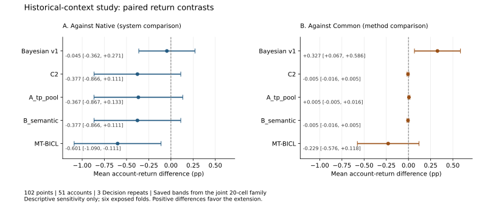
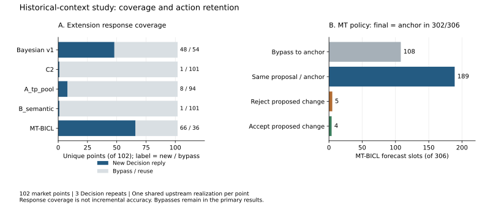

# Chapter 5. Experiments and Discussion

> **Draft status: partial chapter.** Sections 5.1–5.7 cover design and both result collections. Section 5.8 is being completed; Section 5.9 remains in progress.
> Result placeholders do not establish comparative performance. This chapter reports locked historical evidence, not newly collected experiments.

Writing aids: [chapter outline](../outline.md#chapter-5-experiments-and-discussion), [locked study inventory](../evidence.md#3-kiểm-kê-nguồn-hiện-tại-và-hai-nghiên-cứu-đã-khóa), [EX01](../evidence.md#7-ví-dụ-xuyên-suốt-có-truy-vết) and [shared evidence ledger](../evidence.md#8-khung-bản-thảo-và-đối-soát-luận-điểm).

## 5.1. Studies and evidence scope

### 5.1.1. Two response collections and two questions

The **component study** examines the price-driven pipeline with and without
alpha/sentiment report components, together with numerical controls and
small upstream/factorial panels. The **historical-context study** compares
Native, Common and historical-context extensions on one accepted shared
upstream realization per market point. It also records Fact Anchor as a
dependency role. These studies address related questions but have separate
response collections, protocol histories and statistical summaries.
Full/Base in the component study must not be relabeled MT/Common, and
Native responses in the second study are not copies of Full responses
from the first.[^study-scope]

| Scope item | Component study | Historical-context study |
| --- | --- | --- |
| Main market support | 102 stock/date points; nine stocks, 12 dates, six blocks, 51 stock/block accounts | The same 102-point market schedule; nine stocks, 12 dates, six folds, 51 stock/fold accounts per repeat |
| Main response comparison | Full (`AS`) versus Base (`B`): 204 Decision outputs, one per branch/point | Eight roles × three Decision repeats: 2,448 forecast slots, including Fact Anchor |
| Wider response support | 375 distinct Decision executions across main and the two small panels, with documented reuse | 1,290 raw Decision responses and 1,158 no-request bypass slots in the main role grid |
| Supplementary evidence | Upstream panel: nine units × three executions × two branches; factorial/placebo: nine units × three executions × five branches; numerical controls and execution scenarios | Two baseline contrast families, Common–Native / Anchor–Common / MT–Anchor bridges, registered numerical economic controls and recorded sensitivities |
| Principal collections | `revision_minimal_final_v1`, `final_repeats_v1`, `final_temporal_v1`, numerical/execution/contract artifacts | U08 hosted collection and U09 analysis artifacts, with separate receipts/source identities |
| Interpretation | Historical exploratory comparisons, post-inference analysis and prompt-family limitations | Historical exposed-cohort comparisons conditional on shared upstream; descriptive sensitivity analysis |

The 375 component executions are not obtained by adding all nominal panel
counts as if independent. Main has 204 outputs; the upstream panel has
54 branch/execution cells but reuses 18 main outputs; the factorial panel
has 135 outputs. Thus $204+54+135-18=375$. The completion record retains
193 reused outputs and 182 newly successful Decision calls, with 194 new
HTTP attempts and 12 errors. “New” is relative to that component release;
it does not count all earlier donor/vision work. Reusing a response avoids
inventing another execution, but does not turn the panel into a new sample
of market conditions.[^component-lineage]

In the context study, a forecast slot is a planned point/role/repeat output.
A bypass has a valid inherited action and provenance but no new Decision
response. Retries, format repair and retired request generations belong
to HTTP accounting, not additional market points. Numerical controls have
no hosted response. Sections 5.3–5.4 specify these units and comparisons
before the result sections report effects.

### 5.1.2. What was frozen, and what acceptance establishes

The component release is identified by run signature
`904b838a466290d9c8aa73245a6285e813b4f7c90d280355d3b2847ed9933fab`.
Its archived exposure audit places the final queue freeze at
**3 November 2026, 14:44:29.033800 UTC**, between the first recorded request
on 2 November and the last on 4 November. No decision or label date in that
audit is after the final queue freeze. The analysis is explicitly
post-inference and the immutable served-weight revision is null.
This is a versioned historical release, not a claim of preregistration or
a prospectively untouched holdout.

The context collection has its own protocol/runtime, source and journal
identities. U08's research receipt was sealed on **12 November 2026,
03:10:18.266468 UTC**; its acceptance audit was recorded at
03:17:37.298613 UTC. U09 binds that exact package and its own analysis
receipt/artifacts. These timestamps identify collection/acceptance history,
not the dates when financial information became available. Earlier donor
exposure, quota amendments and user-authorized replacements remain in the
ledger. The frozen-source snapshot and archive/member hashes identify
which implementation and records support this thesis; they do not freeze
an external hosted model into a reproducible immutable weight revision.
[^study-freezes]

Recorded PASS receipts support integrity, coverage and the checks within
their declared scopes. They do not negate the **Native row-wise causal
FAIL** or the **whole-system NOT_CERTIFIED** limitation. Nor do they certify
the historical availability of all news, exclude model memorization,
establish survivorship-free sampling or demonstrate realizable live fills.
Application browser acceptance is a separate pending gate, as Section
4.10 explains. No experiment, model call, fit or acceptance replay is
performed to write these sections.

The available component factorial/placebo evidence must not fill gaps in
the context study. A matched retrieval-only/statistics-only/no-target/
no-utility/student-versus-policy decomposition is absent from the unified
response collection. Builder support in code is not a measured ablation.
Sections 5.6–5.9 will distinguish observed effects, mechanisms and remaining
evidence needs; the design specified here does not anticipate a favorable
result or claim that adding historical context makes trading profitable.

[^study-scope]: ED01–ED03 component manifest/summary/completion; ED06–ED09 U09/U08 result/receipts and acceptance; ledger §10.1–§10.2, CL117. The shared market schedule does not make the response collections identical.
[^component-lineage]: ED03 completion and component records/panel support in ED02; CL118. The 18 reused upstream cells reconcile nominal panel counts with 375 unique executions; this is accounting, not a new performance estimate.
[^study-freezes]: ED04 contamination audit, ED05 repeat protocol, ED06–ED09 context receipts/acceptance; CL119–CL120. Ledger §3 retains source/package pins and the distinction between receipt scope and scientific validity.

## 5.2. Data and evaluation support

### 5.2.1. Vendor data, admissible views and exclusions

The reconstructed price-quality record identifies vnstock/VCI daily series
requested for 1 January 2020–30 September 2026. Each of the nine raw stock
files has 1,681 observed rows, from 2 January 2020 to 30 September 2026.
Retrieval was recorded on 1 November 2026. The record explicitly labels
these as a **new retrieval, not an authenticated historical-run snapshot**.
Observed vendor sessions are not an independently certified exchange
calendar; a complete action/dividend adjustment ledger is unavailable.
Consistent units allow the stated return calculation but do not resolve
these provenance limitations.[^data-provenance]

BHN's 13 September 2022 row has Open 43.55 below Low 43.96. The analysis
view retains the raw file but discards the prefix through that contradiction:
673 rows are excluded and the valid suffix starts on 14 September 2022.
It does not synthesize a corrected candle. BHN consequently contributes
only the last three evaluation blocks; its six absent earlier stock/date
cells are structural input exclusions, not losses or model failures.
The nine-stock/twelve-date rectangular frame would contain 108 market
cells, but actual eligible support is 102. In the component nine-strategy
grid this is 972 potential cells versus 918 admitted predictions; the 54
absent strategy cells are not additional missing market points.

Each admitted test decision requires 600 historical bars for alpha
preparation, a 45-bar chart/indicator window and three later observed
sessions for the economic label. Longer warm-up requirements of individual
indicators/resources are respected within their own history. Invalid or
unavailable required history is not filled with future data. A retrospective
loader's ability to read future outcome prices is separate from what the
forecast snapshot is allowed to contain.

### 5.2.2. Main schedule and chronological partitions

**Table B04a. Actual market schedule, shared by the two main studies.**
Each admitted stock/fold has two evaluated endpoints. These are selected
decision dates, not every daily decision in the intervening interval.

| Block/fold | First decision | Second decision | Stocks | Points | Stock/fold accounts per method/repeat |
| --- | --- | --- | ---: | ---: | ---: |
| b2023_h2 | 2023-07-03 | 2023-09-22 | 8 | 16 | 8 |
| b2024_h2 | 2024-07-01 | 2024-09-20 | 8 | 16 | 8 |
| b2025_h1 | 2025-01-02 | 2025-03-31 | 8 | 16 | 8 |
| f2025_q4 | 2025-10-01 | 2025-12-19 | 9 | 18 | 9 |
| f2026_q2 | 2026-04-01 | 2026-06-24 | 9 | 18 | 9 |
| f2026_q3 | 2026-07-01 | 2026-09-23 | 9 | 18 | 9 |
| Total | 12 distinct dates | — | 9 distinct stocks | 102 | 51 |

The component numerical-control schedule is chronological and purged.
For example, CMG in b2023_h2 has 70 training cycles and 19 validation
cycles: its last training label is dated 31 March 2023, first validation
decision 5 April, last validation label 28 June and first test decision
3 July. It has two test endpoints and 89 final-refit cycles. Across the
51 component scopes, recorded train counts range from 32 to 318 and
validation counts from 18 to 21; the source audit reports all 51 purge
checks passing. These are the component controls' recorded schedules,
not the final Common-alpha split in the second study.[^data-partitions]

The historical-context study retains all 102 donor endpoints but freezes
one Common-alpha selector per stock **before that stock's earliest test**.
The final eight non-BHN selectors use training decisions from 14 April
2021 to 30 September 2022 and validation decisions from 6 October 2022
to 27 June 2023. Each has 123 admitted train cycles; common validation
support varies from 54 to 60. BHN instead uses 20 December 2023–26 December
2024 for training and 2 January–25 September 2025 for validation, with
85 train and 56 common validation cycles. Labels must mature before the
next partition; these date ranges are decision bounds, not permission to
fit on labels before their exits.

There are 51 selector bindings but only **nine unique fitted selectors**;
later folds reuse each stock's frozen selector. The amended design discloses
an unused expanding-split prototype that computed earlier-fold query
labels, and a support amendment replacing an empty-target global context
freeze with pre-query fold freezes. Final assets exclude all 102 reserved
query IDs before historical label construction. These amendments constrain
the final path but do not erase prior exposure or convert this into a fresh
test. F02 in Chapter 3 illustrates the temporal rules; the table above
provides the actual sampled dates.

### 5.2.3. Coverage, historical resources and missing sentiment

**Table B04b. Main market support and resource coverage.** UP/DOWN are
canonical net-return labels. Missing sentiment is counted once per point
from the context study's saved shared snapshot, before expanding repeats.
The bank column describes stored signal episodes, not eligible episodes
for every query or numerical MT observations.

| Stock | Main points | Net UP / DOWN | Context sentiment unavailable | Stored signal-bank episodes |
| --- | ---: | ---: | ---: | ---: |
| BHN | 6 | 1 / 5 | 5 | 0 |
| CMG | 12 | 3 / 9 | 12 | 0 |
| FPT | 12 | 2 / 10 | 11 | 211 |
| HVN | 12 | 2 / 10 | 8 | 0 |
| MBB | 12 | 5 / 7 | 8 | 0 |
| MWG | 12 | 4 / 8 | 11 | 213 |
| VCB | 12 | 4 / 8 | 9 | 215 |
| VJC | 12 | 4 / 8 | 8 | 0 |
| VNM | 12 | 0 / 12 | 7 | 213 |
| Total | 102 | 25 / 77 | 79 | 852 |

The signal bank covers CORE4 (FPT/MWG/VCB/VNM), whose main support is
48 points; the other five stocks contribute 54. No same-stock bank means
the declared Common fallback, not cross-stock synthetic episodes. The
bank's latest exit is 30 December 2022. Its prices and the query vendor
series have different provenance: the saved audit records 828 of 852
return values differing by more than $10^{-8}$ percentage points, with maximum absolute
difference 0.04298848884252138 percentage points. That is a **return-value
comparison**, not a count of changed binary labels. Original records are
retained rather than relabeled to hide the transfer.

Numerical MT context can cover all nine stocks and is a different resource.
It uses mature cycles frozen before each fold's first query, with all
evaluation IDs withheld, and retains prior/target/query task boundaries.
The HMM, four-feature scaler and teacher/student cutoffs in Section 4.8
must not be substituted with the 2022 signal-bank cutoff. Query-local
support can still fail even where historical data exist.

Context sentiment is unavailable at 79/102 points (approximately 77.45%);
its 23 available points do not establish independent financial sentiment
validation. Component lineage also records fewer than three verified
articles at 79 of its 102 main units. The two counts have different source
fields: article-count metadata versus the shared `is_unavailable` flag.
Neither justifies treating missing text as a neutral score or excluding
those points from the primary comparison. Date metadata and conservative
next-day admission of date-only news enforce the local contract, while
content authenticity and historical availability remain limitations.
[^data-coverage]

The 96-point common-eight and 54-point recent-nine component cohorts are
overlapping sensitivity subsets of the 102, not new independent cohorts.
Likewise, CORE4 is a declared secondary context subset. Main results retain
unsupported/fallback points and their planned denominators; eligibility
must not be chosen after observing returns to create a better-looking
comparison.

[^data-provenance]: ED10 price-quality record, ED11 main predictions and ED13 fold audit; CL121. The raw nine files and BHN valid suffix have distinct identities; vendor data are not certified venue fills.
[^data-partitions]: ED13 component `folds.csv`, ED14 final U06 protocol and ED15 asset manifest `alpha_support.scopes`; CL122–CL123. Earlier component control training and the amended fixed-per-symbol Common selector have different schedules.
[^data-coverage]: ED11/ED12 main labels/lineage, ED15 bank audit/provider support and U08 shared-point metadata checked by the read-only U09 consumer; ED16 prediction grid; CL124–CL125. B04 panels use saved fields and direct counts, not a new signal, label or model evaluation.

## 5.3. Configuration and paired protocol

### 5.3.1. Runtime, model identities and offline fitting

**Table B04c. Recorded configuration of the two response collections.**
Configuration values come from their own manifests and request telemetry,
not the application's current defaults.

| Setting | Component collection | Historical-context collection |
| --- | --- | --- |
| Python | 3.13.5 | 3.13.5; full locked analysis environment records 107 packages |
| NumPy / pandas / SciPy | 2.1.2 / 2.3.3 / 1.16.1 | 2.1.2 / 2.3.3 / 1.16.1 |
| scikit-learn / TA-Lib | 1.7.2 / 0.6.8 | 1.7.2 / 0.6.8 |
| groq / langchain-core / langchain-groq | 0.37.1 / 1.2.17 / 1.1.2 | 0.37.1 / 1.2.17 / 1.1.2 |
| Pydantic | 2.11.7 | 2.11.7 |
| Hosted vision alias | `qwen/qwen3.8-27b` | `qwen/qwen3.8-27b` |
| Hosted Decision alias | `openai/gpt-oss-20b` | `openai/gpt-oss-20b` |
| Declared temperature / observed request temperature | 0 / $10^{-8}$ in archived SDK metadata | 0 / $10^{-8}$ in archived wire options |
| Maximum output tokens: vision / Decision | 1,024 / 2,048 | 960 / 960 |
| Input language / analysis timeframe | Vietnamese / 1D | Vietnamese / 1D |
| Alpha normalization / weights | `zscore_tanh` / no supplied factor-weight vector | Same declared normalization; Common additionally uses its frozen causal selector |
| Prompt constraints | Final Decision <6,500 characters | Final Decision, including repair, <6,500; prior/projection ≤600 |
| Hosted reproducibility limit | Aliases and reported metadata; immutable served-weight revision unavailable | Aliases, raw requests/responses and receipts; no claim that a future call reproduces the same served weights or response |

The component attempt ledger contains no observed API seed. A declared
zero temperature or observed near-zero value does not establish deterministic
hosted generation. In U08 the wire additionally binds `n=1`, non-streaming
requests, on-demand tier, hidden reasoning, vision effort `none` and
Decision effort `low`; SDK retries are zero. These are recorded study
options, not recommendations about current provider availability.
[^configuration-models]

Offline fitting and hosted inference must be counted separately. Component
price/logistic controls use their frozen chronological train/validation
resources; reading the final release does not refit them. Final Common
alpha has nine stock-specific fits and 51 scope bindings as Section 5.2
explains. The MT teacher uses 48 historical tasks/731 train cycles and the
student resource is the selected seed-42/step-3000 export from three
5,000-step training seeds. The training recipe, scaler/HMM cutoffs and
selection constraints are specified in Section 4.8.3. U06 preparation and
U08 collection reuse those resources; `student_teacher_hmm_training=false`
at asset preparation means **no new training in that phase**, not that the
resources were never trained. Neither collection is a fine-tuning experiment
on the hosted Decision LLM.

### 5.3.2. Pairing and execution histories

The component main comparison pairs Full/Base on the same saved upstream
reports and market input. Its main grid has one paired pass over 102 points.
The nine-unit upstream panel varies upstream realization across three
executions, with the first realization's paired outputs shared with main.
The factorial panel instead has three Decision executions on its selected
units and fixed upstream. Three panel executions do not imply three fresh
main-market runs. Main/upstream compact-alpha and factorial full-value
prompts are separate families.

Execution metadata also constrain the component interpretation: the
147 paired groups record 40 mismatches between planned job listing and
successful-request order, and nine groups cross execution epochs. Reuse,
quota routing and longest-processing-time scheduling did not guarantee
actual counterbalance. The final collection's provider-only execution
amendment removes the earlier internal attempt/deadline limits while
retaining the scientific jobs, prompts and outputs. It must not be
described using U08's later three-attempt transport rule. Outcomes are
retained rather than reordered or recollected to improve balance.
[^configuration-pairing]

The context study uses one accepted upstream realization per point and
three Decision repeats, with a fresh repeat-local dependency map. Each
repeat schedules the eight roles in Section 4.9's constrained topological
order. Common precedes its dependent roles, and Fact Anchor precedes MT.
The fixed organization assignment is $1+(i\bmod5)$ for global point index
$i$; cross-point finish order may differ across queues. All 24 forecasts
must be durable before that point's outcome is opened. There is no voting,
best-repeat selection or response borrowing across repeats.

U08's quota policy changes and explicitly authorized point/slot replacement
generations are retained as described in Section 4.10. Ordinary resume
preserves the active execution identity and attempt cap; authorized
replacements preserve retired raw evidence and phase accounting. Pairing
uses the accepted shared parent for each completed point, without denying
that failed generations existed. The recorded source/runtime signatures,
raw source IDs and output hashes establish lineage; they do not establish
independent financial observations.

### 5.3.3. Forecast, response and HTTP accounting

**Table B04d. Context roles across all three repeats.** Every role has
306 scheduled forecast slots on the same 102 market points. A no-request
bypass remains in the primary action grid.

| Role | Actual raw Decision responses | No-request bypass slots |
| --- | ---: | ---: |
| Native | 306 | 0 |
| Common | 306 | 0 |
| Bayesian v1 | 144 | 162 |
| C2 | 3 | 303 |
| A_tp_pool | 24 | 282 |
| B_semantic | 3 | 303 |
| Fact Anchor | 306 | 0 |
| MT_BICL | 198 | 108 |
| Total | 1,290 | 1,158 |

These sum to 2,448 role slots. The accepted upstream work has 102 shared
stages, 408 graph stages and 204 render stages; the graph stages include
deterministic/combined work and therefore are not 408 hosted vision calls.
The accepted Pattern/Trend work has 204 logical executions. The context
controls add two sets of numerical actions, without hosted inference.

**Table B04e. Recorded request-ledger scopes.** Success/status counts refer
to the ledger named in the row, not interchangeable output denominators.

| Ledger scope | HTTP attempts | Recorded success/status accounting |
| --- | ---: | --- |
| Component frozen-source ledger | 455 | 433 successes, 22 errors; 240 upstream and 215 Decision attempts |
| Component release's new calls | 194 | 182 successes, 12 errors; Decision only, zero new vision calls |
| U08 entire research ledger | 1,702 | 1,505 HTTP 200, 194 HTTP 429, one HTTP 503, two UNKNOWN |
| U08 active ledger | 1,687 | 1,495 HTTP 200, 191 HTTP 429, one HTTP 503 |
| U08 retired records, retained in entire ledger | 15 | Ten HTTP 200, three HTTP 429 and two UNKNOWN |

An HTTP 200 is not by itself a schema-valid selected forecast: request
attempts may include parse/repair history. Thus neither 1,505 nor 1,495
replaces 1,290 raw Decision outputs. The U08 receipt records at most three
attempts per active execution and a maximum final Decision text of 4,750
characters including repair. It retains 9,177 reserved tokens for the two
uncertain retired sends and records 2,986,930 observed tokens in the entire
ledger. Observed tokens do not establish billing for failed/uncertain
requests. Smoke/history carry and the numerical analysis phase have their
own scopes; U09's `new_api_calls=0` describes analysis, not an absence of
hosted collection in U08.[^configuration-counts]

Each method has 51 account paths per repeat; the context study therefore
has 153 method-specific account paths across three repeats, not 153
independent accounts. Main statistical aggregation first respects those
repeats and 51 account identities. The number of sampled market points
remains 102, with only six exposed temporal clusters. Source counts,
attempt counts and repeated decisions cannot be added to that denominator.

[^configuration-models]: ED01 component runtime, ED17 attempt metadata, ED20/ED21 component manifests and ED22 U08 runtime; U09 input runtime in ED07; CL126–CL127, ledger §10.4. Declared temperatures are distinguished from observed SDK/wire values.
[^configuration-pairing]: ED02/ED03 component summaries, ED19 pairing and ED20 provider-only execution policy; ED14/ED22 U08 protocol/runtime, plus Chapter 4 source bindings SYS44–SYS57; CL128. Scientific pairing and actual successful-call ordering are different facts.
[^configuration-counts]: ED03/ED17/ED18 component completion/attempt/cost ledgers and ED08/ED09 U08 acceptance/receipt; U09 telemetry in ED07; CL129–CL130. Counts are read from archived records, including retired HTTP, without replaying requests or measuring new latency/usage.

## 5.4. Comparators and interventions

### 5.4.1. Component main controls and response interventions

The main component grid contains Full (`AS`), Base (`B`) and seven numerical
controls, each evaluated on the same 102 units and net labels. Full adds
the alpha and sentiment report sections to the shared price-report pipeline;
Base removes those report sections. Remaining decision rules may still
mention alpha or sentiment, so this is a report/routing intervention, not
the removal of every related concept from the model's instructions.

| Main component control | Recorded rule or fitted input | Interpretation |
| --- | --- | --- |
| `constant_down_cash` | Always predict SHORT and retain CASH | Majority-class/economic inactivity reference; no short sale |
| `constant_up_cycles` | LONG on each registered cycle, with full entry/exit costs | Cycle timing/cost reference |
| `train_majority` | LONG only if the training positive-label share exceeds 0.5; otherwise CASH | Train-only class-frequency rule; ties do not become LONG |
| `momentum_20` | LONG iff trailing 20-session price return is positive | Simple price-direction rule |
| `logistic_price` | Logistic model on recorded price-derived features | Numerical price-information reference |
| `logistic_matched_market_inputs` | Logistic model on the recorded numerical market-feature bundle, including factor/sentiment and missingness inputs | Broader numerical-information reference; not access to image interpretations or all LLM reasoning |
| `factor_only_vote` | Median-center factor values and estimate orientations on train; LONG iff the oriented sign-vote mean is positive | Fixed factor-universe numerical vote, distinct from dynamic top-five LLM input |

The logistic recipe chooses $C\in\{0.01,0.1,1,10\}$ and threshold in the
ordered grid $(0.5,0.4,0.6)$ by validation balanced accuracy; ties retain
the first encountered setting. Median imputation with missing indicators
and standardization are fitted inside the training pipeline, then refitted
with the chosen model on train plus validation. The solver is lbfgs with
maximum 3,000 iterations. Frozen predictions/models are reused where the
recorded provenance permits it; this thesis does not train them again or
claim the broader numerical model exactly matches the LLM's information
processing.[^component-comparators]

The **upstream panel** has nine selected units, two branches and three
realizations, giving 54 paired cells with 18 outputs shared with main.
It examines variability conditional on that small selected panel, not
the variance of all 102 main predictions.

The **factorial/placebo panel** uses nine selected units, five branches and
three Decision executions, giving 135 outputs on eight stocks/four dates.
Its branches are B (neither report), A (current alpha), S (current sentiment),
AS (both), and P (sentiment plus a past-donor alpha-value control). The
full-value prompt family differs from compact-alpha main/upstream prompts.
The donor intervention retains current names/headings/schema/missingness
but replaces the scalar/sign/skill values using one past donor rank-vector;
it is not an independent per-factor shuffle or an identity-matched donor
covariance experiment.

The seven factorial contrasts are AS−B, A−B, AS−S, S−B, AS−A, AS−P and
$\mathrm{AS}-\mathrm{A}-\mathrm{S}+\mathrm{B}$. The last is a factorial
contrast of recorded scores, not proof of causal synergy. The final panel
selection is round-robin by stock and increasing date using locked metadata.
Its shared support and prompt family remain explicit; results from a larger
parent panel are not substituted into the selected nine-unit report.

### 5.4.2. Separate factor-selection and economic controls

The separate **numerical factor-selection experiment** has 23 strategies
on the same 102 test units: fixed custom five, dynamic train-selected top
five, the same dynamic five without sign flipping, and 20 random eligible
five-factor sets (`random_seed_00`–`random_seed_19`). It produces
$23\times102=2,346$ test actions across 51 fit scopes, with no hosted calls.
Random sets are drawn within each scope from its train-eligible factors;
the 20 trials are all retained rather than selecting the best seed.

The fixed set is CURRENT_1_FDM, CURRENT_2_SFA, CURRENT_3_LVR,
CURRENT_4_BFE and CURRENT_5_OFE. Train statistics determine imputation,
scaling, eligibility, ranking and sign orientation. Each selected normalized
factor contributes −1/0/+1 using the strict ±0.1 threshold; a positive
mean of the five votes yields LONG, ties CASH. Ineligible fixed slots
abstain instead of being replaced. The no-flip strategy preserves the
selected IDs while removing orientation flips; it does not rerank a new
set. These train-only numerical rules differ from the Native per-cutoff
selector and cannot be reported as matched LLM selector ablations.
[^factor-controls]

Economic references also require distinct names. **Always-LONG cycles**
enters/exits on each sampled cycle and stays in CASH between cycles,
incurring two-way costs each time. **Continuous holding** carries exposure
through the gaps and therefore has a different schedule and turnover.
The component financial report includes `continuous_hold_price_only` as
a separately labeled price-only benchmark, not another classification
prediction on 102 entries. The unified context study explicitly excludes
continuous holding from its registered controls; it contains only
CASH_EVERY_CYCLE and ALWAYS_LONG_EVERY_CYCLE_WITH_FULL_COSTS on the same
canonical cycle outcomes.

The component execution extension contains 12 recorded scenarios, varying
cost/settlement/financing/lot/participation or fill proxies under its locked
policy. Predictions, labels and original support remain fixed; only the
economic mapping is varied. It is not a new Decision experiment or a
venue-certified worst-case bound. In particular, a no-fill screen can
avoid a loss or miss a gain; it does not establish that the strategy knew
the ex-post daily-bar condition at entry. These scenario results belong
to their own support/assumption panel, not the canonical label definition.

### 5.4.3. Context baseline families, bridges and absent ablations

For every context extension $E$ in {Bayesian v1, C2, A_tp_pool, B_semantic,
MT_BICL}, the study retains both baselines:

| Contrast family | Compared outputs on common support | What the contrast can describe |
| --- | --- | --- |
| System | $E-\mathrm{Native}$ | Whole package, including declared alpha/report/prompt/context/policy differences |
| Method | $E-\mathrm{Common}$ | Added method package conditional on the Common foundation |
| Bridge 1 | Common − Native | Foundation/report/prompt transformation |
| Bridge 2 | Fact Anchor − Common | Factual anchoring plus changed instructions/response format |
| Bridge 3 | MT_BICL − Fact Anchor | Context/student/utility/proposal/policy package relative to its anchor |

Every main family uses all 102 points, three repeats and 51 accounts per
repeat. A fallback stays in the denominator, and a paired comparison does
not select only points where both methods issued fresh LLM calls. The two
main families have five extension contrasts each for **two endpoints**,
balanced accuracy and mean account return: 20 main endpoint/contrast cells.
The three bridges are reported separately. Fact Anchor is both a recorded
role and a dependency, not one of the five extensions used to enlarge the
main family after seeing results.[^context-comparators]

The unified response collection does **not** contain matched
random/recent/similarity/Bayesian retrieval interventions, statistics-only/
examples-only/no-regime interventions, or the planned Plain_revision,
No_utility, No_target, Stats_only and Utility_only panel. The protocol and
result artifact mark them deferred. Existing builders, component factorial
experiments or the 23 numerical strategies do not supply those missing
responses. The Anchor ladder can describe the observed package differences,
but cannot isolate a causal student contribution or certify that the
utility gate alone explains a performance difference.

[^component-comparators]: ED11 main variant grid, ED05 final repeat protocol, ED20 component configuration; ES01/ES02 numerical recipe/source and archived provenance §3.2; CL131–CL132, ledger §10.5. Definitions do not substitute newly fitted controls for frozen predictions.
[^factor-controls]: ED23–ED25 factor-control run/summary/inference, ED27 protocol and ES03 design source; ED26 execution scenario policy; CL133–CL134. Source field `eligible_train_range` counts eligible factors, not training rows. Continuous-hold interpretation also follows the component financial artifact inventoried in §3.2.
[^context-comparators]: ED14 family/control registration, ED07 U09 `contrasts/bridge/deferred_panels`; CL135–CL136. Common differs from component Base, and each bridge is a package contrast rather than a single-cause ablation.

## 5.5. Metrics and statistical analysis

### 5.5.1. Classification, support and undefined values

Evaluation uses the **final** action: LONG predicts UP and CASH predicts
DOWN, where $y=1$ iff the canonical net LONG return is strictly positive.
Zero is DOWN. A raw SHORT proposal is an executable CASH action, not a
negative payoff from selling stock short. Let TP/FN count UP cases and
TN/FP count DOWN cases; $N=TP+FN+TN+FP$. The reported classification
definitions are

$$
\mathrm{Accuracy}=\frac{TP+TN}{N},\qquad
\mathrm{BA}=\frac12\left(\frac{TP}{TP+FN}+\frac{TN}{TN+FP}\right),
$$

$$
\mathrm{MCC}=\frac{TP\,TN-FP\,FN}
 {\sqrt{(TP+FP)(TP+FN)(TN+FP)(TN+FN)}},\qquad
\mathrm{LONG\ rate}=\frac{TP+FP}{N}.
$$

For UP, precision is $TP/(TP+FP)$, recall is $TP/(TP+FN)$ and
$F1_{UP}=2TP/(2TP+FP+FN)$. Swap UP/DOWN to obtain the negative-class
metrics; macro-F1 is $(F1_{UP}+F1_{DOWN})/2$ when both are defined.
“Macro-F1” across classes is different from a macro average across stocks.
Classification fractions are converted to percent only where the output
field/caption says percent; a difference between percentages is in
**percentage points (pp)**, not relative percent improvement.
[^classification-contract]

Zero denominators produce null/NA with reasons. BA is undefined without
both true classes; constant predictions can make MCC undefined even when
accuracy and BA are defined. F1 can equal zero when its denominator is
positive, but a zero denominator is not silently replaced with zero.
For example, the all-CASH rule on the stated 25-UP/77-DOWN support has
accuracy $77/102$ and BA $0.5$, while MCC is undefined. This arithmetic
illustrates class imbalance, rather than introducing a newly measured
result. VNM has no UP labels, so stock-level BA is undefined; a macro-stock
summary must report its defined-stock denominator instead of averaging
an invented VNM score.

Component main classification pools its 102 points once per method and
also reports per-stock/per-block and macro-stock summaries with planned,
defined and undefined counts. Context classification first computes each
repeat's metric on the full 102-point pool, then averages the three metric
values. It does not select the best repeat or compute an uncertainty sample
as if 306 forecasts were independent market outcomes. A context summary
metric is null if any required repeat value is undefined; subgroup reports
retain their own missing-class reasons. Sample SD across three repeat
summaries (`ddof=1`) measures conditional response variability, not market
sampling uncertainty.

For recorded numerical probabilities, supported-only Brier score is
$N_p^{-1}\sum_{i\in\mathcal P}(p_i-y_i)^2$, accompanied by $N_p$ forecast
count and the number of distinct points. Undefined/unsupported probabilities
are not filled with 0.5. This is a restricted numerical-target diagnostic;
LLM confidence labels are not mapped to probabilities and no calibrated
LLM-confidence claim follows from it.

### 5.5.2. Net economics, account aggregation and risk conventions

The canonical candidate LONG payoff is

$$r_i=\frac{C_{t_i+3}}{O_{t_i+1}}
 \frac{(1-0.001)(1-0.0025)}{(1+0.001)(1+0.0025)}-1.$$

This includes slippage and brokerage on both sides. For action indicator
$a_i=\mathbf1\{\mathrm{LONG}\}$, strategy return per cycle is $z_i=a_i r_i$;
CASH is zero. The gross diagnostic and execution scenarios do not replace
the fixed net labels. The target audit records seven gross/net label
disagreements and 65 cases where entry Open differs from decision Close;
neither Close-to-Close nor an unverified legacy price alias substitutes for
the specified oracle.

Reference accounts start with VND 50 million, use fractional all-in LONG
positions and retain CASH between nonoverlapping sampled cycles. For
account $q$ and method/repeat $(m,r)$,

$$R_{qmr}=\prod_{i\in q}(1+z_{imr})-1.$$

Primary component financial comparisons take an equal mean of the 51
stock/fold account returns for a method. Primary context return is

$$\bar R_m^{(\%)}=\frac{100}{51}\sum_{q=1}^{51}
 \left[\frac13\sum_{r=0}^{2}R_{qmr}\right].$$

Thus repeats are averaged within account before accounts are averaged.
The implementation's mean over all 153 complete account paths is
algebraically identical on this balanced grid. A contrast is the difference
of these method estimators, in pp. It is not the average one-cycle payoff,
a single capital stream across folds, or a market portfolio.
The separate 23-strategy panel's headline `mean_symbol_return_pct` averages
its **nine stock-level accounts**, with cycles compounded across each
stock's recorded schedule; its 51 scope accounts remain separate outputs.
That statistic must not be silently relabeled the primary 51-account mean.
[^economic-estimators]

Daily NAV marks stock at the observed close and cash after exit costs,
including a starting-capital anchor. Maximum drawdown is reported as a
nonnegative percentage,

$$\mathrm{MDD}=100\max_d\left(1-\frac{V_d}{\max_{u\le d}V_u}\right).$$

Full EOD NAV drawdown differs from drawdown computed only at cycle ends.
The context account spans the first query through the last exit, including
the first query's initial cash observation. The component reference daily
ledger starts at its first entry with a separate initial-capital anchor.
Both retain intervening cash sessions. Mean account MDD and worst-account
MDD are different summaries; neither is the drawdown of a constructed
portfolio. Fractional accounting, immediate reference cash availability
and daily marks do not certify settlement, round-lot capacity, taxes,
dividends or actual fills.

| Quantity | Component reference | Context reference |
| --- | --- | --- |
| Costs | Sum recorded brokerage/slippage in VND; already included in net returns | Same distinction between VND costs and net return fractions |
| Held-session fraction | Sessions with an intraday holding, including exit session, divided by recorded account sessions | Same held-session indicator, on the context account's query-to-exit window |
| Close exposure | Position survives that session's close; exit close is cash | Kept distinct from held-session fraction; do not infer an unrecorded close-exposure field |
| Turnover | Daily buy/sell quoted notional divided by preceding NAV, then summed/averaged as labeled | Sum quoted buy/sell notional in VND and divide by initial capital for `turnover_over_initial` |
| Orders versus exposure | Two orders per completed LONG cycle; no orders for CASH | Action/holding counts differ from API calls and from traded notional |

**Risk ratios keep their recorded conventions.** Component daily risk
artifacts use daily NAV returns $d_j$, population SD (`ddof=0`), zero
risk-free/MAR and nominal 252-period scaling. The reported Sharpe is
$\sqrt{252}\,\bar d/\mathrm{SD}_{pop}(d)$. Its legacy Sortino denominator
is the population SD of the **negative-return subset**, not downside RMS:
$\sqrt{252}\,\bar d/\mathrm{SD}_{pop}(d\mid d<0)$.
A denominator no larger than $10^{-12}$ is undefined. The separate sparse
cycle-frequency audit can leave annualized ratios null when the schedule
is insufficient or gapped. Nominal daily scaling in a recorded artifact
does not validate annualizing the two sampled cycle returns as daily data.

Context primary ratios are **unannualized cycle diagnostics**:

$$\mathrm{Sharpe}_{cycle}=\frac{\bar z}{s_z},\quad s_z:\mathrm{ddof}=1;
\qquad
\mathrm{Sortino}_{LPM2}=\frac{\bar z}
 {\sqrt{N^{-1}\sum_i\min(z_i,0)^2}}.$$

Here the downside denominator uses all scheduled cycles, including zeros,
with MAR=0. Zero denominators remain null. Account-level and per-repeat
pooled-cycle ratios have their stated scopes; averaging ratios is not
the same as recomputing a ratio on an invented portfolio. The context
summary leaves annualized metrics null. Ratios from these two studies
must not be ranked as though they shared a frequency or downside definition.
[^risk-conventions]

### 5.5.3. Paired resampling and descriptive uncertainty

All reported resampling operates on saved predictions/actions and outcomes,
with the same sampled blocks applied to compared methods. It does not
rerun hosted models, refit selectors or replace invalid draws until a
desired interval appears. The procedures are study-specific:

| Evidence family | Recorded paired procedure | Interpretation retained |
| --- | --- | --- |
| Component main | 10,000 whole-market-block draws across six blocks, seed 20261102; pool confusion within each draw; percentile intervals on finite draws | Preserve all symbols/dates/methods in a drawn block; report missing-class/undefined draws |
| Component upstream/factorial | Saved block and execution resampling weights, 10,000 draws, seed 20261102; retain three-execution structure | Small selected-panel conditional variability, not new market replications |
| Factorial seven-BA family | Centered maximum absolute deviation across the seven contrasts on their jointly finite draws | Unstandardized descriptive sensitivity envelope; not calibrated simultaneous coverage |
| Numerical factor-selection family | Paired six-block bootstrap, 10,000 draws, seed 0; exact $2^6=64$ block sign assignments and Holm over all 23 BA contrasts | Diagnostic symmetry/exchangeability assumptions remain unverified; no confirmatory LLM ablation |
| Context main 20-cell family | Circular moving-block bootstrap across six chronological folds, length 2, 10,000 draws, PCG64 seed 20261110; shared indices for both endpoints and all methods/repeats | Max-standardized descriptive band conditional on six exposed clusters |

The component main intervals and the factorial seven-contrast envelope
are not the context joint band. In the factorial artifact 6,986 draws are
jointly finite and 3,014 are undefined; its recorded envelope conditions
on those finite draws. It does not satisfy or use the context-specific
9,500-draw admission rule. Numerical-control `dynamic_vs_random_mean`
compares the dynamic score with the mean score over all 20 trials,
not an ensemble or the best random trial. Its sign-flip statistic uses
fixed full-support class weights; its bootstrap recomputes class support
for each sampled block set. Holm preserves the 23-contrast family even
when a value is undefined.[^component-uncertainty]

For the context band, let $\hat\delta_j$, $j=1,\ldots,20$, denote the ten
account-return contrasts followed by the ten BA contrasts. Circular
length-two blocks select six fold positions per draw. All stocks and
both endpoints within a fold remain paired; sampled copies retain
account resets rather than compounding separate folds together. Account
support, including BHN's structural absence in early folds, determines
the account-mean denominator in each draw. BA is pooled separately per
repeat and then averaged, as for the point estimator.

With $s_j$ the bootstrap sample SD on the **jointly finite** draws, define

$$M_b=\max_j\frac{|\delta^*_{bj}-\hat\delta_j|}{s_j},\quad
c=Q_{.95}^{\mathrm{higher}}(M),\quad
\mathcal B_j=[\hat\delta_j-cs_j,\hat\delta_j+cs_j].$$

The band is admitted only if at least 9,500 of 10,000 draws are jointly
finite, point estimates are finite and every column has finite nonzero SD.
Otherwise the **whole family** has null bands and explicit reasons;
zero-variance contrasts are not dropped to open a more favorable family.
The saved primary U09 family has 10,000 finite draws and no zero-SD
columns. This is a reported finite-sample sensitivity construction, not
a proof of 95% coverage, statistical superiority, power or generalizable
profitability.

Recorded context sensitivities use block lengths 1 and 3, CORE4,
leave-one-fold-out and leave-one-stock-out. Component common-eight/
recent-nine, leave-one-block, circular-block and panel-HAC diagnostics
retain their own definitions and are secondary. They do not create
additional independent datasets or a license to choose the narrowest
band. With six historical clusters, shared dates, reused inputs and prior
exposure, stronger causal or confirmatory claims would require evidence
beyond these reported comparisons.[^context-uncertainty]

[^classification-contract]: ES04/ES06 context classification and ES07/ES09 component metric definitions; ED07/ED11 saved support; CL137–CL138, ledger §10.6. NA/defined counts are part of the metric contract, not omitted observations.
[^economic-estimators]: ES04–ES06 account estimator, ES01 reference ledger, ED07 definitions and ED30 target audit; ED24 separate numeric headline; CL139–CL140. Labels and economic mappings retain the canonical two-way costs and source units.
[^risk-conventions]: ES06 context `cycle_ratios/account`, ES07 recorded component daily-risk recipe, ES10 legacy risk/frequency convention and ED31 risk audit; CL141. No ratio is silently recomputed under another study's denominator or annualization.
[^component-uncertainty]: ED28 primary dependence, ED29 seven-BA family, ED05 panel protocol, ED25/ED27 numerical family and ES07/ES08 procedures; CL142. Stored draws/intervals are read, not regenerated.
[^context-uncertainty]: ES05 `indices/estimates/bands`, ED07 joint-family metadata and sensitivities; CL143–CL144. The 20-cell band includes both baselines/endpoints and preserves its predeclared scope; no bootstrap is newly executed for this text.

## 5.6. Component-study results

The full component system improves some classification measures over Base
on the recorded main sample, but its mean account return is slightly
lower. Price-only logistic regression has higher pooled BA than Full,
and CASH has a higher mean return than every active main comparator.
The small upstream and factorial panels give different rankings. Together,
these observations support a conditional description of the system's
behavior, rather than a general advantage from adding alpha and sentiment.
All results below use the locked component collection introduced in
Section 5.1. They are separate from the historical-context results in
Section 5.7.

### 5.6.1. Main comparison and economic outcomes

**Table B05a. Main component comparison.** Classification uses the same
102 points, with 25 UP and 77 DOWN labels, nine stocks, twelve dates and
six blocks. Each financial mean uses 51 separate stock–fold accounts.
Acc., BA and LONG rate are percentages; MCC and macro-F1 are unitless.
Returns and positive-magnitude EOD maximum drawdowns are percentages,
averaged equally across accounts under the fractional reference ledger.
The continuous-hold control has no pointwise classification output:
its classification entries are NA, while its recorded financial
support is 51 accounts. Display precision is three decimals; contrasts
use the saved unrounded values.[^component-main-results]

| Method | Acc. (%) | BA (%) | MCC | Macro-F1 | LONG (%) | Mean return (%) | Mean MDD (%) |
| --- | --- | --- | --- | --- | --- | --- | --- |
| Full | 65.686 | 52.961 | 0.060 | 0.530 | 23.529 | -0.797 | 1.367 |
| Base | 60.784 | 49.714 | -0.005 | 0.496 | 28.431 | -0.750 | 1.453 |
| CASH | 75.490 | 50.000 | NA | 0.430 | 0.000 | 0.000 | 0.000 |
| Train-majority | 75.490 | 50.000 | NA | 0.430 | 0.000 | 0.000 | 0.000 |
| Always-LONG cycles | 24.510 | 50.000 | NA | 0.197 | 100.000 | -3.000 | 4.523 |
| Momentum 20 | 49.020 | 47.325 | -0.046 | 0.449 | 48.039 | -1.636 | 2.576 |
| Logistic price | 67.647 | 55.610 | 0.114 | 0.557 | 23.529 | -0.683 | 1.177 |
| Logistic matched inputs | 60.784 | 52.416 | 0.044 | 0.518 | 32.353 | -1.105 | 1.602 |
| Factor vote | 51.961 | 51.974 | 0.034 | 0.483 | 49.020 | -1.457 | 2.488 |
| Continuous hold (price only) | NA | NA | NA | NA | NA | -2.127 | 12.939 |

Full's pooled BA is 52.961%, compared with 49.714% for Base: a difference
of **+3.247 percentage points (pp)**. Accuracy increases by 4.902 pp and
MCC moves from a small negative value to 0.060. This gain does not imply
strong UP detection. Table B05b shows that both methods identify only
7 of the 25 UP outcomes, giving UP recall of 28.000%. Full has five fewer
false positives in aggregate, while retaining the same true-positive
count; this is an aggregate confusion comparison, not a claim that
exactly five individual actions changed.

**Table B05b. Full/Base confusion counts and recorded exposure.** TP/FN
refer to UP; TN/FP refer to DOWN. LONG/CASH counts sum to 102. Exposure
columns are means of the 51 account fractions over the ledger calendar,
including cash gaps; they are distinct from the fraction of scheduled
decisions classified LONG.[^component-main-results]

| Method | TP | FN | TN | FP | LONG | CASH | Held sessions (%) | Close exposure (%) |
| --- | --- | --- | --- | --- | --- | --- | --- | --- |
| Full | 7 | 18 | 60 | 17 | 24 | 78 | 2.353 | 1.569 |
| Base | 7 | 18 | 55 | 22 | 29 | 73 | 2.843 | 1.895 |

The majority DOWN class explains why CASH and train-majority reach
75.490% accuracy despite BA of 50.000%, no UP detections and undefined
MCC. They retain their NA values rather than being assigned zero MCC.
Full's BA exceeds these constant controls by only 2.961 pp. Logistic
price reaches BA of 55.610% and MCC of 0.114, both above Full. The matched
input logistic control reaches BA of 52.416%, slightly below Full, while
the factor vote reaches 51.974%. These are observed rankings under their
recorded representations and fitting protocols, not evidence that all
comparators received identical information in identical form.

The saved six-block percentile interval for Full minus Base BA is
**[−1.176, 8.125] pp**, from 10,000 draws with no undefined draws. All
eight saved main BA intervals comparing Full with the other classification
methods include zero. As specified in Section 5.5, these are descriptive
historical block-bootstrap intervals, not evidence of confirmed
superiority or calibrated coverage.[^component-main-uncertainty]

Full's mean net account return is −0.797%, compared with −0.750% for
Base. The unrounded difference is **−0.047 pp**, so the classification
improvement does not translate into a higher mean return. Full does have
lower average drawdown and lower held-session exposure than Base, but
both returns remain negative. Among active main comparators, logistic
price has the least negative mean return, −0.683%; CASH and train-majority
remain at 0.000%. Always-LONG cycles lose 3.000% on average. The
continuous-hold result, −2.127%, belongs to a different holding rule and
cannot be treated as an always-LONG classification strategy.

The divergence between BA and return is expected to be possible under
the estimators in Section 5.5: classification counts outcomes, whereas
account returns depend on the magnitude and sequence of selected net
cycles. Lower exposure can reduce losses and drawdown without establishing
a profitable signal. These account averages are neither an investable
multi-stock portfolio return nor an execution-certified performance
record.

### 5.6.2. Stock and temporal-block patterns

**Table B05c. Full/Base BA on every recorded stock and block.** Each row
uses its own shared Full/Base support; stock rows and block rows are two
overlapping partitions of the same 102 points. NA means that BA is
undefined because one outcome class is absent. The rows must not be
summed together or treated as independent replications.[^component-groups]

| Group | Points | UP/DOWN | Full BA (%) | Base BA (%) |
| --- | --- | --- | --- | --- |
| symbol: BHN | 6 | 1/5 | 100.000 | 80.000 |
| symbol: CMG | 12 | 3/9 | 44.444 | 61.111 |
| symbol: FPT | 12 | 2/10 | 40.000 | 30.000 |
| symbol: HVN | 12 | 2/10 | 60.000 | 60.000 |
| symbol: MBB | 12 | 5/7 | 48.571 | 55.714 |
| symbol: MWG | 12 | 4/8 | 56.250 | 50.000 |
| symbol: VCB | 12 | 4/8 | 50.000 | 37.500 |
| symbol: VJC | 12 | 4/8 | 43.750 | 37.500 |
| symbol: VNM | 12 | 0/12 | NA | NA |
| block: b2023_h2 | 16 | 3/13 | 38.462 | 34.615 |
| block: b2024_h2 | 16 | 7/9 | 49.206 | 49.206 |
| block: b2025_h1 | 16 | 0/16 | NA | NA |
| block: f2025_q4 | 18 | 7/11 | 59.740 | 55.195 |
| block: f2026_q2 | 18 | 6/12 | 45.833 | 45.833 |
| block: f2026_q3 | 18 | 2/16 | 62.500 | 50.000 |

The aggregate result is heterogeneous. Full has higher BA on five stocks,
lower BA on CMG and MBB, and the same BA on HVN. VNM has no UP outcome,
so its BA is undefined for both methods. BHN's apparently perfect Full
BA comes from only six observations with one UP outcome, over its shorter
admissible history. It therefore cannot support a broad stock-specific
performance claim. Full's BA is below 50% on CMG, FPT, MBB and VJC.

Among the five blocks with defined BA, Full exceeds Base in three and
ties it in two. The remaining block, `b2025_h1`, contains sixteen DOWN
outcomes and no UP outcomes. Full is itself below 50% BA in three of the
five defined blocks. These small, uneven supports explain why pooled
and equal-stock summaries answer different questions. No stock or block
is removed from the primary result because its outcome is unfavorable
or its BA is undefined. Additional cohort and dependence sensitivities
belong to the later robustness analysis.

### 5.6.3. Separate numerical factor controls

**Table B05d. Numerical five-factor controls.** Each strategy is evaluated
on the same 102 points with 25 UP and 77 DOWN outcomes. The 23 strategies
comprise three named rules and all twenty random-factor trials. The last
row reports the mean of the twenty trial metrics, not an ensemble's
actions. Unlike B05a, the return column is the saved mean of **nine
stock-level account returns**, not the mean of 51 stock–fold accounts;
its level should not be ranked directly against B05a.[^component-numeric-results]

| Numerical strategy | Acc. (%) | BA (%) | MCC | LONG (%) | Mean stock return (%) |
| --- | --- | --- | --- | --- | --- |
| Fixed five | 49.020 | 39.221 | -0.193 | 36.275 | -8.653 |
| Train-ranked five | 62.745 | 55.065 | 0.093 | 32.353 | -5.648 |
| Same five, no sign flip | 50.980 | 48.623 | -0.024 | 46.078 | -7.608 |
| Random five (mean of 20) | 51.275 | 47.738 | -0.039 | 44.216 | -8.097 |

Train-ranked factors improve pooled BA over the fixed set by 15.844 pp,
over the random-trial mean by 7.327 pp, and over the same selected IDs
without sign flipping by 6.442 pp. Their mean stock return is nevertheless
negative at −5.648%. All twenty random trials also have negative mean
stock returns. The saved random BA dispersion is 47.738% ± 5.377 pp
(mean ± trial SD), with range [37.974%, 57.169%]; mean stock return is
−8.097% ± 1.404 pp, with range [−10.414%, −5.537%]. These are variations
across retained random factor sets, not confidence intervals over future
markets. No favorable seed is selected.

**Table B05e. Three declared numerical contrasts within the full family
of 23 diagnostics.** BA differences and saved percentile intervals are
in pp. The exact two-sided diagnostics use all 64 block-sign assignments;
Holm adjustment uses all 23 contrasts, including the twenty individual
random-trial comparisons.[^component-numeric-results]

| Recorded contrast | BA difference (pp) | Percentile interval (pp) | Exact p | Holm p (23) |
| --- | --- | --- | --- | --- |
| dynamic_vs_fixed | 15.844 | [6.817, 25.217] | 0.06250 | 1.000 |
| dynamic_vs_random_mean | 7.327 | [0.567, 13.748] | 0.12500 | 1.000 |
| dynamic_vs_no_flip | 6.442 | [-10.932, 20.263] | 0.53125 | 1.000 |

The first two percentile intervals exclude zero, whereas their exact
diagnostic p-values exceed 0.05 and their Holm-adjusted values are 1.000.
These procedures have different constructions and should be reported
together rather than selecting the favorable output. There are zero
Holm rejections in the full recorded family. With only six exposed
blocks and unverified symmetry/exchangeability, none of these diagnostics
establishes a confirmatory effect. This panel compares numerical factor
rules; it does not isolate the LLM factor selector or show that the
full agent system benefits causally from train-ranked factors.

### 5.6.4. Upstream variation and alpha–sentiment–placebo panel

**Table B05f. Separate small panels, with all three realizations retained.**
Entries are the saved mean ± sample SD of three execution-level metrics;
the SD is in the displayed metric's units. Each execution uses nine
points with two UP and seven DOWN outcomes across three blocks. The
upstream panel covers nine stocks/three dates and nine accounts per
branch/execution; the factorial panel covers eight stocks/four dates and
eight accounts per branch/execution. Returns are execution-level means
of those accounts, then summarized over executions. The panels' supports
are different from one another and from the main sample.[^component-panel-results]

| Panel | Branch | BA (%) | MCC | LONG (%) | Mean account return (%) |
| --- | --- | --- | --- | --- | --- |
| upstream | AS | 95.238 ± 4.124 | 0.837 ± 0.141 | 29.630 ± 6.415 | 0.496 ± 0.222 |
| upstream | B | 90.476 ± 10.911 | 0.745 ± 0.261 | 37.037 ± 16.973 | 0.371 ± 0.378 |
| factorial | A | 19.048 ± 4.124 | -0.518 ± 0.069 | 48.148 ± 6.415 | -2.034 ± 0.314 |
| factorial | AS | 19.048 ± 10.911 | -0.537 ± 0.196 | 48.148 ± 16.973 | -2.228 ± 0.632 |
| factorial | B | 28.571 ± 7.143 | -0.381 ± 0.096 | 33.333 ± 11.111 | -1.699 ± 0.551 |
| factorial | P | 30.952 ± 4.124 | -0.347 ± 0.053 | 29.630 ± 6.415 | -1.415 ± 0.331 |
| factorial | S | 14.286 ± 0.000 | -0.598 ± 0.000 | 55.556 ± 0.000 | -2.342 ± 0.220 |

In the upstream panel, Full averages 95.238% BA and 0.496% account return,
compared with Base's 90.476% and 0.371%. The Full minus Base BA difference
is +4.762 pp; the saved conditional percentile interval is [0.000,
10.000] pp, with 6,986 finite and 3,014 undefined draws. The mean pairwise
action-disagreement rates across the three realizations are 7.407% for
Full and 22.222% for Base. The 54 panel decisions include eighteen main
decisions also used in this panel, so they are not 54 additional
independent observations. These favorable small-panel outcomes do not
replace the negative main financial result. They also do not estimate
separate upstream and Decision variance components.

In the factorial panel, `B` removes the alpha/sentiment report sections,
`A` supplies alpha, `S` supplies sentiment, `AS` supplies both, and `P`
combines sentiment with the past-donor alpha-value control defined in
Section 5.4. All five branches have mean BA below 50%, negative MCC and
negative mean account returns. Full (`AS`) has BA of 19.048%, below
Base's 28.571%, and mean return of −2.228%, below Base's −1.699%.
The placebo branch has BA of 30.952% and mean return of −1.415%, both
above Full within this panel. These adverse comparisons remain in the
result. The positive interaction contrast below does not imply that Full
beats Base or placebo, or that the combined information is beneficial.

**Table B05g. Complete seven-contrast factorial BA family.** Differences
are computed from the saved unrounded execution means. The last row is
`AS − A − S + B`. Envelopes are the saved joint-finite maximum-absolute-
deviation sensitivity construction, converted to pp; they are not the
historical-context study's standardized simultaneous bands.[^component-panel-results]

| Factorial BA contrast | Difference (pp) | Joint-finite sensitivity envelope (pp) |
| --- | --- | --- |
| AS-B | -9.524 | [-37.143, 18.095] |
| A-B | -9.524 | [-37.143, 18.095] |
| AS-S | 4.762 | [-22.857, 32.381] |
| S-B | -14.286 | [-41.905, 13.333] |
| AS-A | 0.000 | [-27.619, 27.619] |
| AS-P | -11.905 | [-39.524, 15.714] |
| interaction | 14.286 | [-13.333, 41.905] |

All seven envelopes include zero. Their shared radius is 27.619 pp,
conditional on 6,986 jointly finite draws; 3,014 of the 10,000 draws are
undefined. These counts and the three-block/three-execution support
preclude interpreting the display as calibrated simultaneous coverage
or evidence of a statistically established interaction. In particular,
the AS minus placebo difference is −11.905 pp, not a demonstrated
advantage from the current alpha values.

Prompt representation limits attribution across these comparisons.
The main and upstream Full/Base results use compact-alpha reports,
whereas the factorial study uses the full-value prompt family. Removing
reports also changes text, prompt length and information, and may leave
instructions referring to absent sections. Placebo changes donor values
under the recorded rank-vector procedure rather than supplying an
identity-matched counterfactual. Consequently, differences between the
panels cannot identify a pure prompt-format effect, an alpha-only causal
effect or a population alpha–sentiment interaction.

### 5.6.5. Bounded answer to RQ1

On the recorded 102-point component sample, the combined system has
higher BA than Base with the same UP recall and fewer false positives
in aggregate. It does not have the best classification result among
the controls, and its mean account return is negative and slightly worse
than Base. The numerical panel favors train-ranked factors descriptively,
but supplies no isolated LLM-selection effect. The upstream and factorial
panels show that observed rankings depend on support and representation;
the latter contains unfavorable Full/Base and Full/placebo comparisons.
The evidence therefore does not establish a general profitability or
causal advantage from adding alpha and sentiment.

This answer retains the previously reported native row-wise causality
**FAIL**: outer point-in-time input checks do not repair noncausal
historical alpha normalization. Previously exposed folds, provider/model
uncertainty and the small dependent sample further limit generalization.
Whole-system status remains **NOT_CERTIFIED** and UI acceptance remains
pending. None of the component results changes those audit statuses.

[^component-main-results]: Main B05a/b cells: root exports ED32–ED34, classification support ED35; CL145–CL147 and ledger §10.7. Continuous hold retains zero classification units and 51 financial accounts. Original artifact values are retained at source precision; displayed rounding changes no estimator.
[^component-main-uncertainty]: ED28 `cohorts.all_102.intervals`, eight contrasts, 10,000 draws each; CL145, ledger §10.7. The displayed Full/Base difference is direct arithmetic on ED33, not a new bootstrap.
[^component-groups]: ED35 `classification.csv`, `all_102`/`symbol` and `block`, paired `AS`/`B` rows; ED36 retains equal-stock macro denominators; CL148, ledger §10.7. One-class rows remain visible as NA.
[^component-numeric-results]: ED24 `headline`, `random_family`, `holm_rejections`; ED25 `contrasts`, full family and draw metadata; CL149–CL150, ledger §10.7. This is the separate 23-rule numerical panel, not the factor-vote row of B05a.
[^component-panel-results]: ED37 `upstream`/`factorial` summaries, support, disagreement and statistics; ED29 complete BA family, ED05 intervention protocol; CL151–CL154, ledger §10.7. All realizations and unfavorable contrasts are retained; no response, fitting or resampling is newly generated.

## 5.7. Historical-context results

### 5.7.1. Overall results on the complete cohort

The historical-context study evaluates eight research roles and two
economic controls on 102 points, 51 stock–fold accounts and three Decision
repeats. Every repeat has 25 UP and 77 DOWN outcomes. Unsupported and
bypassed forecasts remain in the primary cohort. Native and Common are
the two baselines defined in Section 5.4; they are distinct input and
instruction profiles. Neither is the component study's Base comparator.

**Table B06a. Historical-context results on the complete cohort.**
Classification metrics are pooled within each 102-point repeat and then
averaged across three repeats. Account returns first average the three
repeats within each stock–fold account and then average the 51 accounts.
Repeat SD is the sample SD of three repeat-level mean returns, in pp;
it is not a confidence interval for market performance. MDD is the mean
positive-magnitude daily NAV drawdown under the recorded reference ledger.
Acc. and BA are percentages, MCC/macro-F1 are unitless, and return/MDD
are percentages. NA preserves an undefined metric.[^context-result-cells]

| Role/control | Acc. (%) | BA (%) | MCC | Macro-F1 | Mean return (%) | Repeat SD (pp) | Mean daily MDD (%) |
| --- | --- | --- | --- | --- | --- | --- | --- |
| Native | 65.359 | 51.844 | 0.037 | 0.518 | -0.653 | 0.093 | 1.186 |
| Common | 57.843 | 45.965 | -0.076 | 0.461 | -1.025 | 0.098 | 1.647 |
| Bayesian v1 | 63.399 | 50.095 | 0.002 | 0.501 | -0.698 | 0.050 | 1.321 |
| C2 | 57.516 | 45.749 | -0.080 | 0.459 | -1.030 | 0.090 | 1.653 |
| A_tp_pool | 58.170 | 46.182 | -0.072 | 0.463 | -1.019 | 0.098 | 1.642 |
| B_semantic | 57.516 | 45.749 | -0.080 | 0.459 | -1.030 | 0.090 | 1.653 |
| MT-BICL | 52.941 | 43.169 | -0.124 | 0.433 | -1.253 | 0.100 | 1.853 |
| Fact Anchor | 52.288 | 42.736 | -0.131 | 0.429 | -1.286 | 0.070 | 1.883 |
| CASH | 75.490 | 50.000 | NA | 0.430 | 0.000 | 0.000 | 0.000 |
| Always-LONG cycles | 24.510 | 50.000 | NA | 0.197 | -3.000 | 0.000 | 4.523 |

All eight research roles have negative mean account returns. Native has
the least negative research-role mean, −0.653%, while Common records
−1.025%. Bayesian v1 is at −0.698%, between the two baselines. C2 and
B_semantic each record −1.030%; A_tp_pool records −1.019%. MT-BICL and
Fact Anchor have the most negative research-role means, −1.253% and
−1.286%, respectively. CASH preserves its zero-return reference; the
fully costed cycle-LONG control records −3.000%. These are means of
separate accounts, not returns of a multi-stock capital allocation.

Native also has higher mean BA than all other research roles, at
51.844%. Bayesian v1 reaches 50.095%, above Common's 45.965% but below
Native. C2, A_tp_pool and B_semantic remain close to Common. MT-BICL's
43.169% BA is only slightly above Fact Anchor's 42.736%. The constant
controls each have BA of 50.000%, with undefined MCC. CASH's 75.490%
accuracy reflects the predominance of DOWN outcomes; it does not identify
UP outcomes. The paired differences and their joint descriptive bands
are presented separately below so that rankings are not mistaken for
established effects.

### 5.7.2. Response coverage and retained fallbacks

**Table B06b. Actions and response coverage.** Every row contains 102
unique points × three repeats = 306 final forecast slots. LONG is the
total count over those slots. A bypass reuses a recorded dependency or
follows a policy path without a new Decision response; for the two
economic controls the last column means registered no-LLM slots, not a
fallback to Common. A raw reply counts a retained Decision response,
not an HTTP attempt or an independent market observation.[^context-result-cells]

| Role/control | Points | Final slots | LONG slots | Raw replies | Bypass/no-LLM slots |
| --- | --- | --- | --- | --- | --- |
| Native | 102 | 306 | 69 | 306 | 0 |
| Common | 102 | 306 | 88 | 306 | 0 |
| Bayesian v1 | 102 | 306 | 73 | 144 | 162 |
| C2 | 102 | 306 | 89 | 3 | 303 |
| A_tp_pool | 102 | 306 | 87 | 24 | 282 |
| B_semantic | 102 | 306 | 89 | 3 | 303 |
| MT-BICL | 102 | 306 | 105 | 198 | 108 |
| Fact Anchor | 102 | 306 | 107 | 306 | 0 |
| CASH | 102 | 306 | 0 | 0 | 306 |
| Always-LONG cycles | 102 | 306 | 306 | 0 | 306 |

The eight research roles contain 1,290 retained raw Decision replies and
1,158 bypasses, totaling 2,448 completed slots with no active failures or
input exclusions. The controls add their own deterministic 306 slots
each and are outside that eight-role total. Bayesian v1 supplies 144 raw
responses and falls back in 162 slots. C2 and B_semantic each supply only
three new raw responses; A_tp_pool supplies twenty-four. Their overall
metrics therefore describe mostly fallback behavior. Low response
coverage is a material part of the result, rather than a reason to remove
unsupported observations or to claim that the conditional methods were
fully exercised. MT-BICL has 198 responses and 108 bypasses; its final
actions also depend on the anchor and utility policy examined in
Section 5.8.

### 5.7.3. Repeat dispersion and secondary support

**Table B06c. All repeat-level returns and BA.** Each return averages 51
accounts and each BA pools 102 points. The repeated control values are
retained to show the complete ten-role schedule; deterministic controls
do not supply stochastic replications.[^context-repeat-cells]

| Role/control | Return r0 (%) | Return r1 (%) | Return r2 (%) | BA r0 (%) | BA r1 (%) | BA r2 (%) |
| --- | --- | --- | --- | --- | --- | --- |
| Native | -0.726 | -0.684 | -0.548 | 52.961 | 52.312 | 50.260 |
| Common | -0.930 | -1.019 | -1.125 | 47.714 | 47.065 | 43.117 |
| Bayesian v1 | -0.642 | -0.715 | -0.738 | 50.312 | 50.312 | 49.662 |
| C2 | -0.946 | -1.019 | -1.125 | 47.065 | 47.065 | 43.117 |
| A_tp_pool | -0.930 | -1.003 | -1.125 | 47.714 | 47.714 | 43.117 |
| B_semantic | -0.946 | -1.019 | -1.125 | 47.065 | 47.065 | 43.117 |
| MT-BICL | -1.175 | -1.220 | -1.366 | 43.818 | 43.169 | 42.519 |
| Fact Anchor | -1.234 | -1.259 | -1.366 | 43.169 | 42.519 | 42.519 |
| CASH | 0.000 | 0.000 | 0.000 | 50.000 | 50.000 | 50.000 |
| Always-LONG cycles | -3.000 | -3.000 | -3.000 | 50.000 | 50.000 | 50.000 |

Every research role has a negative mean return in each of the three
repeats. Bayesian v1 has the smallest recorded return SD among the
research roles, 0.050 pp; the other research-role SDs range from 0.070 pp
to 0.100 pp at displayed precision. This dispersion is conditional on the
same shared upstream realization and the recorded inputs. It does not
measure variation across independent upstream runs, different model
versions or future market samples. No repeat is selected as a best run.

Stock, fold and bank-domain analyses retain their separate support in
the saved grouped results and sensitivity analysis. In particular, VNM
and the `b2025_h1` block have no UP outcomes, so their BA is undefined;
they remain in the primary return and classification accounting. CORE4
and bank-supported comparisons are secondary to the complete 102-point
cohort. Restricting to the stocks for which a historical bank exists
changes the population as well as the method's opportunity to act.
The later robustness analysis therefore reports these subsets explicitly,
without replacing the main results with a covered-only estimate.

[^context-result-cells]: ED07 `summary`/`coverage`, with support and raw/bypass identities checked against ED16; CL155–CL156, ledger §10.8. All ten roles and negative research-role results are retained; values are formatted from saved estimators, not recomputed.
[^context-repeat-cells]: ED38 `per_repeat.csv` and ED07 `per_repeat`, keys `(method, repeat)` for all thirty rows; grouped support ED39; CL157–CL158, ledger §10.8. Means, SDs and NA conventions remain those of Section 5.5.

### 5.7.4. Paired contrasts against both baselines

**Table B06d. Complete primary historical-context contrast family.** Each
cell reports the saved difference followed by its joint descriptive band,
in pp, with the extension minus the stated baseline. The family comprises
five extensions × two baselines × two endpoints = twenty cells. It uses
the paired 102-point, three-repeat, 51-account support and the joint
construction specified in Section 5.5; these are not twenty separately
selected intervals.[^context-contrast-cells]

| Baseline | Extension | Return difference [band] (pp) | BA difference [band] (pp) |
| --- | --- | --- | --- |
| Native | Bayesian v1 | -0.045 [-0.362, 0.271] | -1.749 [-6.374, 2.876] |
| Native | C2 | -0.377 [-0.866, 0.111] | -6.095 [-11.629, -0.561] |
| Native | A_tp_pool | -0.367 [-0.867, 0.133] | -5.662 [-11.771, 0.446] |
| Native | B_semantic | -0.377 [-0.866, 0.111] | -6.095 [-11.629, -0.561] |
| Native | MT-BICL | -0.601 [-1.090, -0.111] | -8.675 [-20.239, 2.888] |
| Common | Bayesian v1 | 0.327 [0.067, 0.586] | 4.130 [2.011, 6.249] |
| Common | C2 | -0.005 [-0.016, 0.005] | -0.216 [-0.668, 0.235] |
| Common | A_tp_pool | 0.005 [-0.005, 0.016] | 0.216 [-0.235, 0.668] |
| Common | B_semantic | -0.005 [-0.016, 0.005] | -0.216 [-0.668, 0.235] |
| Common | MT-BICL | -0.229 [-0.576, 0.118] | -2.797 [-11.168, 5.575] |

**Figure F09. Paired mean account-return differences.** Both panels use
the same horizontal pp scale. Positive differences favor the extension.
All ten return contrasts are shown; their BA counterparts are retained in
B06d. The plotted estimates and band endpoints are read directly from
the locked result, without new resampling. Editable plotting source,
[vector PDF](../assets/figures/F09_return_contrasts.pdf) and
[PNG preview](../assets/figures/F09_return_contrasts.png) accompany the
[SVG/source code](../assets/figures/F09_return_contrasts.py).

Bayesian v1 improves on Common by **+0.327 pp** in mean account return
with band [0.067, 0.586] pp, and by **+4.130 pp** in BA with band
[2.011, 6.249] pp. Against Native, however, its return difference is
−0.045 pp with band [−0.362, 0.271] pp, and BA difference is −1.749 pp
with band [−6.374, 2.876] pp. Thus the favorable Common-based comparison
does not establish an advantage over Native. It also does not establish
profitability: the Bayesian v1 mean return remains negative.

The small C2/A_tp_pool/B_semantic return differences against Common have
bands crossing zero and mostly reflect retained fallback slots. C2 and
B_semantic have adverse BA bands against Native, entirely below zero at
displayed precision. MT-BICL's return difference against Native is
−0.601 pp with band [−1.090, −0.111] pp; its BA band spans zero.
Against Common, both MT-BICL bands span zero. These unfavorable and
endpoint-dependent results remain visible. A band excluding zero here
is a feature of a saved descriptive sensitivity construction on six
exposed folds, not a calibrated confirmatory test, a causal effect or a
forecast of future trading performance.

### 5.7.5. Descriptive bridge to anchor and MT policy

**Table B06e. Native → Common → Fact Anchor → MT-BICL bridge.** Each row
is the method minus the stated predecessor, over 306 paired final-action
slots on the same 102 points. Returns use 51 accounts and three repeats;
BA uses the within-repeat estimator. Agreement is a count of identical
final actions, not independent market observations. No unrecorded bridge
band is added.[^context-bridge-cells]

| Predecessor | Method | Return difference (pp) | BA difference (pp) | Same final actions |
| --- | --- | --- | --- | --- |
| Native | Common | -0.372 | -5.879 | 273/306 |
| Common | Fact Anchor | -0.262 | -3.229 | 273/306 |
| Fact Anchor | MT-BICL | 0.033 | 0.433 | 302/306 |

Moving from Native to Common changes both the alpha projection and the
prompt instructions. The return and BA decrease in this bridge, while
273/306 final actions agree. Adding Fact Anchor to Common is associated
with further decreases and the same agreement count, 273/306. These are
combined comparisons involving recorded responses, not isolated numeric
veto effects.

MT-BICL improves on Fact Anchor by only +0.033 pp in return and +0.433 pp
in BA, with **302/306 identical final actions**. The final-action system
is therefore very close to the anchor on this collection. This observation
does not identify how much is attributable separately to the student,
historical tasks, teacher or utility policy. Section 5.8 examines the
recorded bypasses and proposal–anchor disagreements before interpreting
the MT result.

[^context-contrast-cells]: ED07 `contrasts` and `primary_joint_family`; CL159–CL161, ledger §10.9. The complete twenty-cell identity, baseline, endpoint, effect and saved band are checked together; no bootstrap is newly drawn.
[^context-bridge-cells]: ED07 `bridge` and ED16 final actions; CL162, ledger §10.9. Only saved bridge differences and agreement counts are shown; no causal student decomposition or fabricated bridge interval.

## 5.8. Mechanisms, case studies and robustness

### 5.8.1. Historical support and recorded context

The coverage analysis separates bank availability, a method's readiness
gate, a new raw response and a change in final action. These stages are
not interchangeable. The frozen same-symbol signal bank covers the 48
CORE4 points; the other 54 points have no same-symbol bank. The latter
reuse Common at the same repeat for all four signal-prior methods.

**Table B07a. Signal-prior support, counted once per point at repeat 0.**
All three repeats have the same support partition. “Ready” is the recorded
conditional request status; v1 does not apply the C2 quality gate. Visible
examples count what the request exposes, not every eligible historical
record. Bank-covered insufficient points and no-bank points are distinct
fallback reasons.[^context-mechanism-support]

| Signal prior | Bank-covered | No same-symbol bank | Conditional READY | Covered insufficient | Points with new reply | Visible examples |
| --- | --- | --- | --- | --- | --- | --- |
| Bayesian v1 | 48 | 54 | Not applied | Not applied | 48 | 3 on 48 points |
| C2 | 48 | 54 | 1 | 47 | 1 | 0 on all 48 points |
| A_tp_pool | 48 | 54 | 8 | 40 | 8 | 0 on all 48 points |
| B_semantic | 48 | 54 | 1 | 47 | 1 | 0 on all 48 points |

Bayesian v1 retrieves three examples on each of its 48 active points.
Among those points, its recorded retrieval regime is CONSOLIDATION for
40, BULL for four and CHOPPY for four. These are the signal-retrieval
regimes; they must not be relabeled as the separate VN-Index/HMM regimes
used by numerical MT context. The same inputs can have different regime
labels from the two implemented sources, as EX01 demonstrates.

For C2 and B_semantic, only one point is READY; A_tp_pool has eight.
Their READY requests have zero visible examples and expose ready
statistics. Thus a conditional call here does not establish that a
full three-example prompt was used. Among the 48 bank-covered points,
LOW_POPULATION_SUPPORT appears in forty request reason lists for each
conditional method; QUERY_FEATURE_UNAVAILABLE appears in ten. These
reason counts overlap and do not partition the cohort. No-bank coverage
and conditional readiness explain why metrics in Section 5.7 can remain
close to Common without showing that two fully active methods behave
identically.

**Table B07b. Available context descriptors and probability outputs.**
Age/similarity are summaries of recorded per-point fields, counted once
at repeat 0 and checked unchanged across repeats. Age is the recorded
mean example age in calendar days; similarity follows the signal scorer,
not a calibrated probability. The MT rows describe a different context
representation. NA means that the indicated cohort field is not available
in the U09 prediction export, rather than a numerical zero.[^context-mechanism-support]

| Recorded quantity | Unique-point support | Saved-field summary |
| --- | --- | --- |
| v1 effective K | 48 | 3 on every active point |
| v1 mean example age (days) | 48 | median 1291.833; range [441.667, 2026.000] |
| v1 mean similarity | 48 | median 0.833; range [0.500, 1.000] |
| MT effective K | 102 | 3 on 86 points; 0 on 16 points |
| MT mean age / similarity (U09 export) | 0 | NA / NA |
| MT numeric probability | 86 | 258 slots; supported-only Brier 0.205811 |
| MT teacher probability | 66 | 198 slots; supported-only Brier 0.212024 |
| Prior regret (U09 export) | 0 | NA: NOT_RECORDED_IN_LOCKED_TRACE |

The v1 age range, extending beyond five years for some point-level means,
shows that temporal maturity does not ensure recency or relevance. Its
similarity values belong to the recorded signal-match rule. Neither
those values nor the observed regime labels alone demonstrate a regime
mechanism: matched no-regime/recent/random retrieval results are absent
from this hosted collection. The MT age/similarity cells in this export
are left unavailable; the detailed numerical-context example in Chapter 4
does not supply a cohort summary for those missing export fields. Prior
regret is also not recorded in the locked prediction fields and is not
invented as an explanation of performance.

### 5.8.2. Anchor-relative revisions and probability outputs

**Figure F10. Response coverage and final-action retention.** The left
panel counts unique points; the right counts 306 MT forecast slots.
All bypasses remain in primary metrics. The chart is drawn from saved
summary counts, with [PDF](../assets/figures/F10_coverage_actions.pdf),
[PNG](../assets/figures/F10_coverage_actions.png) and
[plotting source](../assets/figures/F10_coverage_actions.py).

**Table B07c. Complete MT policy path counts.** The five mutually exclusive
reason categories sum to 306 slots. A support bypass has no new revision
response; it is not a rejected malformed response. Counts below are the
actual saved reason counts.[^context-mechanism-policy]

| Saved reason | Forecast slots | Final-action relationship |
| --- | --- | --- |
| BYPASS_QUERY_FEATURE_UNAVAILABLE | 48 | Retain anchor; no revision reply |
| BYPASS_UTILITY_UNSUPPORTED | 60 | Retain anchor; no revision reply |
| KEEP_PROPOSED_SAME | 189 | Proposal already equals anchor |
| REJECT_NONPOSITIVE_Q10_DELTA_U | 5 | Reject change; retain anchor |
| ACCEPT_POSITIVE_Q10_DELTA_U | 4 | Change from anchor |

Numerical features are available on 86 points, but only 66 are eligible
for a hosted MT revision: twenty further points lack supported utility.
The sixteen feature-unavailable points and twenty utility-unsupported
points produce 48 and 60 bypass slots, respectively. The recorded
effective K is three on 86 points and zero on sixteen; K alone therefore
does not certify eligibility or a raw revision response.

Fact Anchor records valid fact assertions in all 306 slots and no numeric
veto. Among the 198 eligible MT responses, fact assertions are also valid
in every slot: 189 proposals map to the existing anchor action, and nine
differ. The utility policy rejects five of those nine changes and accepts
four, leaving 302/306 final actions equal to the anchor. The MT export's
false assertion-validity flag on 108 bypass slots is not evidence of
108 malformed responses: those slots have no new revision response.

As defined in Section 4.8.6, a CASH→LONG change needs Q10(U)>0, whereas
a LONG→CASH change needs −Q90(U)>0. U09's `utility_q10` and `utility_q90`
are utility-distribution fields, not automatically Q10 of the
anchor-relative change. Consequently, an accepted switch to CASH can
coexist with a negative recorded Q10(U); the upper quantile supplies the
relevant test. The case analysis below checks both action direction and
the policy record rather than inferring a veto from a quantile's sign.

The saved numeric-probability Brier score is 0.205811 on 258 supported
slots representing 86 unique points. The teacher-probability score is
0.212024 on 198 slots representing 66 points. These are different support
sets and numerical outputs; the two scores do not establish that one
predictor outperforms the other on matched support. Repeated points are
not independent calibration samples, and no LLM verbal confidence is
mapped into a probability. Unsupported observations remain in the main
action results, although Brier is defined only on the recorded supported
probabilities.[^context-mechanism-policy]

The observed policy suppresses most deviations from Fact Anchor, but
the collection has no matched hosted No_utility or Plain_revision panel
to estimate the utility gate's isolated performance effect. Similarly,
the near-anchor final actions cannot identify a separate student benefit.
The bridge is descriptive of the implemented combined system.

> **Case studies and robustness remain in progress.** The following tasks add the declared case selection and saved sensitivity/resource analyses.

[^context-mechanism-support]: ED16 prediction fields linked by `trace_sha256` to ED40; ED07 support summaries; CL163–CL165, ledger §10.10. Descriptor summaries are direct counts/median/range of stored fields, not new forecasts or performance estimates. Missing fields and overlapping gate reasons are preserved.
[^context-mechanism-policy]: ED07 `summary.MT_BICL.policy_reasons`, `calibration`, ED16 slot-level actions/flags/quantiles and the Chapter 4 policy contract; CL166–CL168, ledger §10.10. The 302/306 agreement includes bypasses and rejected changes; no causal decomposition or matched-probability comparison is claimed.

## 5.9. Unperformed ablations and threats to validity

> **Not yet drafted.** Identify missing matched ablations and limits involving native causality, input authentication, bank/query provenance, coverage, dependence, historical exposure, model contamination, sampling and execution assumptions. Distinguish numerical return discrepancies from label changes. Conclude with the research-question/observation/supported-answer/remaining-evidence table; do not fill it before reviewing the actual results.
